# 快速入门（跟我做）

> 预计用时：10 分钟 | 您将完成：安装 → 登录 → 配置 → 第一次监控 → 看懂第一个分析结果

本教程会**带着您一步一步操作**。请打开 AgentSec，跟着做。

如果您想直接使用配套示例完成后续安全分析，可以先下载 [UiPath 示例包](https://github.com/PolyUxAISecurity/AgentSec-UserDoc/raw/main/Demo/agentsec-uipath-demo.zip)，解压后在后续步骤中把 `Demo` 文件夹设为监控目录。

---

## 1. 安装并打开

### Windows 用户

1. 从 [发布页](https://github.com/PolyUxAISecurity/AgentSec-Release/releases)下载当前版本的 Windows x64 ZIP 包（文件名包含版本号）
2. 解压到一个新建目录（如 `D:\AgentSec Client`）
3. 双击 `agentsec.exe`

> 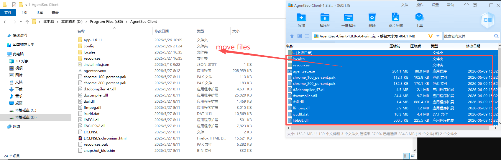

> 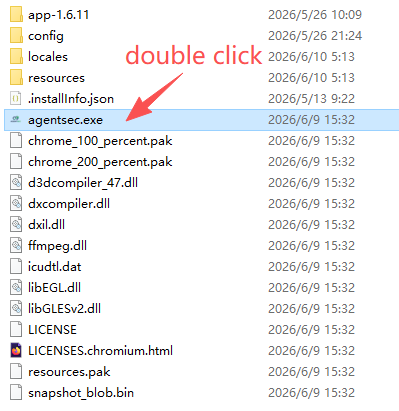

### macOS 用户

1. 从 [发布页](https://github.com/PolyUxAISecurity/AgentSec-Release/releases)下载 `.dmg` 文件，双击挂载
2. 拖入 `Applications` 文件夹
3. 在「应用程序」中打开 **AgentSec Desktop**

---

## 2. 首次配置（引导向导）

打开应用后，会自动弹出引导向导。

如果需要重新配置：

点击左侧 ⚙「设置」→ 左侧选「常规」→ 点击顶部的 **「运行引导向导」** 按钮。

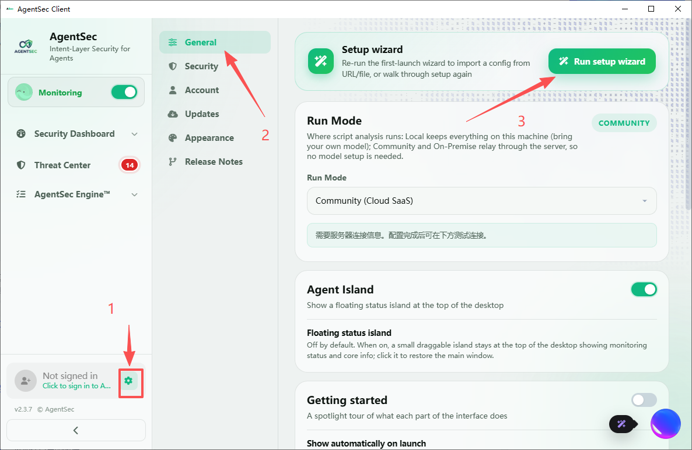

### 2.1 选择使用方式

您会看到两个选项：

> 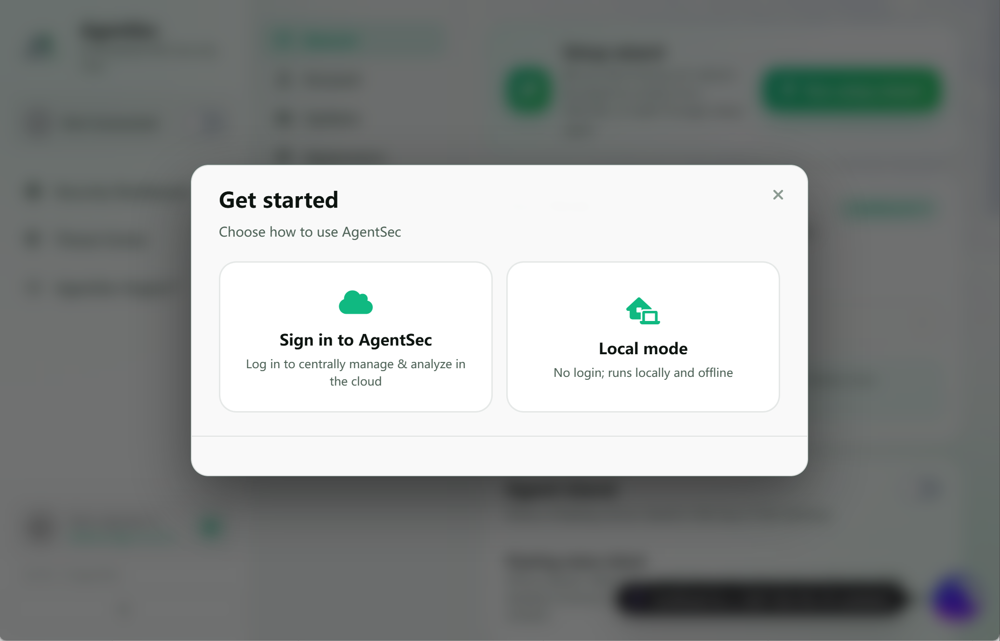

| 选项 | 适合谁 | 需要准备 |
|------|--------|---------|
| **从 AgentSec 登录**（推荐👍） | 有账号、能上网 | 一个邮箱（注册账号用） |
| **本地模式** | 不登录 AgentSec，使用本机规则扫描 | 无需模型；使用 AI 功能时再配置自己的模型 |

> 💡 **不确定？选「从 AgentSec 登录」**，这是最简单的方式，不需要额外配置 AI。

### 2.2 登录（选择「登录」的用户）

1. 点击「下一步」
2. 浏览器自动打开 AgentSec 登录页
3. 输入邮箱和密码（没有账号？点击注册）
4. 登录成功后，浏览器会**自动回到应用**

> 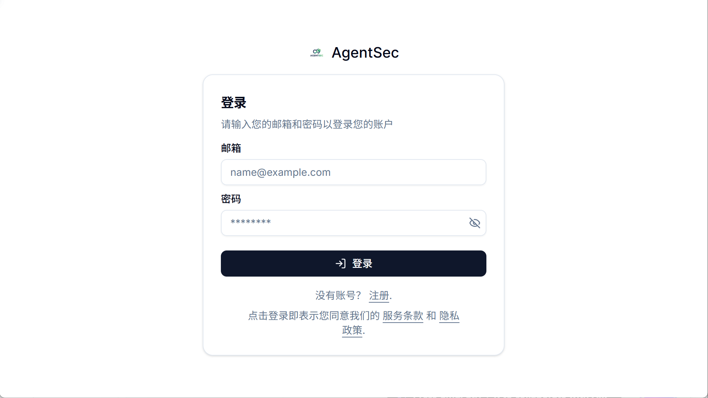
>
> 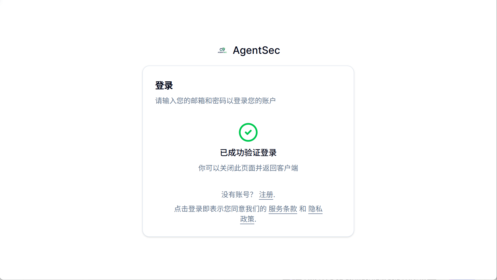

**成功标志**：侧边栏底部出现您的邮箱和头像。

> 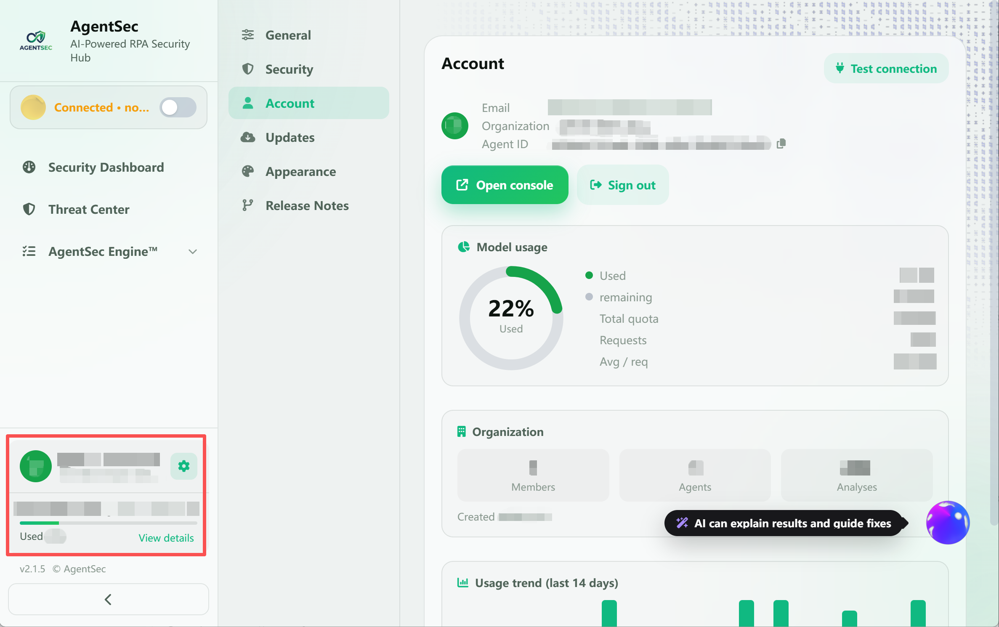
### 2.3 选择监控目录

点击「添加目录」，找到您存放 RPA 脚本的文件夹；在弹出的窗口中点击「选择文件夹」确认。

> 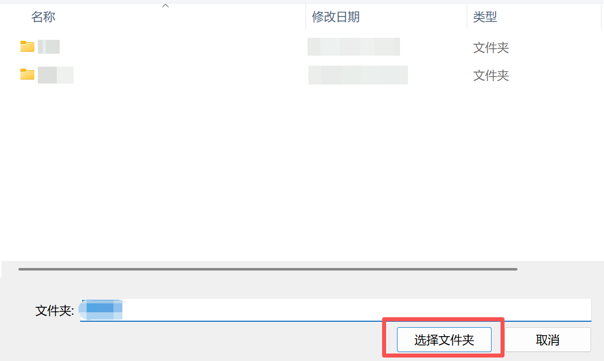
>
> 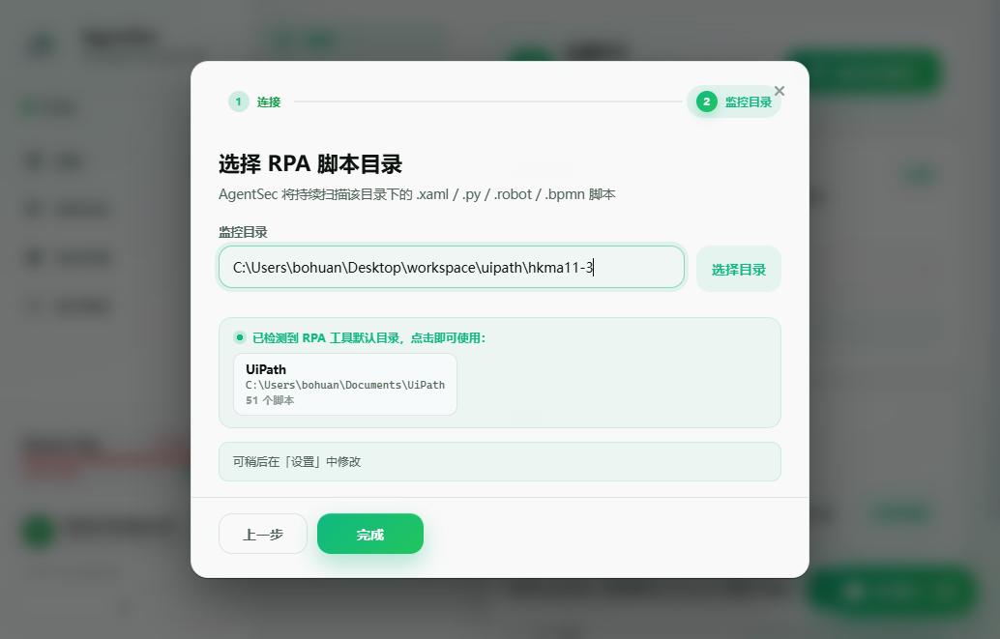

> 💡 如果电脑安装了 UiPath，AgentSec 会自动检测并显示建议目录，直接点击即可。

### 2.4 配置 AI 模型（本地模式，可选）

本地模式最后会显示 **「配置 AI 模型（可选）」**。不配置模型也能完成引导并使用规则扫描；配置后可使用 AI 研判和 AI 助手。

选择供应商并填写模型名称，按供应商要求填写 API Key；Ollama 等本机模型可留空。使用 Ollama 或 OpenAI 兼容服务时，核对 **自定义 Base URL**。也可以以后在 **设置 → 常规 → 运行模式** 中填写，并点击 **测试 LLM**。

> 使用远程模型服务时，AI 请求会发送到您配置的服务；只有使用本机模型时，AI 推理才在本机完成。

---

## 3. 启动第一次监控

引导完成后，您会看到**仪表盘**。

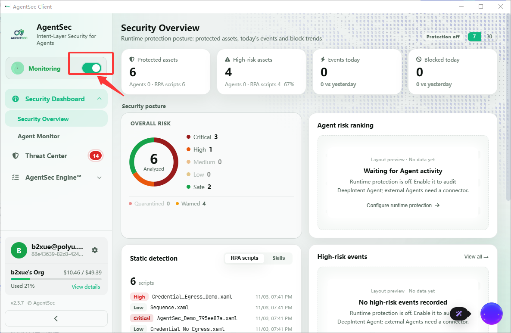

现在，点击开关按钮，启动监控。

**您会立刻看到的变化：**

| 变化   | 说明                    |
| ---- | --------------------- |
| 监控开关 | 由关闭变为开启，状态文字显示为 `监控中` |
| 分析结果 | 分析脚本数量与风险文件列表会随扫描结果更新 |

**AgentSec 正在做什么？**

AgentSec 会扫描监控目录中的脚本，执行规则检查，并按配置进行 AI 研判。风险结论和实际处置分别显示；需要人工确认的高危建议，请到威胁中心复核后处理。

---

## 4. 看懂分析结果

规则结果会先出现；AI 研判的等待时间取决于脚本、模型和服务响应，可在详情中查看进度。

### 4.1 仪表盘概览

| 看这里                   | 说明                             |
| --------------------- | ------------------------------ |
| **总体风险**              | 脚本风险等级及处置分布                    |
| **静态检测结果 → RPA 脚本**   | 已检测脚本和最近结果                     |
| **风险趋势 → 脚本分析**       | 近 7 或 30 天的分析次数、高危量与拦截建议       |
| **Agent 风险排行、实时高危事件** | 已接入 Agent 的工具调用记录；仅扫描脚本时可以暂无数据 |

### 4.2 进入威胁中心

点击左侧 **「威胁中心」**，查看每个脚本的详情。

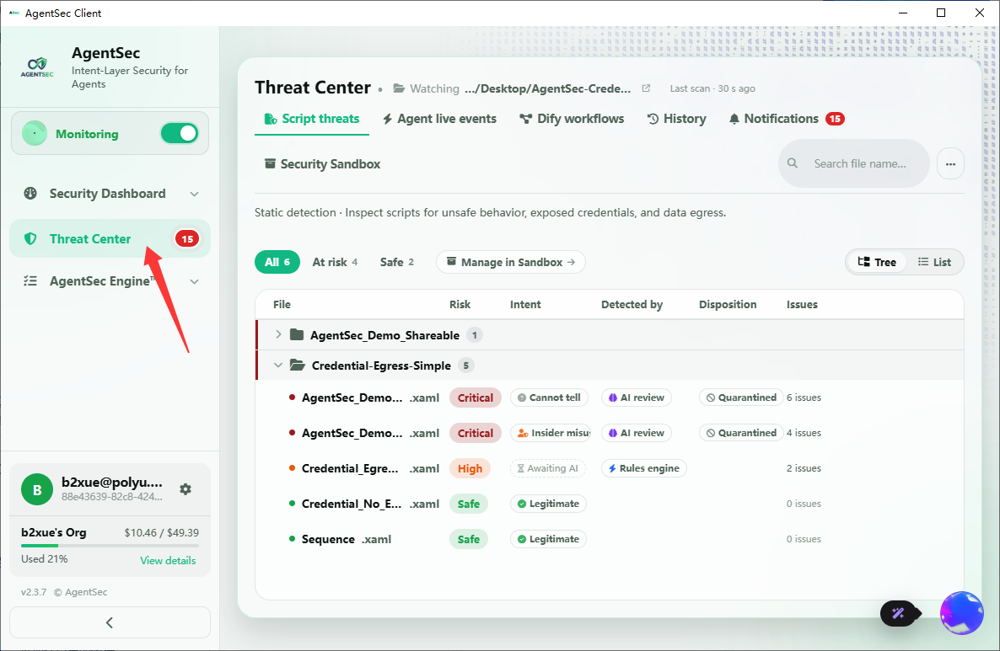

**点击任意一个脚本**，展开右侧详情面板：

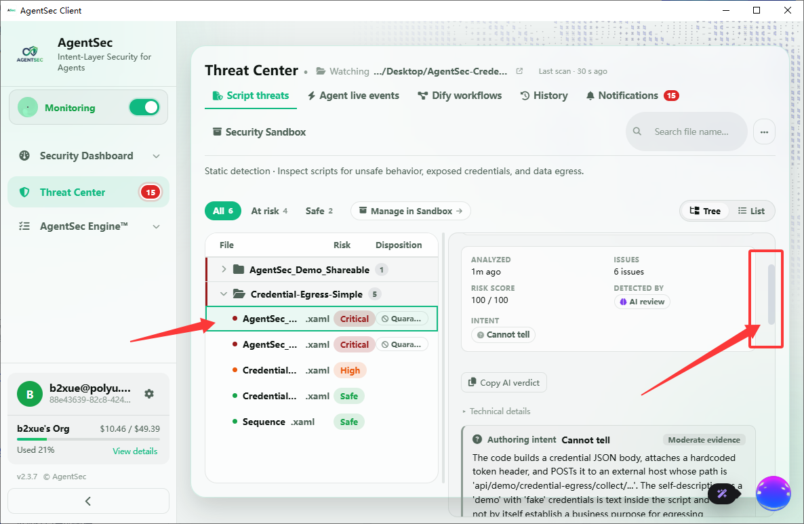

**三个关键信息**：
1. **💡 建议**：告诉您怎么修复
2. **📝 代码片段**：指出具体哪行有问题
3. **风险等级颜色**：红 > 橙 > 黄 > 灰（越红越紧急）

---

## 5. 如果脚本被拦截了

如果看到「已隔离」标签，说明该文件已移入隔离区。若显示待确认的高危建议，先查看证据，再决定是否隔离；高风险结论不一定代表已经执行隔离。

### 您确认它是恶意脚本？

保持隔离，不要点击「信任」或还原。展开问题查看证据，并按组织流程处理该文件；原文件保存在 `.agentsec_quarantine` 目录中，原路径由安全桩替代。

### 您确认它是误拦（脚本是安全的）？

1. 点击该脚本 → 打开详情面板
2. 点击 **「信任」** 按钮
3. 确认操作 → 文件移至「安全区」

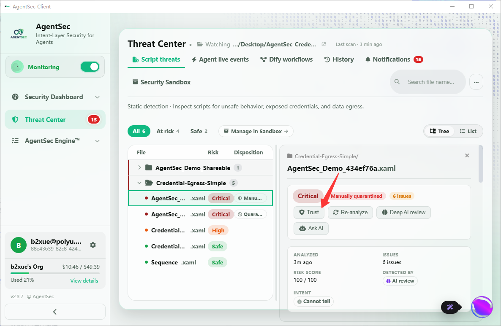

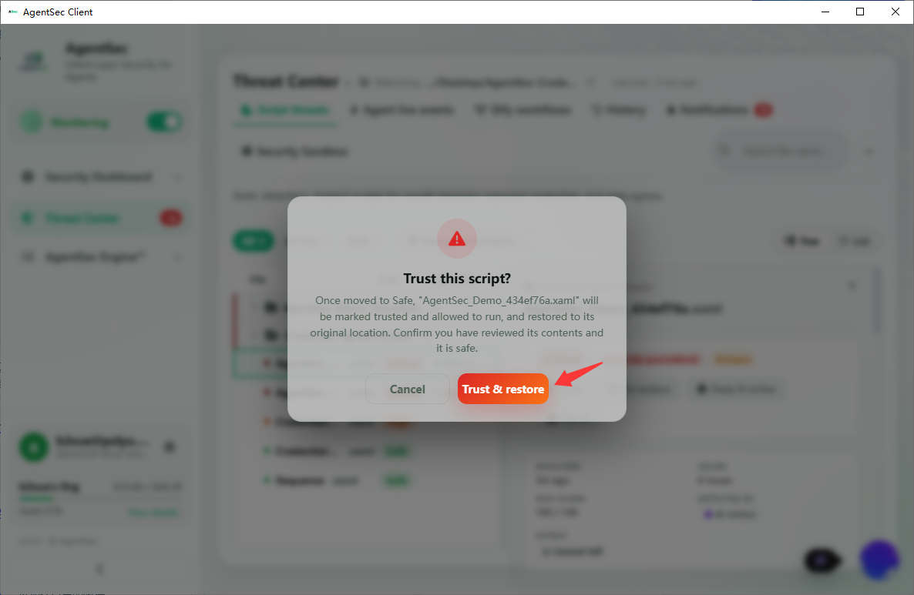

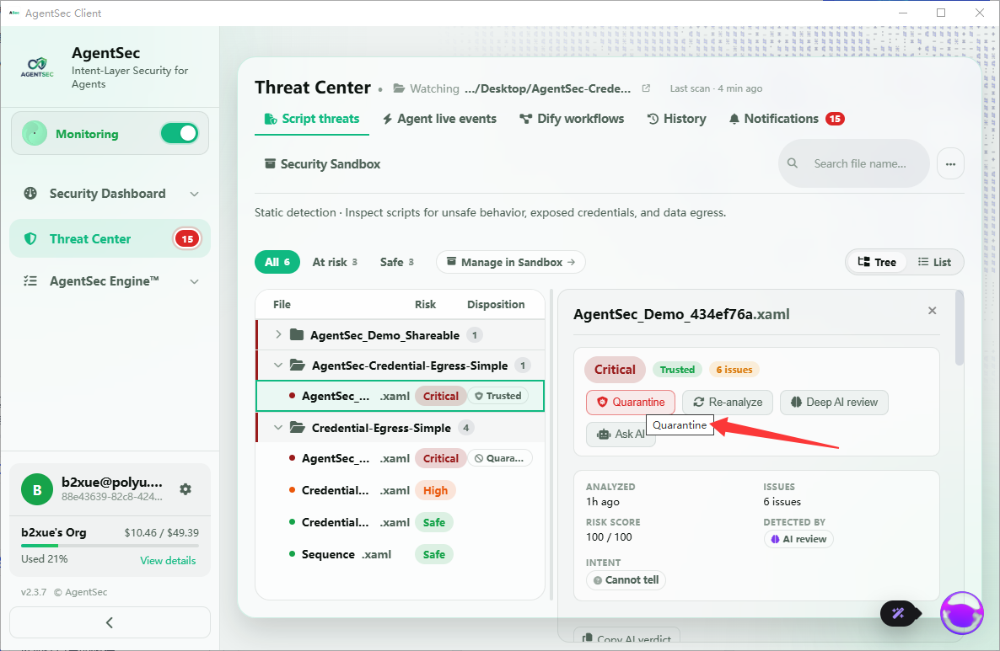

> 💡 还原后该文件内容不变，以后扫描会自动跳过。如果之后修改了文件，AgentSec 会重新分析。

---

## 6. 试用 AI 助手

按 **`Ctrl+K`**（Windows）或 **`Cmd+K`**（macOS），右侧弹出 AI 助手面板。

试试问它：

> 「总结一下当前的脚本安全状况」

> 「哪个脚本风险最高？为什么？」

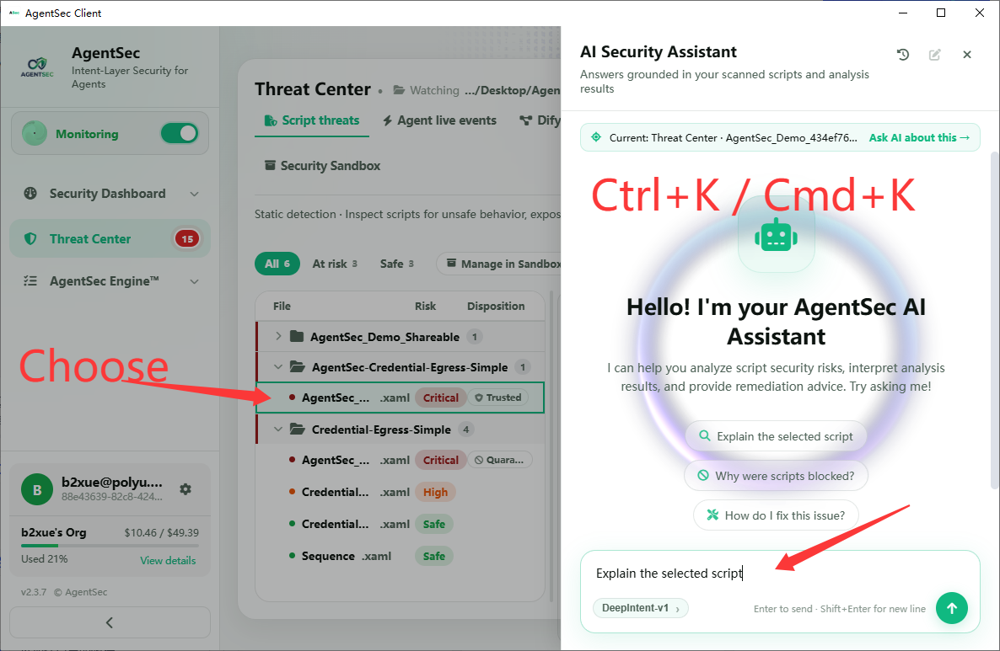

AI 会基于实际的监控数据和分析结果回答，不是套话。

---

## 7. 快速检查：您上手了吗？

- [ ] 监控成功启动，并出现已分析脚本或风险文件
- [ ] 威胁中心中有已完成的分析记录
- [ ] 点击某个脚本，看到了详细的问题列表（或「未发现安全问题」）

如果三项都完成，恭喜！🎉 您已经掌握 AgentSec 的基本使用。

---

## 接下来

| 我想... | 看这个 |
|---------|--------|
| 了解仪表盘每个数字的含义 | [02 — 仪表盘详解](02-dashboard.md) |
| 看一个完整的「发现→分析→处理」案例 | [03 — 第一次安全分析](03-first-analysis.md) |
| 了解监控的细节和优化 | [04 — 监控配置详解](04-monitoring.md) |
| 学习如何解读分析结果 | [05 — 威胁中心（防护日志）](05-security-log.md) |
| 管理被拦截和已信任的文件 | [06 — 安全沙箱](06-sandbox.md) |
| 调整安全检测的严格程度 | [07 — 安全策略](07-security-policy.md) |
| 学习 AI 助手的全部能力 | [08 — AI 安全助手](08-ai-assistant.md) |
| 通过示例学习 AI 助手的用法 | [09 — AI 助手使用场景](09-ai-assistant-use-cases.md) |
| 配置账户、模型、更新等 | [10 — 设置详解](10-settings.md) |
| 理解本文档中的术语 | [11 — 关键概念](11-concepts.md) |
| 遇到问题怎么办 | [12 — 常见问题](12-faq.md) |
