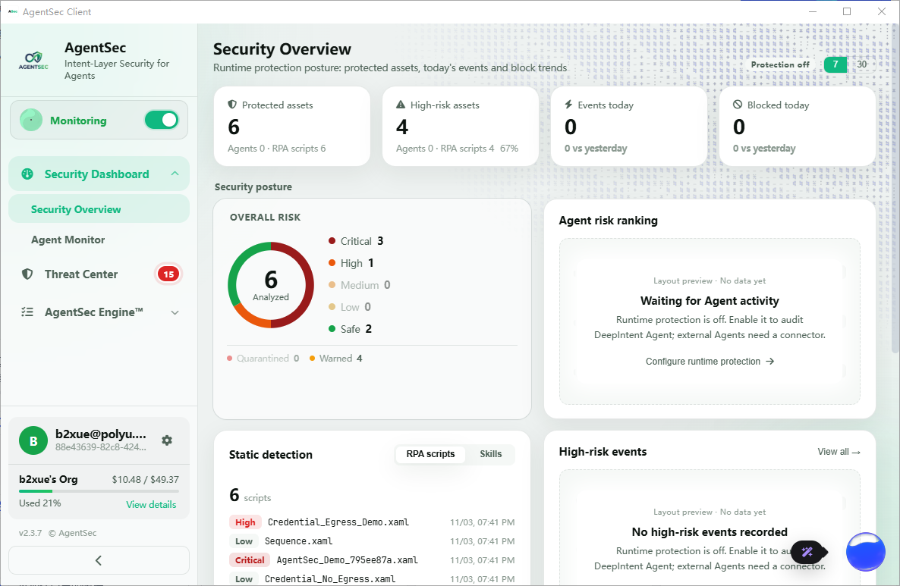
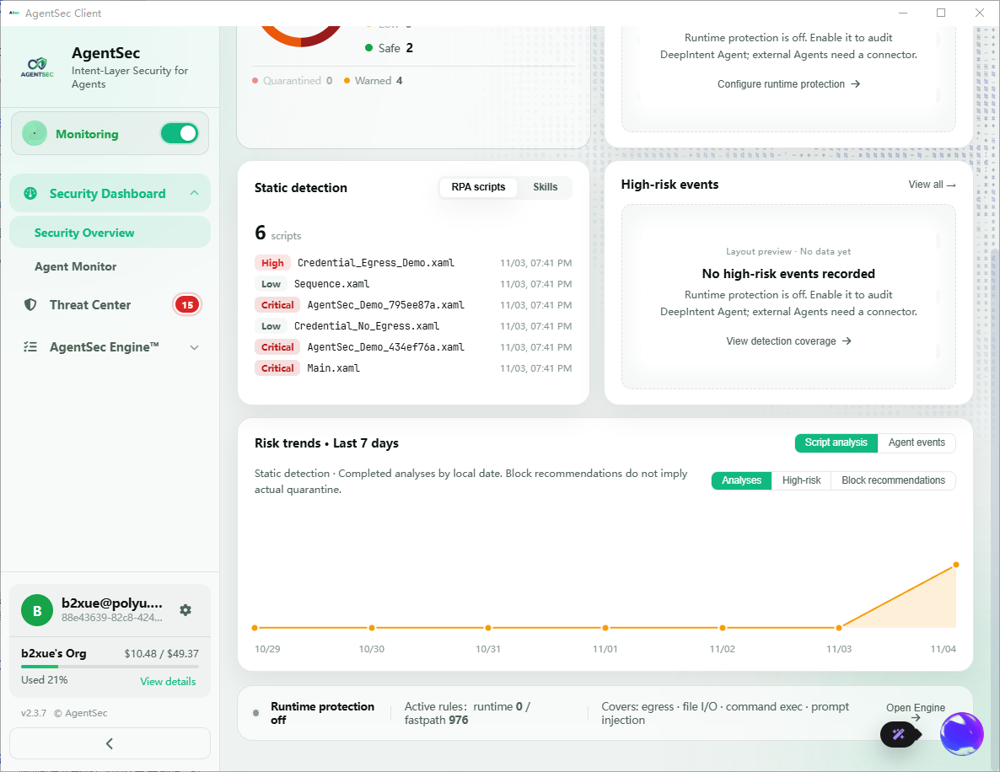
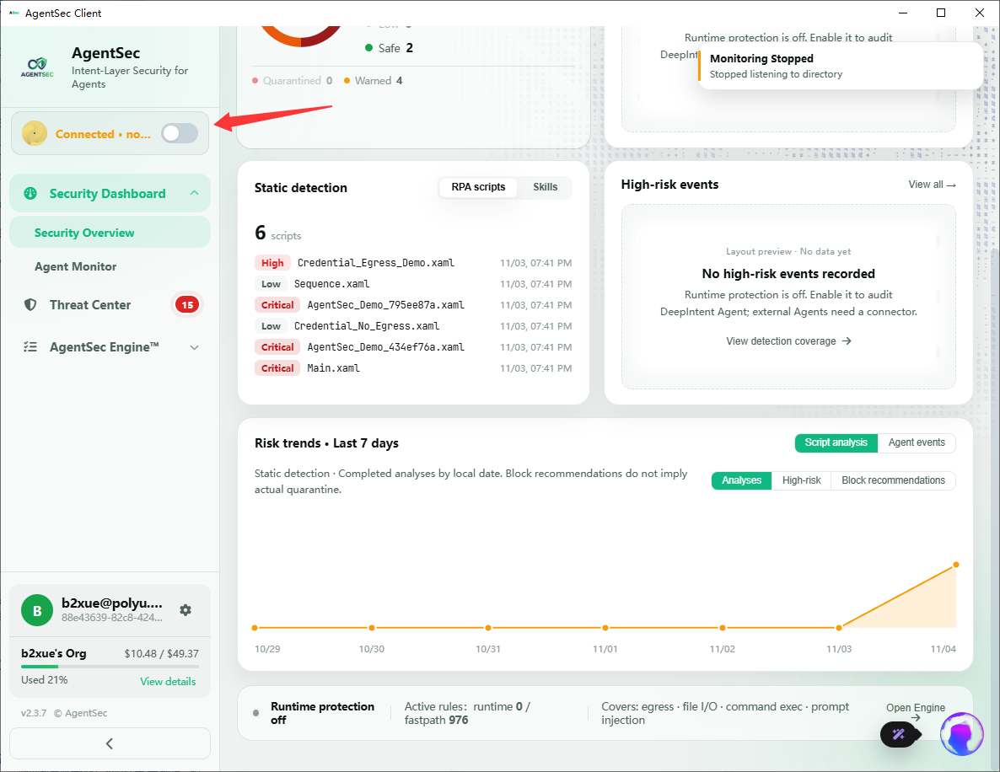

# 安全仪表盘使用指南

左侧 **安全仪表盘** 下有 **安全总览** 和 **Agent 监控** 两个入口。安全总览汇集脚本检测与 Agent 运行时事件；Agent 监控用于查看某个 Agent 的活动和风险。

## 1. 查看安全总览

| 区域 | 如何阅读 |
| --- | --- |
| **受保护资产** | 查看 Agent 和 RPA 脚本数量 |
| **高危资产** | 查看存在高危风险的 Agent 和 RPA 脚本 |
| **今日事件 / 今日阻断** | 查看当天记录的运行时事件与实际拒绝的调用 |
| **总体风险** | 查看脚本风险等级和处置分布 |
| **Agent 风险排行** | 按风险定位 Agent；点击一行进入详情 |
| **静态检测结果** | 在 **RPA 脚本** 中查看脚本数量和最近结果 |
| **实时高危事件** | 查看所属 Agent、时间、风险和处置；点击事件打开详情，或点击 **查看全部** |

**Skill** 标签当前显示「Skill 静态检测暂未开放」，不需要为它准备扫描素材。

没有记录时，页面会显示「展示模板 · 尚无数据」及配置入口。模板图形不是检测结果；配置监控目录或接入 Agent 并产生实际活动后，页面会自动更新。

## 2. 切换趋势统计

1. 在页面右上选择 **7** 或 **30** 天。
2. 在风险趋势中选择 **脚本分析** 或 **Agent 事件**。
3. 选择要看的指标。

| 来源 | 指标含义 |
| --- | --- |
| **脚本分析** | 已完成的分析次数、高危量、拦截建议 |
| **Agent 事件** | 工具事件量、高危量、实际阻断量 |

脚本的「拦截建议」表示分析建议，不等于文件已经隔离。Agent 事件的阻断量统计实际拒绝的调用。

## 3. 启动或停止脚本监控

侧边栏顶部的状态卡片显示连接和监控状态，右侧开关用于启停已配置目录的脚本监控。

先在 **设置 → 安全配置 → 监控目录** 添加文件夹，再开启监控。点击状态球也可进入目录配置。目录操作见 [监控与目录配置](04-monitoring.md)。

脚本监控开关与 **运行时防护** 是两个功能。需要 Agent 工具调用记录时，请在 **设置 → 安全配置** 开启运行时防护并接入所需的外部 Agent，详见 [Agent 运行时防护与监控](agent-runtime.md)。

## 4. 查看 Agent 监控

1. 展开侧边栏 **安全仪表盘**，点击 **Agent 监控**。
2. 在列表中按名称或 ID 搜索，点击需要查看的 Agent。
3. 查看风险评分、近期活动、今日事件、累计阻断、待审批和活跃会话等信息。
4. 在详情下方切换标签页。

| 标签页      | 内容                   |
| -------- | -------------------- |
| **概览**   | 风险来源分布与关联资产、工具、Skill |
| **审计日志** | 该 Agent 的工具调用审计记录    |
| **会话链路** | 按会话查看相关活动            |
| **关联策略** | 查看该 Agent 命中的规则      |

DeepIntent Agent 已内置接入，界面标明 **仅审计**；纯文本对话不计为工具调用事件。外部 Agent 完成接入并产生受支持的工具调用后，才会出现相应审计和处置记录。

## 5. 常用导航

| 入口 | 用途 |
| --- | --- |
| **威胁中心** | 查看脚本威胁、Agent 实时事件、Dify 工作流、历史记录、通知和安全沙箱 |
| **AgentSec Engine™** | 查看引擎模块、规则实验室和策略市场 |
| **侧边栏底部账户 / 用量** | 查看当前身份和组织额度 |
| **侧边栏底部齿轮** | 打开设置 |
| **右下角 AI 助手** | 打开 DeepIntent Agent；也可按 `Ctrl+K` / `Cmd+K` |

接下来可查看 [威胁中心](05-security-log.md)、[Dify 工作流审计](dify.md)或 [AI 助手](08-ai-assistant.md)。
