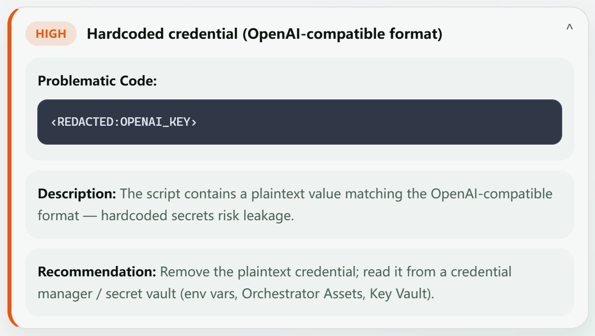

# 威胁中心（防护日志）

> 威胁中心汇总脚本分析、Agent 实时事件、Dify 工作流报告、历史记录、通知和安全沙箱。可通过顶部标签切换。
> 本页重点介绍脚本分析结果：查看规则与 AI 发现的问题、风险等级和文件处置状态。

---

## 打开威胁中心

在左侧导航栏点击 **「威胁中心」**。

> 

| 标签 | 内容 |
| --- | --- |
| 脚本威胁列表 | 本地脚本的风险、证据与处理操作 |
| Agent 实时事件 | 已接入 Agent 的工具调用、风险及待审批事件，详见 [Agent 运行时防护](agent-runtime.md) |
| Dify 工作流 | 已归档的工作流审计报告，详见 [Dify 指南](dify.md) |
| 历史记录 | 过去的脚本分析记录 |
| 通知 | 安全、分析、监控和系统消息 |
| 安全沙箱 | 隔离区、安全区和整改区 |

_截图待更新：顶部六个标签及脚本详情。_

---

## 界面布局

「威胁列表」采用 **左右双栏** 布局。未选择文件时以威胁列表为主；选择文件后，右侧显示该文件的分析详情。

- **左侧**：显示所有已分析脚本，可按风险分组并以目录树或列表方式浏览
- **右侧**：点击某个脚本后，显示该文件的分析结果、风险分数和问题列表

### 顶部工具栏

| 控件                  | 作用                     |
| ------------------- | ---------------------- |
| `全部` / `有风险` / `安全` | 按分析结果筛选文件；标签后的数字表示文件数量 |
| `沙箱管理`              | 进入安全沙箱管理被隔离的文件         |
| 搜索框                 | 按文件名搜索                 |
| `目录树` / `列表`        | 切换威胁列表的显示方式            |

> 

---

## 左侧：威胁列表

### 分组显示

在「目录树」视图中，脚本按目录结构分组。每个分组显示文件数量和风险信息。批量信任或隔离请进入 **「安全沙箱」**。

- **严重**：红色标识
- **高危**：橙色标识
- **中危／低危**：黄色等对应等级标识
- **安全**：绿色标识

每个文件夹可点击折叠/展开，右侧显示该文件夹内的脚本数量。

> 

### 脚本条目信息

每个脚本条目显示：

| 信息   | 示例                  | 含义                   |
| ---- | ------------------- | -------------------- |
| 文件名  | `Call_LLM_API.xaml` | 脚本名称                 |
| 风险等级 | `高危`（橙色）            | 文件的最高风险级别            |
| 文件状态 | `已隔离` / `整改中` | 文件当前处置结果 |
| 问题数  | `5 条问题`             | 发现的安全问题数量；具体在详情面板中显示 |
| 检出方式 | 规则 / AI / 规则与 AI | 本次发现来自哪些引擎 |
| 编写意图 | 研判分类或待研判 | 模型对代码用途的辅助判断 |
| 快捷操作 | 隔离 / 信任 / 重新分析 / AI 深度研判 / 问 AI | 按文件当前状态显示 |
| 子目录  | `Call_LLM/`         | 脚本所在子目录              |

### 状态标签

| 标签 | 颜色 | 说明 |
|------|------|------|
| `分析中` | 绿色旋转图标 | AI 正在分析，并显示已等待时间 |
| `分析失败` | 红色 | 分析过程出错，可能是模型超时 |
| `已隔离` | 红色 | 文件已被移入隔离区 |
| `整改中` | 整改标签 | 隔离副本正在修改或复检，原路径仍为安全桩 |
| `严重` | 红色 | 文件包含严重风险 |
| `高危` | 橙色 | 文件包含高危风险 |
| `安全` | 绿色 | 未检出安全问题 |

---

## 右侧：详情面板

> 

点击左侧任意脚本，右侧会展开详细分析结果。

### 顶部概览

| 信息 | 说明 |
|------|------|
| 文件名 | 脚本名称 |
| 风险等级标签 | `严重` / `高危` / `中危` / `低危`；问题卡片中可显示 `HIGH` 等英文等级 |
| 文件状态标签 | 例如 `已隔离` |
| 问题计数 | 共发现 N 条问题 |
| 操作按钮 | 根据状态显示隔离、信任、重新分析、AI 深度研判、问 AI |

### 元数据网格

| 字段 | 说明 |
|------|------|
| 分析时间 | 什么时候完成的分析（如"3分钟前"） |
| 检出问题 | 问题总数 |
| 风险分数 | 0-100，分数越高风险越大 |
| 检出方式 | 区分规则结果、AI 研判或两者共同发现 |
| 编写意图 | 查看分类及其依据、另一种解释；供人工复核参考 |

元数据下方的 **「技术详情」** 可展开查看更完整的分析信息。问题列表中的每张卡片也可单独展开或折叠。

**「重新分析」**重新检查脚本，规则命中时不会自动调用模型；**「AI 深度研判」**显式调用模型，补充深度分析和编写意图。内容和分析判据未变化时，重新分析可能注明沿用上次 AI 结论。**「问 AI」**则将该脚本作为上下文交给助手解读。

若同一脚本的结论发生变化，详情中的 **「结论变动记录」** 可回看先前风险、参与引擎和时间。**「复制 AI 研判」**可复制摘要供人工审查或整理规则。

### 未发现安全问题

如果本次检查未检出问题，详情会显示相应通过提示。请同时查看参与引擎；仅规则扫描通过不代表已完成 AI 研判。

> ✅ **未发现安全问题**
> 

### 问题卡片

每个安全问题以可折叠卡片展示，包含风险等级、触发位置、代码片段、问题描述和修复建议。

> 

点击卡片标题可展开/折叠详情。

### 风险等级含义

| 等级 | 含义 |
| --- | --- |
| **CRITICAL／严重** | 应优先核查和处理的严重风险 |
| **HIGH／高危** | 需要尽快处理的高风险问题 |
| **MEDIUM／中危** | 需要结合业务和证据复核的问题 |
| **LOW／低危** | 风险较低、仍可进一步改进的问题 |

风险等级不直接表示文件已经隔离。默认处置方式下，拦截级规则命中自动隔离；AI 的拦截建议需要您查看证据后点击 **「隔离」**。仅硬编码凭据等告警可能保留文件原样。

---

## 已隔离脚本的还原

如果某个脚本被错误拦截（您确认它是安全的），可以在详情面板中直接还原：

1. 点击被隔离的脚本，打开详情面板
2. 在详情面板会看到红色隔离信息条
3. 点击 **「信任」** 按钮并确认；批量操作请进入「安全沙箱」

> 

确认信任后，AgentSec 会移除安全桩，将原文件恢复到原路径，并把该文件加入**白名单**（信任列表）。后续扫描时，如果文件内容不变，AgentSec 会跳过该文件。

---
## 导出日志

您可以将分析结果导出为 ZIP 文件，用于提交工单或存档：

1. 在威胁中心右上角打开 **「⋯」** 菜单，点击 **「导出日志」**

2. 选择保存位置

3. 点击「保存」

> 

导出内容包括：

- 安全分析记录（不含脚本源码）

- 应用运行日志

- AI 对话记录
---

## 历史数据

点击顶部 **「历史记录」** 可查看之前的分析记录。即使关闭 AgentSec 后重新打开，已有记录仍会保留。可按文件名、严重程度和时间筛选，并选择每页 10、20 或 50 条。

在 **「通知」** 中按安全、分析、监控或系统分类查看消息，可标记 **「全部已读」** 或 **「清空」** 通知。对于分析失败记录，脚本列表提供 **「删除记录」**；右上角「⋯」也可清除失败记录。这些操作只清理分析记录，不删除磁盘上的脚本。

---

## 下一步

- [如何管理被隔离的文件？](06-sandbox.md)
- [如何调整检测规则的严格程度？](07-security-policy.md)
