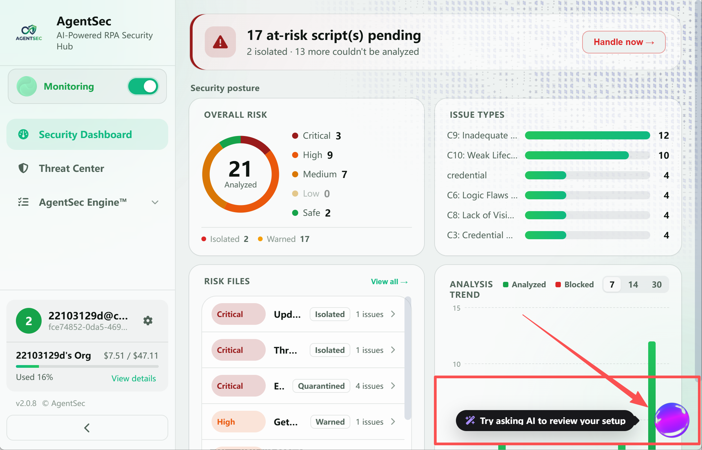
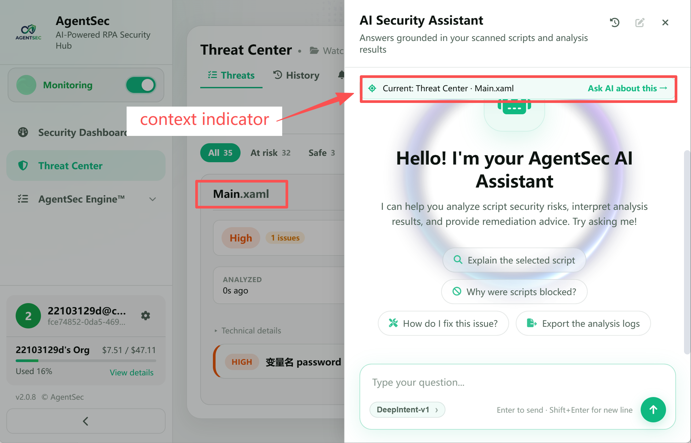
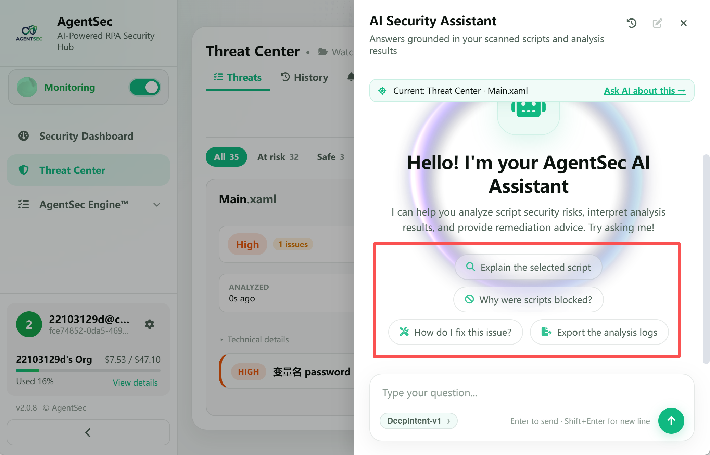

# AI 安全助手使用指南

> AgentSec 内置了一个 AI 安全助手。您可以用自然语言向它提问，它会根据当前的监控状态、分析结果和配置信息给出回答，还可以直接帮您执行操作。

---

## 打开 AI 助手

**三种方式：**

| 方式 | 操作 |
|------|------|
| 点击 FAB | 点击主界面右下角的蓝色「AI 助手」浮动按钮 |
| 快捷键 | 按 `Ctrl+K`（Windows）或 `Cmd+K`（macOS） |
| 再次按快捷键 | 关闭面板 |

> 

---

## 助手面板布局

AI 助手面板包含标题栏、历史对话、新对话、当前上下文提示、建议问题、对话区域、工具执行进度和输入框。用户可以在面板中直接提问，也可以点击建议问题快速开始。


_截图待补：当前版本的面板、历史与新对话按钮、上下文、工具进度和模型标签。_

### 三种显示模式

| 模式 | 效果 |
|------|------|
| 关闭 | FAB 按钮在右下角，面板隐藏 |
| 停靠 | 面板在右侧，占 1/3 宽度，主内容区自动压缩 |
| 全屏 | 面板扩展到最大，适合查看复杂内容 |

在停靠模式下点击标题栏的展开按钮可切换全屏。

---

## AI 助手能做什么？

### 1. 回答安全问题

您可以用自然语言询问：

| 可以问  | 示例                           |
| ---- | ---------------------------- |
| 安全概况 | 「总结一下当前所有脚本的安全状况」            |
| 风险分析 | 「哪些脚本风险最高？为什么？」              |
| 修复建议 | 「如何降低 Main.xaml 的安全风险？」      |
| 规则解释 | 「AgentSec 当前的安全策略是什么？有哪些规则？」 |
| 配置检查 | 「帮我检查当前配置是否合理」               |
| 状态查询 | 「现在有哪些脚本正在分析？」               |

**上下文感知**：AI 助手知道您当前在哪个页面、选中了什么内容。例如在威胁中心中选中 `Cleanup_TempFiles.xaml` 时，上下文提示会自动变为「解读一下 Cleanup_TempFiles.xaml 的分析结果」。

> 

### 2. 自动执行操作

AI 助手可以查询当前应用状态，并协助执行以下操作：

| 能力 | 触发方式 |
|------|---------|
| 检查配置 | 「检查配置」→ AI 自动验证目录、LLM、服务端连通性 |
| 设置监控目录 | 「换个监控目录」→ 弹出文件夹选择器；助手操作范围限于 AgentSec 工作区 |
| 启动/停止监控 | 「启动监控」→ 先检查配置；工作区外的目录请使用界面监控开关 |
| 查看监控状态 | 「监控状态怎么样？」→ AI 返回当前监控情况 |
| 查看策略 | 「当前有哪些安全规则？」→ AI 列出所有启用的规则 |
| 查询分析进度 | 「分析进度怎么样了？」→ AI 返回正在分析的脚本 |
| 查看引擎与规则 | 「当前规则版本是什么？哪些规则开启了？」 |
| 查看实验室与策略市场 | 「有哪些演示样本？有哪些可用策略？」 |
| 读取和修复工作区副本 | 先导入待修复脚本，再让助手读取、解释或修改副本 |

**AI 在操作前会先检查配置**。例如您说「启动监控」，它会先确认监控目录、AI 模型和服务端连接是否可用。如果有问题，AI 会先指出需要修复的配置；确认无误后才会继续执行操作。

日志导出请使用客户端的 **「导出日志」** 按钮；策略应用和规则修改也需要在对应页面完成。


_截图待补：提问后展开工具执行过程，显示实际查询结果。_

### 3. 读取与修复脚本副本

1. 打开 **设置 → 安全配置 → DeepIntent Agent 工作区**。
2. 点击 **「导入待修复脚本」**，选择脚本；客户端将副本放入自己的工作区。
3. 打开 AI 助手，说明文件名和修复目标，例如「读取工作区里的 Main.xaml，解释问题并修复硬编码凭据」。
4. 核对助手的修改后，点击 **「打开工作区」** 查看文件，再由您安排后续验证和使用。

助手只能读写工作区中的副本，不会直接修改外部原文件，也不会执行脚本。


_截图待补：工作区入口、导入完成状态、助手读取和保存副本的过程。_

### 4. 快捷操作按钮

AI 回复末尾可能会附上 **快捷操作按钮**，例如：

```
[总结当前安全状况]  [查看高风险脚本详情]  [如何修复这些风险]
```

点击任一按钮即可自动发送对应问题，无需手动输入。

> 

### 5. 评价回答

已登录并加入组织时，助手回答下方会显示 **「有用」** 和 **「没用」** 按钮。点击「没用」后，可补充一句问题说明并点击 **「提交」**；文字说明可以跳过。本地模式不显示这些反馈按钮。


_截图待补：回答下方的评价按钮、说明输入框和提交状态。_

---

## 对话技巧

### ✅ 好的提问方式

- 「Main.xaml 有哪些安全问题？帮我逐一解释」
- 「对比一下 Process.py 和 Main.xaml 的风险等级」
- 「如何修复硬编码密码的问题？给出具体步骤」

### ❌ 不太有效的提问

- 「安全」（太模糊）
- 「随便修一下」（没有说明文件和目标）
- 「今天天气怎么样」（与 RPA 安全无关）

### 💡 提示

- AI 助手会根据您当前的界面语言自动选择回复语言
- 点击标题栏 **「历史对话」** 可搜索、打开并继续已有会话，关闭应用后仍可查看已保存的对话。
- 点击 **「新对话」** 开始另一段会话，旧会话保留在历史中。需要删除时，在历史列表点击该会话的删除按钮并确认。


_截图待补：历史搜索、新对话按钮及已有会话。_

---

## 模型信息显示

输入框左下角有一个 **模型标签**，显示当前使用的 AI 模型：

- **登录模式**：显示组织当前提供的模型，由 AgentSec 中转。
- **本地模式**：显示您配置的模型。

点击标签可快速跳转到 **AgentSec Engine™ → 引擎 → AI 模型**。本地模型的编辑入口为该页的 **「去设置」**。


---

## 常见问题

**Q: AI 助手需要联网吗？**
A: 取决于您的使用模式。登录模式下需要联网（通过 AgentSec 服务端中转调用 AI）。本地模式下如果使用 Ollama 本地模型则不需要联网。

**Q: AI 助手会消耗多少配额？**
A: 登录模式下，每次对话消耗组织的 AI 配额。您可以在侧边栏底部查看剩余配额。本地模式下无配额限制（取决于您自己的 API 账户）。

**Q: 对话内容会被记录吗？**
A: 对话会保存在本机。已登录并加入组织的客户端还会将会话同步到组织服务端；本地模式不进行这项同步。

**Q: 组织的 AI 配额用完了怎么办？**
A: 联系您的组织管理员在 AgentSec 控制台中充值。用完配额后 AI 助手和 AI 分析都会暂停。

**Q: AI 助手为什么不能回答某些问题？**
A: AgentSec AI 助手的定位是 RPA 安全专家，它会尽量把回答限定在安全分析、脚本风险、修复建议等范围内。与 RPA 安全无关的问题可能会被婉拒。
