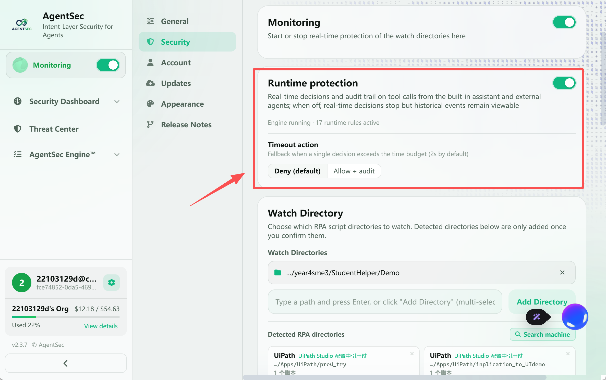
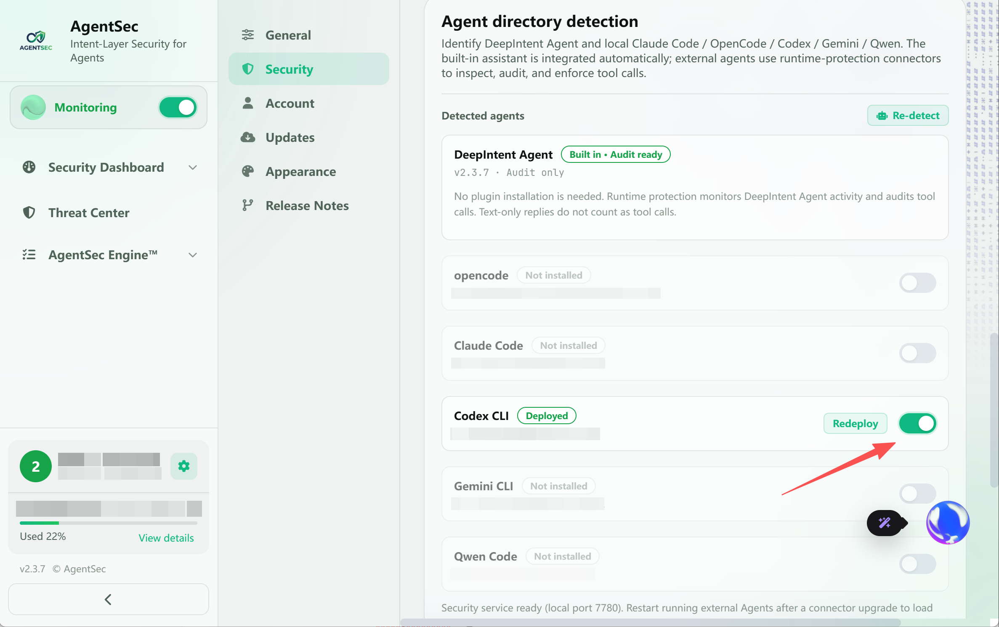
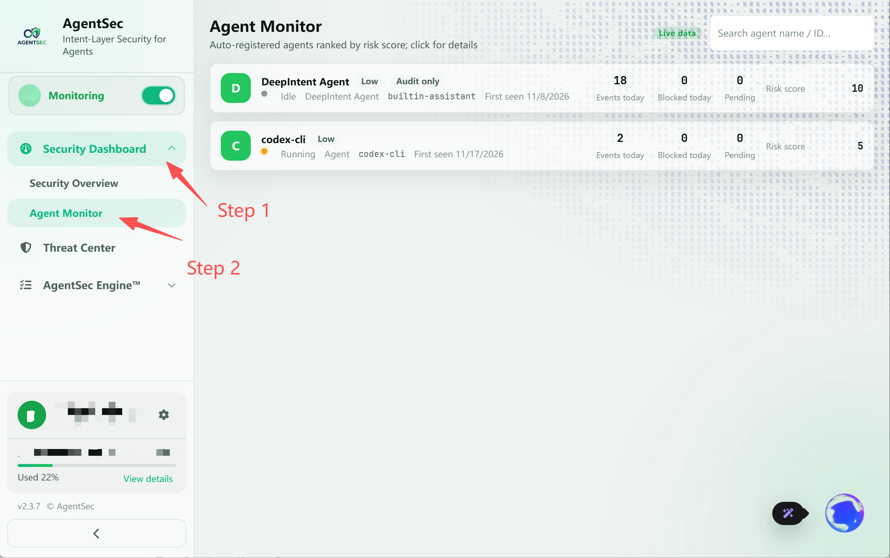
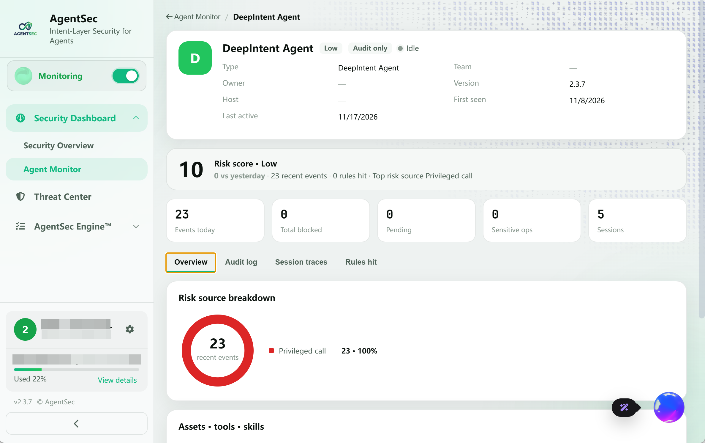
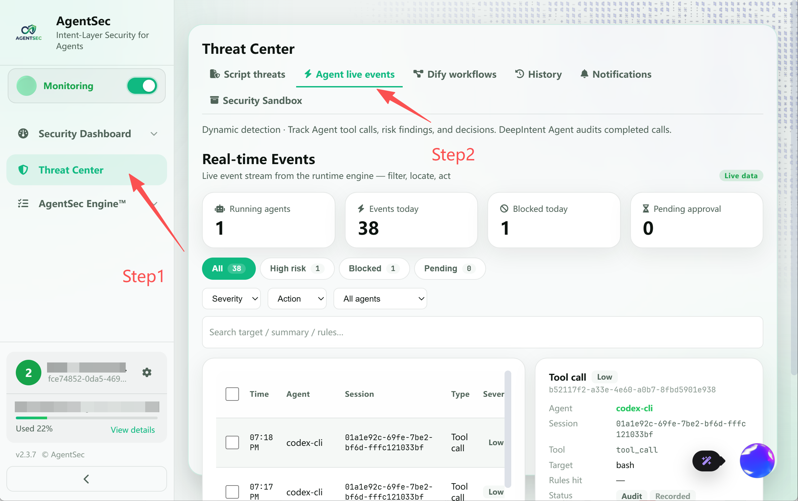
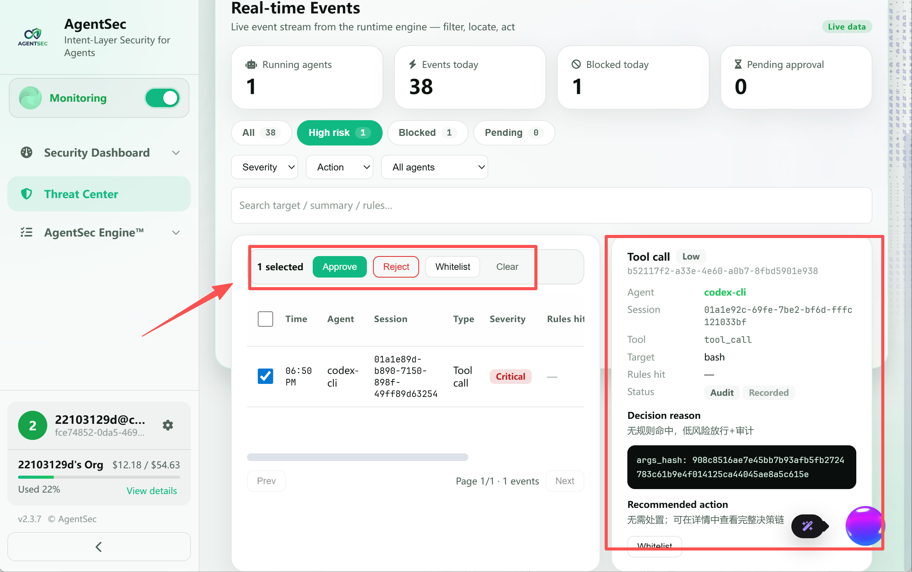

# Agent 运行时防护与监控

本章用于接入本机 Agent，查看工具调用、风险事件和审批记录。支持内置 **DeepIntent Agent**，以及 **Claude Code、OpenCode、Codex CLI、Gemini CLI、Qwen Code**。

## 1. 开启运行时防护

1. 打开 **AgentSec Engine™ → 引擎 → Agent 运行时防护**，查看模块状态和支持名单。
2. 点击 **「配置防护」**，进入 **设置 → 安全配置**。
3. 开启 **「运行时防护」**，等待状态显示引擎运行中。

也可以直接从设置页开启。此开关默认关闭，且独立于 RPA 脚本目录监控开关。

## 2. 接入 Agent

**内置 DeepIntent Agent**
	在开启运行时防护后自动接入，无需安装插件。它记录活动并在工具调用完成后审计；纯文本聊天不会产生工具调用事件。

**外部 Agent接入**
	1. 点击引擎模块 **「管理 Agent 接入」**，或在 **设置 → 安全配置** 找到 **「Agent 目录检测」**。
	2. 点击 **「重新检测」**，查看本机已安装的 Agent。
	3. 开启目标 Agent 行右侧的部署开关，等待显示 **「已部署」**。
	4. 重启对应的外部 Agent，加载接入插件；升级插件后也需要重启。
	外部 Agent 的防护范围是**已接入且受支持的工具调用**。需要移除接入时，关闭该 Agent 的部署开关。

## 3. 查看活动和风险

1. 展开 **安全仪表盘 → Agent 监控**。正在运行的Agent显示黄色，空闲的Agent显示灰色。
2. 搜索一个 Agent，查看风险、事件数量和状态；点击目标Agent打开详情。
3. 点击一个Agent，在详情中切换 **「概览」**、**「审计日志」**、**「会话链路」** 和 **「关联策略」**，查看相关活动。

| 栏目       | 展示内容                                                             | 使用方法                                                           |
| -------- | ---------------------------------------------------------------- | -------------------------------------------------------------- |
| **概览**   | 风险来源分布，以及关联资产、外部服务、工具和技能。风险来源图显示近期事件的数量及占比；关联项展示该 Agent 活动涉及的对象。 | 先查看事件主要来自哪类风险，再检查关联的工具或资产以定位需要关注的活动。 某项显示「—」表示当前没有可展示的关联数据。 |
| **审计日志** | 按时间列出工具调用记录，包括时间、类型、目标、风险等级、处置和命中策略。                             | 根据时间找到记录，并结合目标、风险等级和处置判断该次调用的审计结果。 「—」表示没有显示命中策略。           |
| **会话链路** | 按会话分组，以时间顺序展示会话中的工具调用及处置标记。                                      | 找到相关会话，沿时间线查看调用顺序和上下文；可与审计日志中的目标和时间相互核对。                       |
| **关联策略** | 展示该Agent命中的策略或规则。                                                | 用于查看活动对应的策略依据。 若页面显示「未命中任何规则」，表示当前没有命中记录。                   |

## 4. 查看事件与处理审批

1. 打开 **威胁中心 → Agent 实时事件**。
2. 按风险等级、处理动作、Agent 或关键词筛选；点击事件查看工具、目标、命中规则、原因与建议。
3. 如有 **「待审批」** 事件，先查看详情，确认后点击 **「批准」** 、 **「拒绝」** 或 **「加白」**。
4. 核对事件详情中的处置与审批记录。

内置 DeepIntent Agent 的调用后审计用于记录风险；查看风险时，请同时核对事件的实际动作和处理状态。

## 5. 调整超时处置与关闭防护

在 **设置 → 安全配置 → 运行时防护 → 超时处置** 中，可选择单次风险判定超过时间预算（默认 2 秒）时的处理方式：

- **拒绝（默认）**：拒绝本次工具调用，优先避免未能及时完成风险判定的操作继续执行。
- **放行并留痕**：允许本次工具调用继续执行，同时保留审计记录，便于之后在 **威胁中心 → Agent 实时事件** 中复核。

关闭运行时防护后停止新的实时判定，已保存的事件仍可查看。Dify 工作流的操作见 [Dify 指南](dify.md)。

