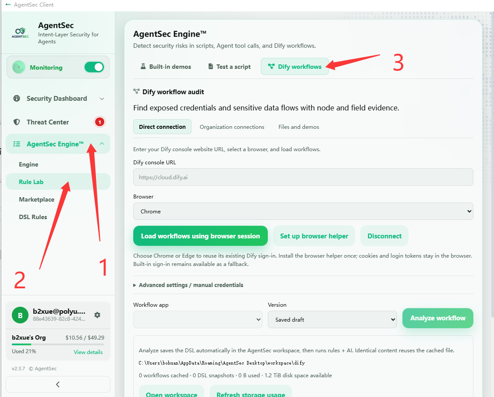
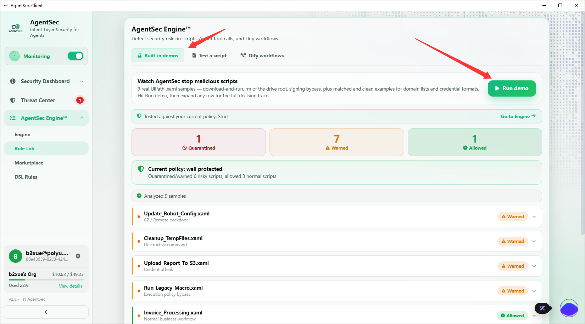
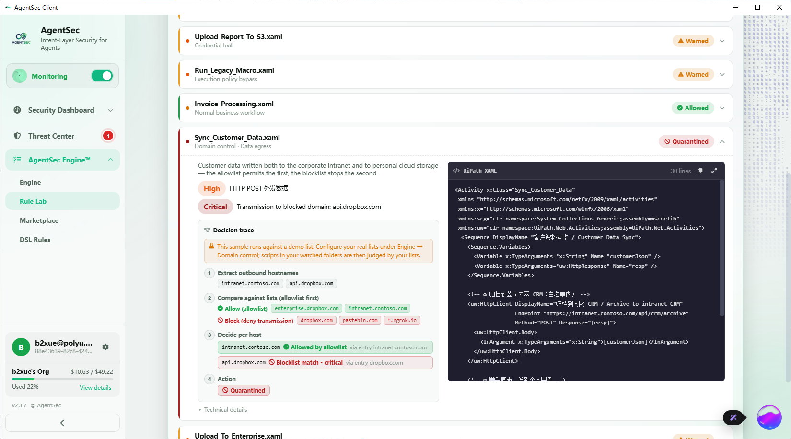
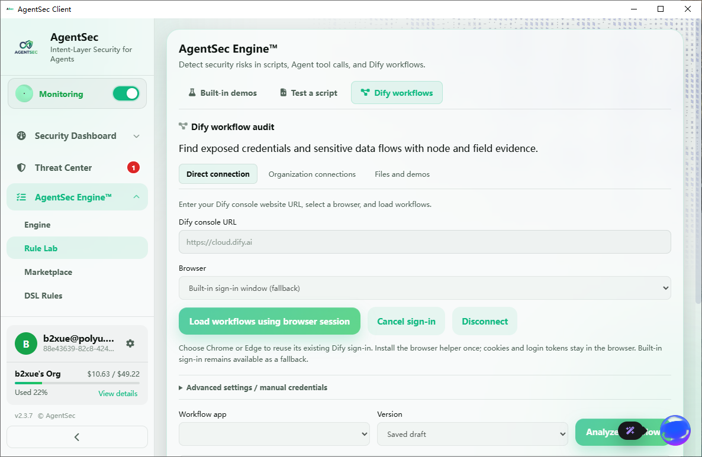
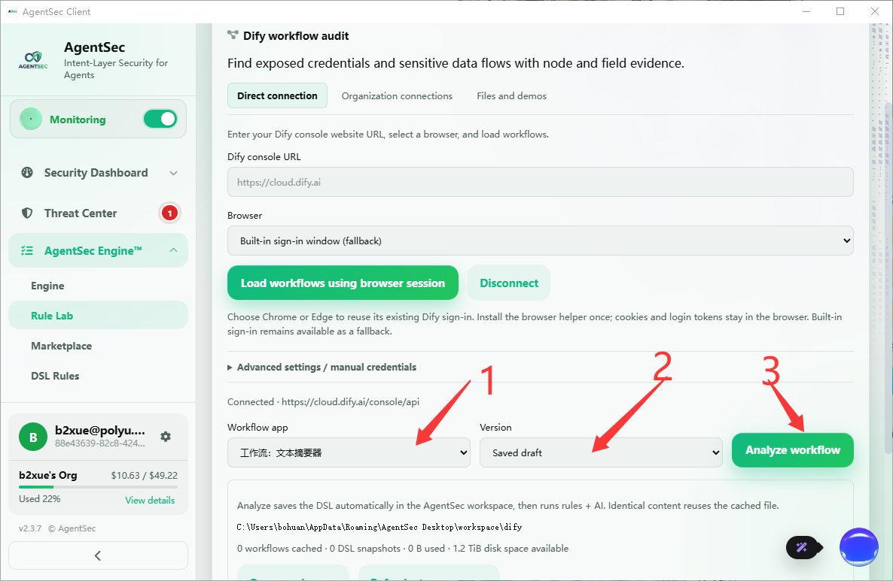
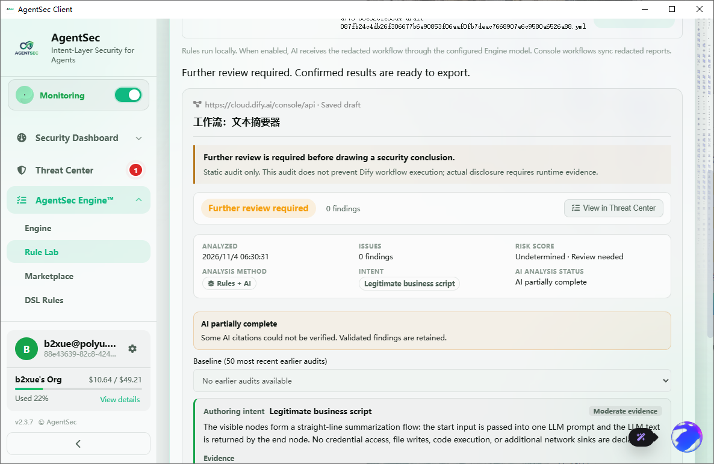
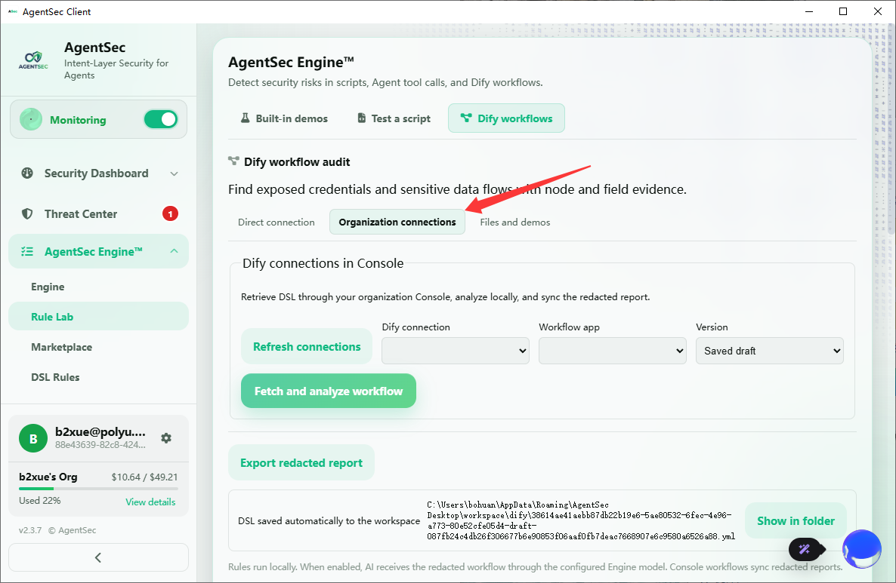
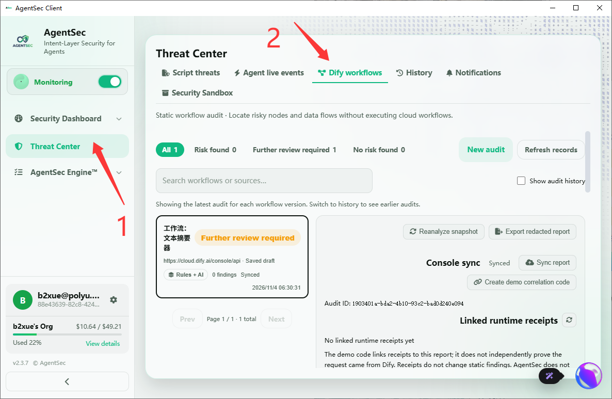
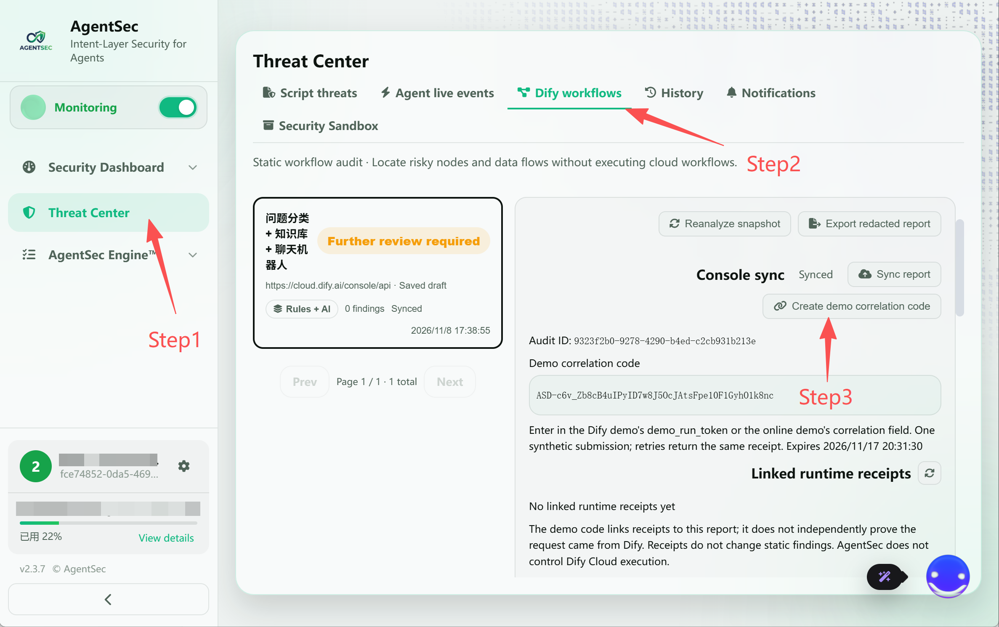

# Dify 工作流审计

AgentSec Desktop 可以检查 Dify 工作流中的明文凭据和敏感数据流向。建议先运行客户端内置演示，再检查自己的工作流。审计读取工作流快照，不会运行或发布 Dify 工作流，也不会阻止 Dify Cloud 执行。

## 1. 运行内置演示

1. 打开 **AgentSec Engine → 规则实验室 → Dify 工作流 → 文件与演示**。
2. 点击 **运行企业场景演示**。客户端会分析一份虚构的售后工单工作流，并显示风险提示。

3. 展开问题，查看命中的节点、字段、脱敏证据和数据路径；同时查看规则匹配和 AI 研判的完成状态。

内置演示使用独立演示策略，不会改变当前安全策略。页面显示的是工作流静态风险，不能把潜在外发路径理解为已经发生的外泄。

## 2. 检查自己的 Dify 工作流

### 使用 Chrome 或 Edge 登录态

1. 在 Chrome 或 Microsoft Edge(推荐用第三个选项Built-in-sign-in windows) 中登录 Dify，并打开应用列表或工作流页面。

2. 在 AgentSec 的 **Dify 工作流 → 本地直连**中填写 Dify 控制台网页地址，选择同一个浏览器。
3. 首次使用时点击 **安装浏览器助手**。在浏览器的扩展管理页开启开发者模式，选择**加载已解压的扩展程序**，加载 AgentSec 打开的助手文件夹。
4. 点击 **使用浏览器登录态获取工作流**，在新打开的助手页点击 **连接并获取工作流**，按提示允许访问该 Dify 站点。
5. 回到 AgentSec，选择**工作流应用**及**已保存草稿**或**发布版本**，点击 **分析工作流**。

客户端会自动保存获取的 DSL，并显示规则与 AI 分析结果。只有已保存的草稿或已发布版本会进入本次检查；编辑器中尚未保存的修改需要先保存。若不便使用浏览器助手，可在浏览器选择框中改用**内置登录窗口**；页面也保留**高级设置 / 手动凭据**入口。

### 使用组织连接或 DSL 文件

- **组织连接**：如果管理员已经在 Console 配置并启用 Dify 连接，在 **组织连接**中点击 **刷新连接**，依次选择连接、工作流应用和版本，然后点击 **获取并分析工作流**。此入口会回传脱敏报告。
- **文件与演示**：如果已有 Dify 导出的 Workflow / Chatflow `.yml` 或 `.yaml` 文件，在 **文件与演示**中点击 **导入 Dify DSL**并选取文件。文件最大 1 MiB。

## 3. 查看结果与整改复测

1. 在报告中查看风险提示、问题详情和**部分待复核**提示。展开问题可查看节点、字段、证据及建议；分析未覆盖的内容会单独提示。
2. 在 **威胁中心 → Dify 工作流**中选择报告，使用搜索、风险筛选或**显示历史审计**查看记录，也可点击 **导出脱敏报告**。
3. 修改并保存 Dify 工作流后，回到分析入口重新获取并分析；文件导入方式需重新导入修改后的 DSL。在新报告的**整改复测对比**中查看**已解决、仍存在、新增风险、待确认**。如需对比另一份记录，可选择**对比基线**。

**重新分析快照**只检查已经保存的旧快照；核对整改后的工作流时，要从来源入口重新获取或导入新版本。

## 4. 关联演示运行回执（可选）

已入组客户端的报告同步到 Console 后，可在 **威胁中心 → Dify 工作流**选中报告，点击 **创建演示关联码**。如果你的 Dify 演示应用提供 `demo_run_token` 输入，将关联码填入后运行合成案例，再回到报告查看**关联运行回执**。回执与静态审计结论分别显示。

