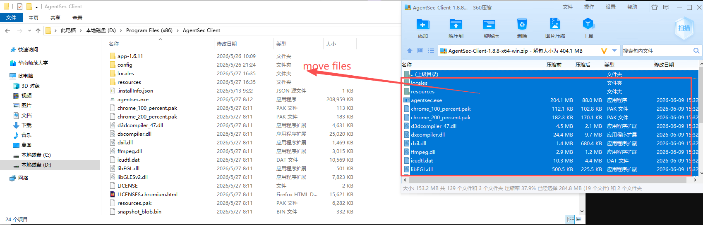
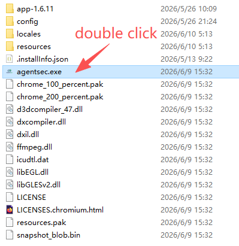
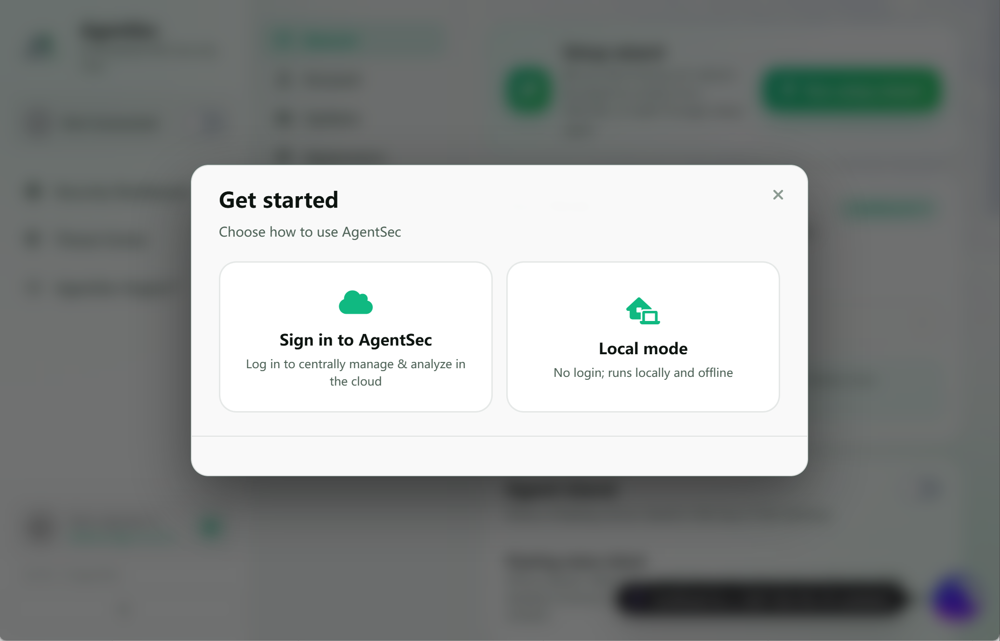
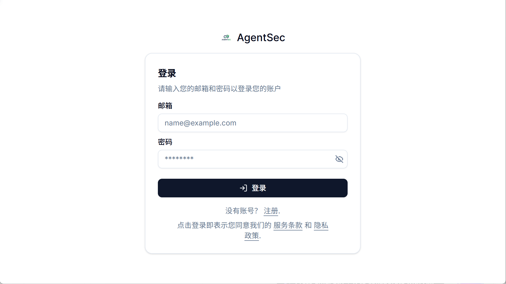
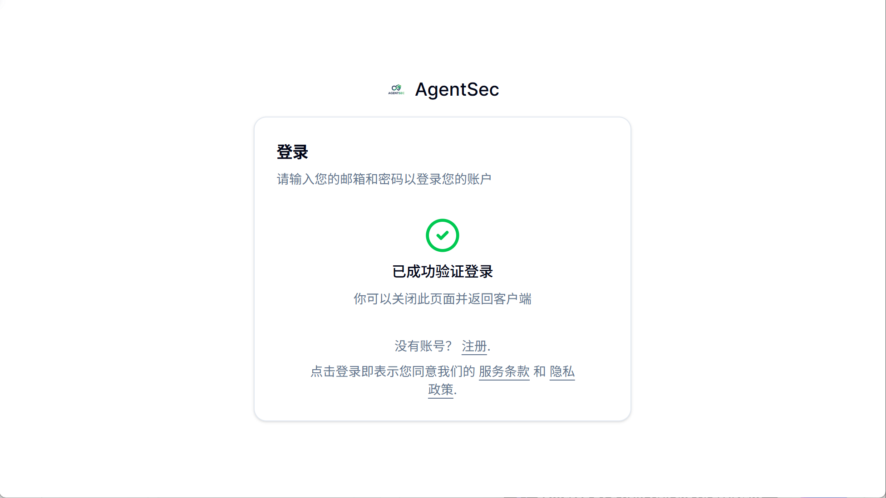
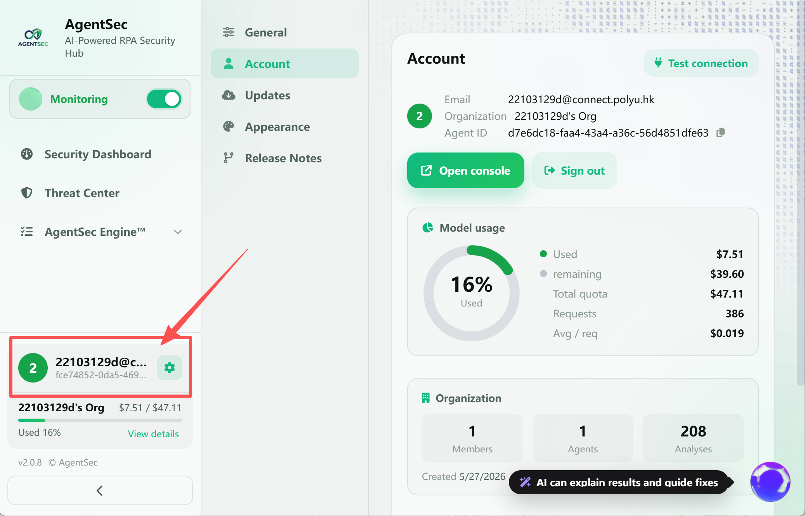
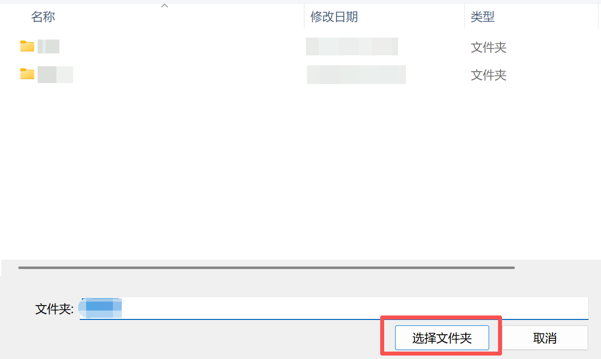
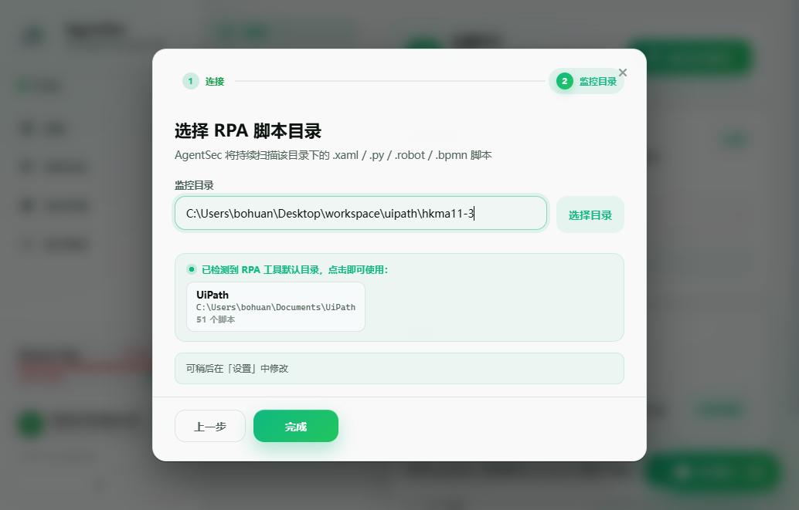

# 01 — Quick Start (Hands-on)

> Estimated time: 10 minutes | You will: Install → Login → Configure → First scan → Understand results

This tutorial will **guide you step by step**. Open AgentSec and follow along.

If you want to use the companion sample for the later security analysis steps, download the [UiPath sample package](https://github.com/PolyUxAISecurity/AgentSec-UserDoc/raw/main/Demo/agentsec-uipath-demo.zip), unzip it, and set the `Demo` folder as the monitored directory in the steps below.

---

## 1. Install and Launch

### Windows

1. Download the current Windows x64 ZIP from the [release page](https://github.com/PolyUxAISecurity/AgentSec-Release/releases); its filename includes the version
2. Extract to any directory (e.g. `D:\AgentSec Client`) — create a new folder if needed
3. Double-click `agentsec.exe`

> 

> 

### macOS

1. Download the `.dmg` from the [release page](https://github.com/PolyUxAISecurity/AgentSec-Release/releases), then double-click to mount
2. Drag into the `Applications` folder
3. Open **AgentSec Desktop** from Applications

---

## 2. First-time Setup (Onboarding Wizard)

After launching the app, the onboarding wizard will appear automatically.

To configure the app again:

Click the ⚙ **Settings** icon at the bottom of the sidebar → select **General** on the left → click the **"Run setup wizard"** button.

### 2.1 Choose your mode

You'll see two options:

> 

| Option | Best For | Needs |
|--------|----------|-------|
| **Login via AgentSec** (Recommended 👍) | Have an account, can connect to internet | An email address (to sign up) |
| **Local Mode** | Use local rule scanning without signing in to AgentSec | No model required; configure your own model to use AI features |

> 💡 **Not sure?** Choose "Login via AgentSec" — no extra AI config needed.

### 2.2 Login (for "Login" users)

1. Click "Next"
2. Browser opens the AgentSec login page automatically
3. Enter email and password (no account? Click Sign Up)
4. After login, the browser **auto-redirects back to the app**

> 
>
> 

**Success indicator**: Your email and avatar appear at the bottom of the sidebar.

> 

### 2.3 Choose Watch Directory

Click **Add Directory** and pick the folder containing your RPA scripts. **Multiple directories can be monitored simultaneously.**

> 
> 

> 💡 If UiPath is installed, AgentSec will auto-detect and suggest the default directory — just click it.

### 2.4 Configure an AI Model (Local Mode, Optional)

Local mode ends with **Configure AI model (optional)**. You can finish without a model and use rule scanning; configuring a model adds AI assessment and the AI Assistant.

Select a provider and model name, then enter an API key if required. Local services such as Ollama can leave the key blank. For Ollama or an OpenAI-compatible service, check the **Custom Base URL**. You can also configure this later under **Settings → General → Run Mode** and select **Test LLM**.

> A remote model service receives AI requests. AI inference stays on this computer only when you use a local model.

---

## 3. Start Your First Scan

After the wizard, you'll see the **Dashboard**.

_Screenshot pending: Security Dashboard → Security Overview, including the sidebar monitoring switch._

Now turn on the monitoring switch.

**What changes immediately:**

| Change | Explanation |
|--------|-------------|
| Monitoring switch | Changes from off to on; the status text displays `Monitoring` |
| Analysis results | Script results and risk distribution update as scanning completes |

**What AgentSec is doing:**

AgentSec scans scripts in the monitored directory, runs rule checks, and performs AI assessment when configured. Risk findings and actual actions are shown separately. Review high-risk recommendations that need confirmation in the Threat Center before acting.

---

## 4. Understanding Analysis Results

Rule results appear first. AI assessment time depends on the script, model, and service response; its progress is shown in the details.

### 4.1 Dashboard Overview

| Look at | Meaning |
|---------|---------|
| **Overall Risk** | Script risk and disposition distribution |
| **Static detection → RPA scripts** | Detected scripts and recent results |
| **Risk trends → Script analysis** | Analyses, high-risk findings, and block recommendations over 7 or 30 days |
| **Agent risk ranking / High-risk events** | Tool activity from connected Agents; these can be empty when only scanning scripts |

### 4.2 Enter Threat Center

Click **"Threat Center"** in the sidebar to view per-script details.

**Click any script** to expand the detail panel:

**Three key pieces of information:**
1. **💡 Recommendation**: How to fix the issue
2. **📝 Code Snippet**: The exact lines with problems
3. **Risk Level Color**: Red > Orange > Yellow > Gray (redder = more urgent)

---

## 5. If a Script Gets Blocked

A **Quarantined** label means the file has been moved to quarantine. For a high-risk recommendation awaiting confirmation, review the evidence before deciding whether to quarantine it. A high-risk finding does not always mean quarantine has happened.

### You think it's actually malicious?

Keep it quarantined; do not select **Trust** or restore it. Review the finding and handle the file through your organization's process. The original is stored in `.agentsec_quarantine`, and a safe stub replaces it at the original path.

### You think it's a false positive (safe script)?

1. Click the script → detail panel opens
2. Click **"Trust"**
3. Confirm → the file moves to the **Safe** area

>

>

> 💡 After restore, the file content stays the same. If you later modify it, AgentSec will re-analyze it.

---

## 6. Try the AI Assistant

Press **`Ctrl+K`** (Windows) or **`Cmd+K`** (macOS) — the AI assistant panel opens on the right.

Try asking:

> "Summarize the current script security status"

> "Which script has the highest risk? Why?"

The AI responds based on actual monitoring data and analysis results — not generic replies.

---

## 7. Quick Check: Are You Onboard?

- [ ] Monitoring started, with analyzed scripts or risk files appearing
- [ ] Threat Center has completed analysis records
- [ ] Clicked a script and saw detailed issues (or "No security issues found")

If all three are done — you've mastered AgentSec basics!

---

## Next Steps

| I want to... | Read this |
|--------------|-----------|
| Understand each dashboard number | [02 — Dashboard Overview](02-dashboard.md) |
| See a complete "discover → analyze → remediate" case | [03 — First Security Analysis](03-first-analysis.md) |
| Learn monitoring details and optimization | [04 — Monitoring & Directory Setup](04-monitoring.md) |
| Learn to interpret analysis results | [05 — Threat Center](05-security-log.md) |
| Manage blocked and trusted files | [06 — Security Sandbox](06-sandbox.md) |
| Adjust security detection strictness | [07 — Security Policy](07-security-policy.md) |
| Learn all AI assistant capabilities | [08 — AI Security Assistant](08-ai-assistant.md) |
| Learn how to use the AI Assistant through examples | [09 — AI Assistant Use Cases](09-ai-assistant-use-cases.md) |
| Configure account, model, updates, etc. | [10 — Settings Details](10-settings.md) |
| Understand terminology in this manual | [11 — Key Concepts](11-concepts.md) |
| Troubleshoot issues | [12 — FAQ](12-faq.md) |
