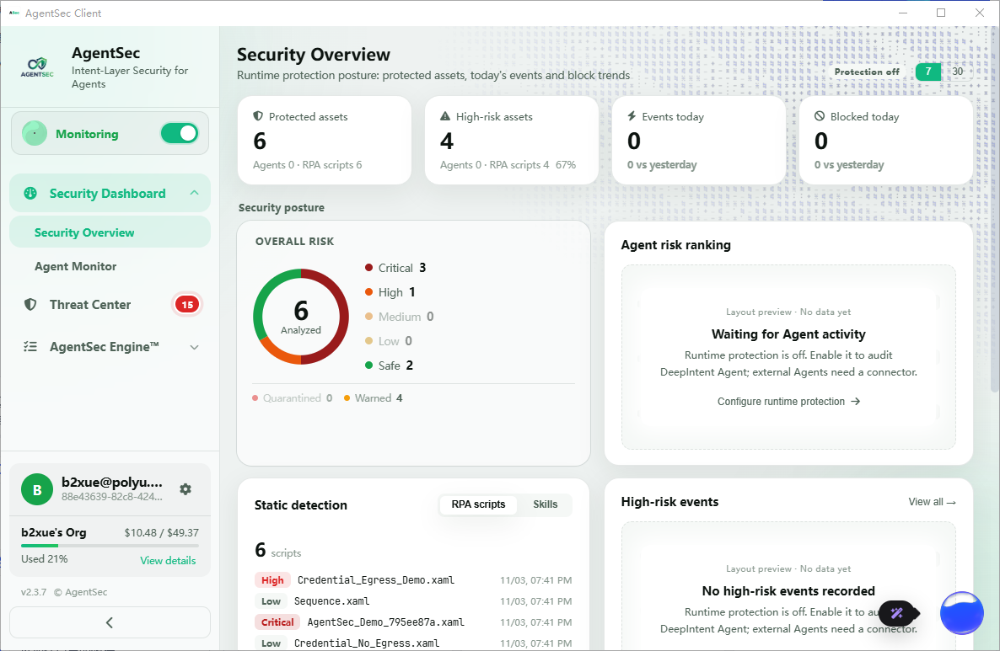
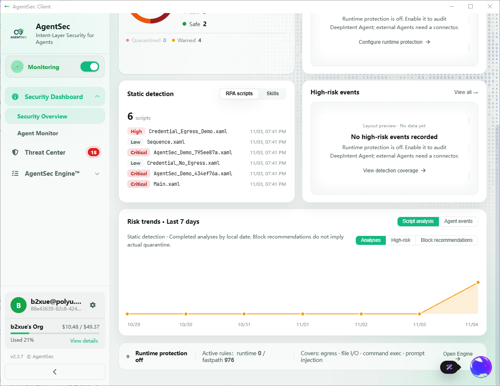
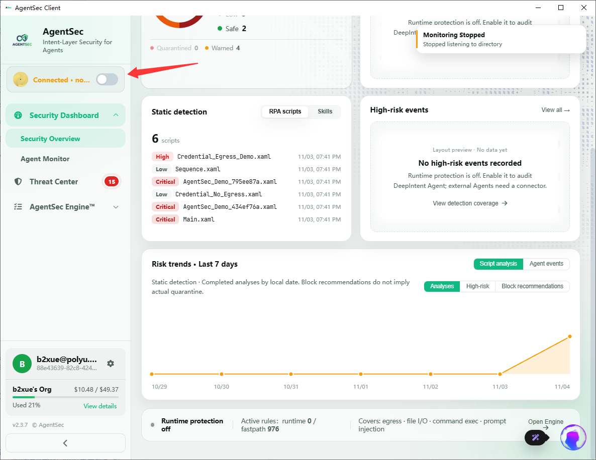

# Security Dashboard Guide

The sidebar's **Security Dashboard** has two entries: **Security Overview** and **Agent Monitor**. The overview brings together script detection and Agent live events. Agent Monitor shows the activity and risk of an individual Agent.

## 1. Read the Security Overview

| Area | How to read it |
| --- | --- |
| **Protected assets** | Agent and RPA script counts |
| **High-risk assets** | Agents and RPA scripts with high risks |
| **Events today / Blocked today** | Today's recorded runtime events and calls actually denied |
| **Overall Risk** | Script risk levels and dispositions |
| **Agent risk ranking** | Locate an Agent by risk; select a row to open its details |
| **Static detection** | Select **RPA scripts** to see the script count and recent results |
| **High-risk events** | Agent, time, severity, and action; select an event for details or select **View all** |

The **Skills** tab currently says that static Skill scanning is not available yet. No scanning sample is needed for it.

Without records, the page shows **Layout preview · No data yet** and links to configuration. These preview graphics are not detection results. The page updates after you configure monitored folders or connect an Agent and generate activity.

## 2. Switch Risk Trends

1. Select **7** or **30** days at the top right.
2. In Risk trends, select **Script analysis** or **Agent events**.
3. Select the metric you want to inspect.

| Source | Metrics |
| --- | --- |
| **Script analysis** | Completed analyses, high-risk findings, and block recommendations |
| **Agent events** | Tool events, high-risk events, and calls actually denied |

A script **block recommendation** does not mean the file has been quarantined. Agent block counts include calls that were actually denied.

## 3. Start or Stop Script Monitoring

The status card at the top of the sidebar shows connection and monitoring status. Its switch starts or stops script monitoring in the configured directories.

First add folders under **Settings → Security → Watch Directory**, then turn monitoring on. Selecting the status indicator also opens directory configuration. See [Monitoring and Directory Setup](04-monitoring.md).

Script monitoring and **Runtime protection** are separate features. To record Agent tool activity, enable runtime protection and connect the external Agents you need under **Settings → Security**. See [Agent Runtime Protection and Monitoring](agent-runtime.md).

## 4. View Agent Monitor

1. Expand **Security Dashboard** in the sidebar and select **Agent Monitor**.
2. Search the list by name or ID, then select an Agent.
3. Review its risk score, recent activity, events today, total blocks, pending approvals, and active sessions.
4. Switch between the detail tabs.

| Tab | Content |
| --- | --- |
| **Overview** | Risk sources and related assets, tools, and Skills |
| **Audit Log** | Tool-call audit records for this Agent |
| **Session Traces** | Related activity grouped by session |
| **Rules hit** | Rules matched by this Agent |

DeepIntent Agent is integrated automatically and labeled **Audit only**. Text-only replies do not count as tool-call events. External Agents need a connector and supported tool activity before their audit and enforcement records appear.

## 5. Common Navigation

| Entry | Purpose |
| --- | --- |
| **Threat Center** | Script threats, Agent live events, Dify workflows, History, Notifications, and Security Sandbox |
| **AgentSec Engine™** | Engine modules, Rule Lab, and Marketplace |
| **Account / usage at the bottom of the sidebar** | Current identity and organization quota |
| **Sidebar gear button** | Open Settings |
| **AI Assistant at the bottom right** | Open DeepIntent Agent; also available with `Ctrl+K` / `Cmd+K` |

Continue with [Threat Center](05-security-log.md), [Dify Workflow Audit](dify.md), or [AI Assistant](08-ai-assistant.md).
