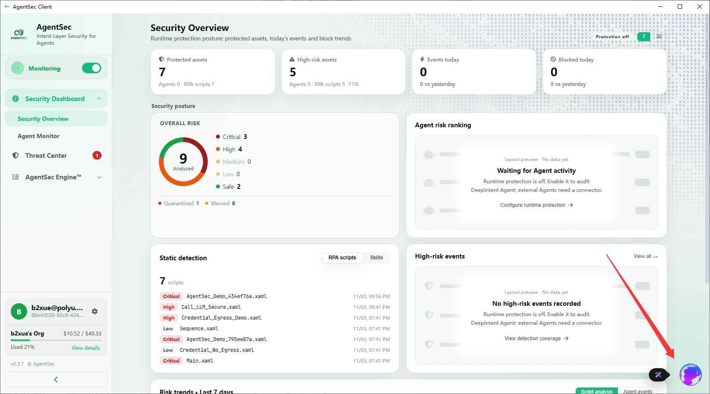
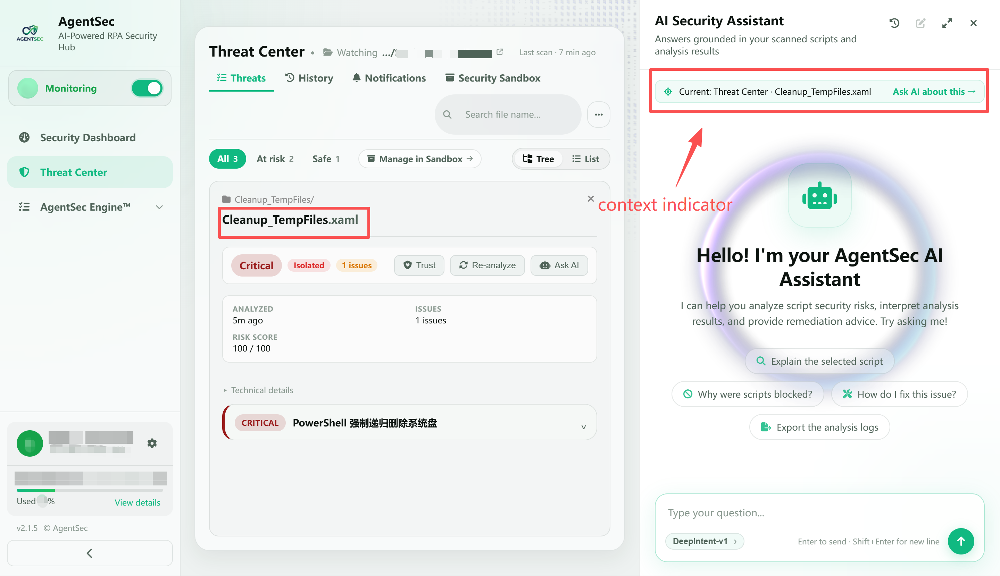
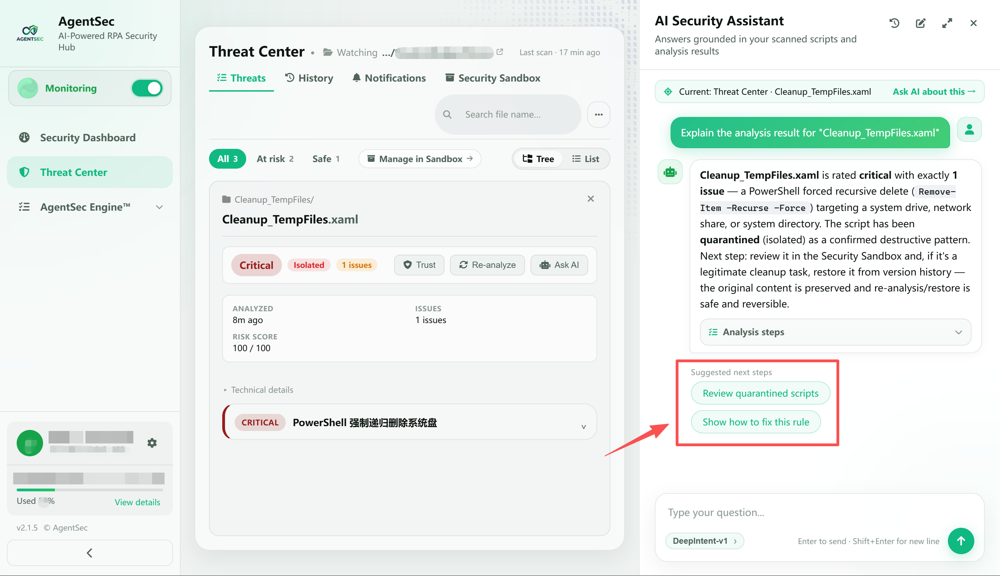
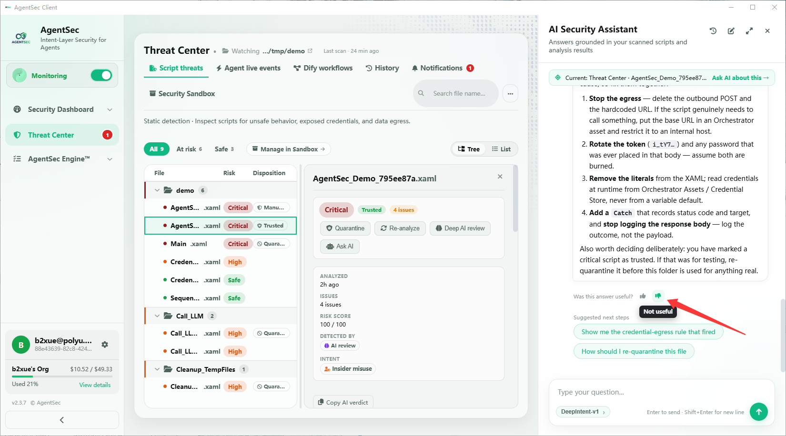
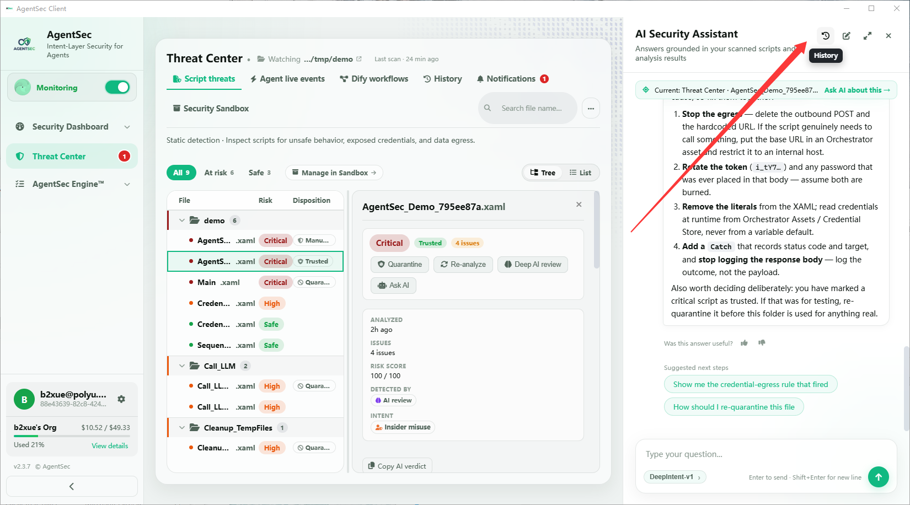

# AI Security Assistant Guide

> AgentSec includes a built-in AI Security Assistant (Copilot). Ask it questions in natural language — it answers based on current monitoring state, analysis results, and configuration, and can even execute operations for you.

---

## Opening the AI Assistant

**Three ways:**

| Method | Action |
|--------|--------|
| Click FAB | Click the blue "AI Assistant" floating button at bottom-right |
| Shortcut | Press `Ctrl+K` (Windows) or `Cmd+K` (macOS) |
| Press again | Close the panel |



---

## Assistant Panel Layout

The panel contains a title bar, chat history, new chat, current-context indicator, suggested questions, conversation area, tool progress, and input box. Type a question or select a suggested question to get started.

### Three Display Modes

| Mode | Effect |
|------|--------|
| Closed | FAB at bottom-right, panel hidden |
| Docked | Panel on right, 1/3 width, main content auto-shrinks |
| Fullscreen | Panel expanded to max width, suitable for viewing complex content |

In Docked mode, click the expand button in the title bar to switch to Fullscreen mode.

---

## What Can the AI Assistant Do?

### 1. Answer Security Questions

Ask in natural language:

| You can ask | Example |
|-------------|---------|
| Security overview | "Summarize the current security status of all scripts" |
| Risk analysis | "Which scripts have the highest risk? Why?" |
| Fix advice | "How do I reduce the security risk of Main.xaml?" |
| Rule explanation | "What is AgentSec's current security policy? What rules does it contain?" |
| Config check | "Check if my current configuration is correct" |
| Status query | "Which scripts are being analyzed right now?" |

**Context-aware**: The AI knows what page you're on and what's selected. For example, selecting `Cleanup_TempFiles.xaml` in Threat Center shows a context chip "Interpret Cleanup_TempFiles.xaml's analysis results".

> 

### 2. Auto-Execute Operations

The assistant can query application state and help with these operations:

| Capability | Trigger |
|-----------|---------|
| Check config | "Check my config" → AI validates directories, LLM, server connectivity |
| Set watch directory | Opens a folder picker; assistant operations are limited to the AgentSec workspace |
| Start/Stop monitoring | Checks configuration first; use the interface monitoring switch for directories outside the workspace |
| View monitoring status | "What's the monitoring status?" → AI returns current state |
| View policy | "What are the current security rules?" → AI lists enabled rules |
| Query analysis progress | "How's the analysis going?" → AI returns in-progress scripts |
| View engine and rules | "What ruleset version is active? Which rules are enabled?" |
| View lab samples and policies | "Which demo samples and policies are available?" |
| Read and repair workspace copies | Import a script, then ask the assistant to read, explain, or modify the copy |

**AI checks config before acting**. For example, if you say "Start monitoring", it verifies that the monitoring directory, AI model, and server connection are ready. If something is wrong, it explains what needs fixing before continuing.

Use the client's **Export logs** button to export logs. Apply policies and change rules on their respective pages.

### 3. Read and Repair a Script Copy

1. Open **Settings → Security → DeepIntent Agent workspace**.
2. Select **Import scripts for repair** and choose a script. The client places a copy in its workspace.
3. Open the assistant and identify the file and goal, for example: "Read Main.xaml in the workspace, explain the issues, and repair hardcoded credentials."
4. Review the changes, then select **Open workspace** to inspect the file and arrange validation and use.

The assistant can read and write workspace copies. It does not directly modify the external original or execute scripts.

### 4. Quick Action Buttons

AI replies may include suggested action buttons:

```
[Summarize status]  [View high-risk details]  [How to fix]
```

Click any button to auto-send that question — no typing needed.

> 

### 5. Rate an Answer

When signed in and enrolled in an organization, **Useful** and **Not useful** buttons appear below assistant answers. Select **Not useful** to optionally describe the problem, then select **Send**. Local mode does not show these feedback buttons.



---

## Conversation Tips

### ✅ Good Questions

- "What security issues does Main.xaml have? Explain each one"
- "Compare the risk levels of Process.py and Main.xaml"
- "How do I fix the hardcoded password issue? Give concrete steps"

### ❌ Less Effective

- "Security" (too vague)
- "Just fix it" (missing the file and goal)
- "What's the weather?" (unrelated to RPA security)

### 💡 Tips

- The AI automatically replies in your current UI language
- Select **Chat history** in the title bar to search, open, and continue saved conversations, including after restarting the app.
- Select **New chat** to start another conversation. Older conversations remain in history. To remove one, select its delete button in the history list and confirm.



---

## Model Info Display

The input box bottom-left shows a **model badge** with the current AI model:

- **Signed-in mode**: Shows the model currently provided by your organization through AgentSec.
- **Local mode**: Shows your configured model.

Select the badge to open **AgentSec Engine™ → Engine → AI Model**. Select **Go to settings** there to edit a local model.

---

## FAQ

**Q: Does the AI assistant need internet?**
A: Depends on your mode. Signed-in mode requires internet (relayed via AgentSec server). Local mode with Ollama works offline.

**Q: How much quota does it consume?**
A: In signed-in mode, each conversation draws from the organization's AI quota (visible in sidebar). Local mode has no quota limit (depends on your own API account).

**Q: Are conversations recorded?**
A: Conversations are saved locally. Signed-in clients enrolled in an organization also synchronize sessions to the organization's server. Local mode does not perform this synchronization.

**Q: What if the org's AI quota runs out?**
A: Contact your org admin to top up via the AgentSec console. When exhausted, both AI Assistant and AI analysis pause.

**Q: Why can't the AI answer certain questions?**
A: AgentSec's AI Assistant is positioned as an RPA security expert. It keeps answers scoped to security analysis, script risks, and remediation. Unrelated questions may be declined.
