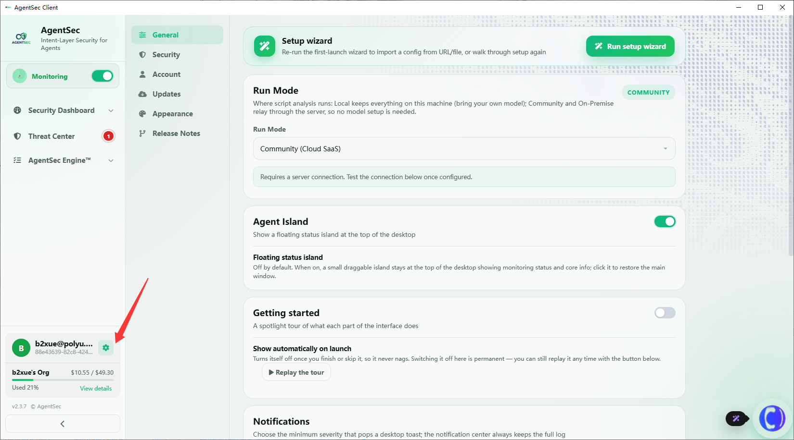
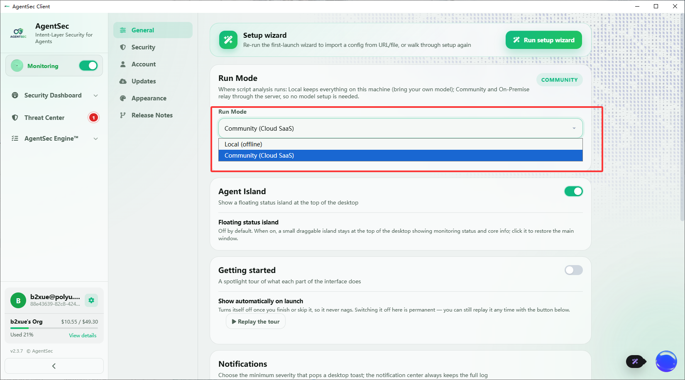
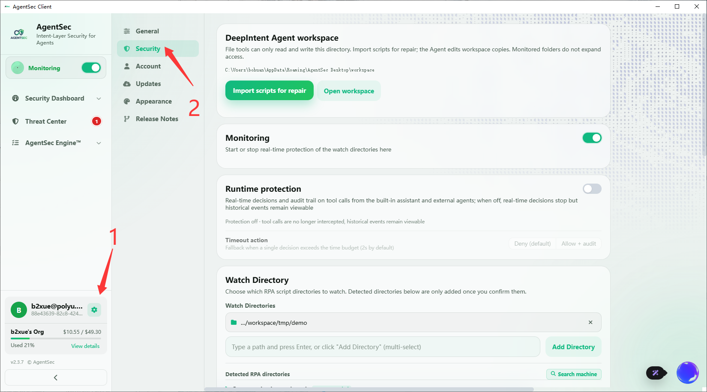
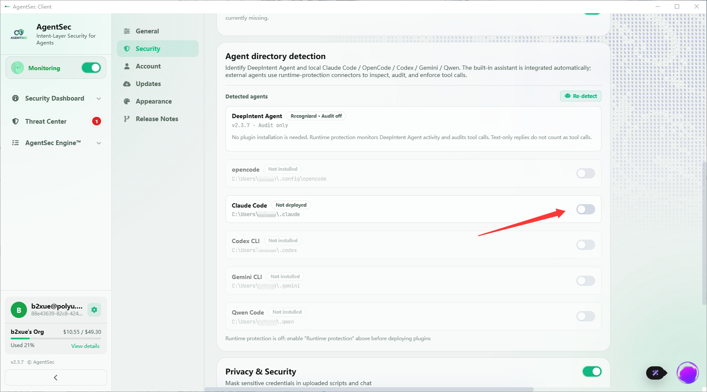
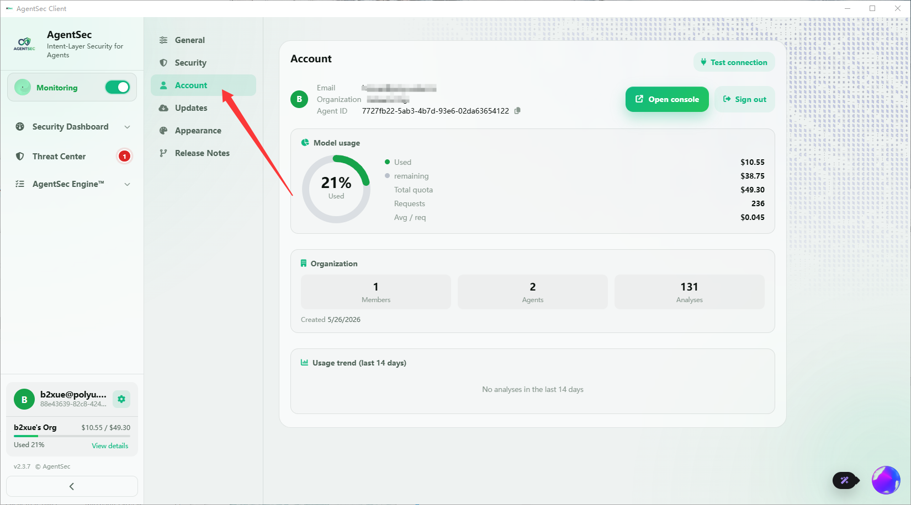
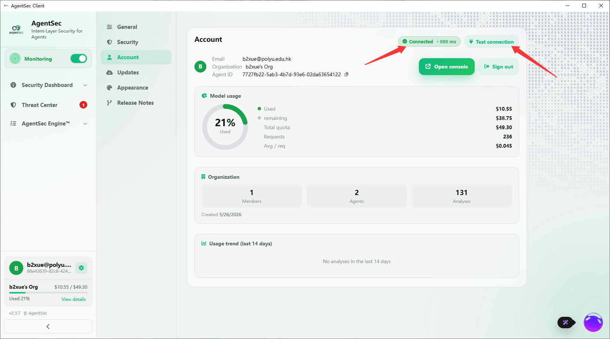
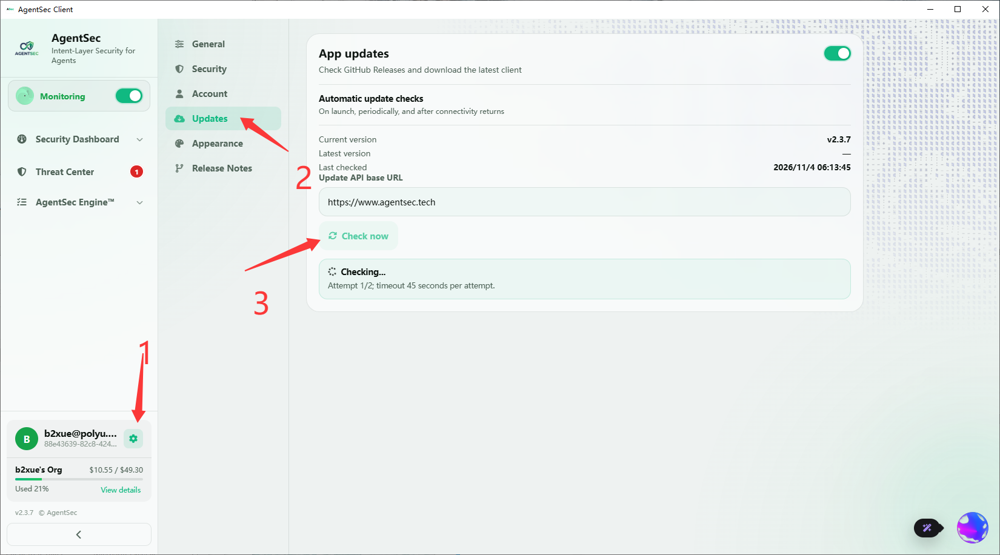
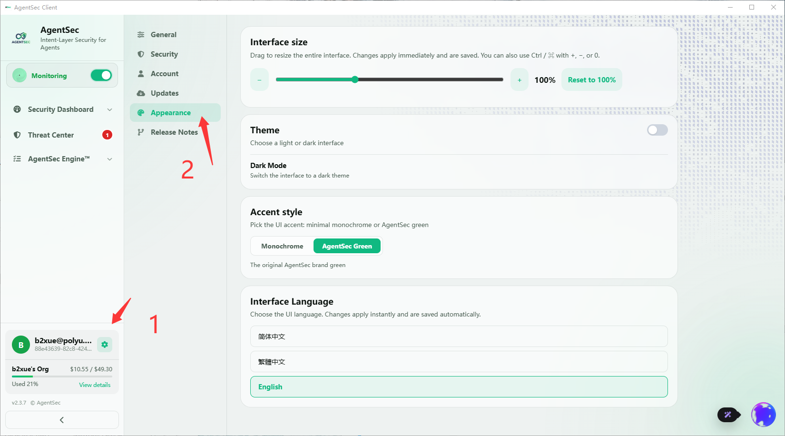
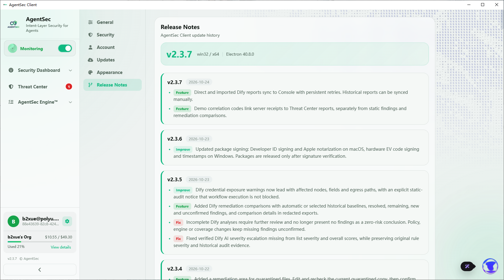

# Settings and Account Guide

> The Settings page is used to manage all AgentSec configuration, including General, Security, Account, AI model, automatic updates, and more.

---

## Open Settings

Select the **⚙ Settings** button at the bottom of the sidebar.

---

## Settings Page Layout

The Settings page uses a **left-side category navigation and right-side content** layout. Use the left side to switch between General, Security, Account, Updates, Appearance, and Version; the right side shows the settings for the selected category.

### ⚡ Auto-Save

Settings save automatically. Monitoring and runtime-protection switches take effect immediately. There is no separate save button at the bottom of the page.

---

## I. General

### Setup Wizard

Select **Run setup wizard** to run initial setup again. This is useful when you want to reconfigure the run mode or monitoring directories.

### Run Mode

| Mode | Description |
| --- | --- |
| Local (Offline) | No AgentSec sign-in; rules run on this computer. AI is optional and uses your configured model service |
| Community (Cloud SaaS) | Sign in to AgentSec cloud and use the model service provided by your organization |

After you switch modes, the corresponding messages and configuration options appear below.

The **AI assessment model (optional)** form is here in local mode. Select the provider and model, and enter an API key if required. Ollama and OpenAI-compatible services also support a custom Base URL. Select **Test LLM** to check the connection. Rule scanning works without a model. For an enterprise deployment, use the server and account supplied by your administrator.

### Tutorial, Notifications, and Advanced Mode

- **Agent Island**: Enable a draggable desktop status island for monitoring and analysis progress; select it to restore the main window. It is off by default.
- **Tutorial**: Replay the interface introduction.
- **Notification level**: Show all popups, warnings and above, errors only, or no popups. Notifications remain available in the Threat Center.
- **Advanced mode → Show custom DSL rules**: Reveals the Engine's **DSL Rules** entry. Hiding the entry does not disable saved rules.

### Developer Options

- **Show Debug View**: Adds a **“Debug”** entry to the sidebar, where you can view the real-time analysis log stream
- Enable this option only when troubleshooting

Debug's **Git Vault** shows snapshot commits, tracked files, and content differences. **Live Logs** lets you view, clear, or export logs. These entries appear only after Debug is enabled; normal monitoring and audits do not need them.

### Danger Zone

The **“Reset All Data”** button:

- Clears configuration, Agent ID, analysis history, chat history, and the allowlist
- Automatically exits the application after deletion is complete
- Makes the application behave like a first-time installation when reopened

> ⚠️ This operation cannot be undone!

---

## II. Security

### DeepIntent Agent Workspace

Select **Import scripts for repair** to copy scripts into the workspace, then **Open workspace** to view them. The assistant's file tools access only this workspace. Monitoring directories do not expand its access, and importing a script does not modify the original.

### Runtime Protection and Agent Connections

Enable **Runtime protection** to record DeepIntent Agent activity and tool audits. External Agents need a connector under **Agent directory detection**:

1. Select **Re-detect** to find installed Claude Code, OpenCode, Codex, Gemini, or Qwen.
2. Turn on the deployment switch for the Agent you want to connect.
3. Restart running external Agents after deployment or redeployment.
4. View records under **Security Dashboard → Agent Monitor** and **Threat Center → Agent live events**.

DeepIntent Agent is integrated automatically and labeled **Audit only**. External Agent protection applies to supported tool calls from connected Agents. **Timeout action** offers **Deny (default)** or **Allow + audit**.

### Monitoring

Use the **Monitoring** card to start or stop script monitoring. When monitoring is off, AgentSec no longer analyzes new or modified RPA scripts in those directories in real time. Turn it on again to resume monitoring.

### Watch Directory

AgentSec supports **monitoring multiple directories simultaneously**. Add the RPA script directories you want to protect in any of the following ways:

- Enter a path in the input box and press Enter
- Click **“Add Directory”** to open the directory selector; you can select multiple directories at once
- Click **“Search This Computer”** to detect script directories for common RPA tools

Directories found by the search appear under **“Detected RPA Directories”**, together with the tool name, path, and number of scripts. Detected directories are not added to monitoring automatically; they take effect only after you confirm them.

Removing a monitored directory requires confirmation and clears its local analysis, trust, and content-snapshot records. Scripts and quarantined copies on disk remain. Handle any quarantined files in Security Sandbox first if needed.

#### Start Monitoring at Launch

When enabled, AgentSec automatically monitors configured directories that currently exist when it starts, so you do not need to start monitoring manually each time. Monitoring does not start automatically if no monitoring directory is configured or if the configured directories no longer exist.

### Privacy and Security

#### Mask Sensitive Credentials

Enabled by default. When you upload scripts or use AI Q&A, credentials are replaced with irreversible placeholders before leaving the local machine or appearing in the interface. This prevents sensitive information such as API keys and passwords from being displayed or transmitted directly. The original local script is not modified.

### Analysis Engine

#### Rules Engine (DSL Ruleset)

The rules engine is **always enabled** and performs deterministic rule matching. Analysis completes locally within milliseconds and does not depend on a network connection or large model. When a rule matches, AgentSec provides a risk conclusion and recommended disposition according to that rule.

Rules can be updated in two ways:

- **Update Rules from Console**: Connect to the Console to retrieve the latest rules
- **Import Rule Update Package (Offline)**: For intranet environments or systems that cannot connect to the Console; an administrator exports a signed rule package for import here

#### AI Assessment (Optional)

AI assessment interprets script intent and helps identify risks not yet covered by rules. When disabled, script contents do not leave the local machine for AI assessment, and analysis conclusions are provided by the rules engine only.

---

## III. Account

#### Signed In

The following information is displayed:

| Field | Description |
| --- | --- |
| Avatar | An identifier generated automatically from the email address |
| Email | Email address used to sign in |
| Organization | The AgentSec organization (tenant) you belong to |
| Agent ID | Unique identifier for the current machine |
| Model Usage | Organization's AI quota usage |

Click **“Sign Out”** to disconnect from the server.

#### Not Signed In

- A **“Connect to Console (Sign In)”** button is displayed

### Connection Test

Click **“Test Connection”** to verify that the server is reachable and the sign-in credentials are valid.

---

## IV. Updates

### Automatically Check for Updates

- **Switch**: Enable or disable automatic update checks at startup and at regular intervals
- **Default**: Enabled; checks every 6 hours

### Current Version Information

| Information | Description |
| --- | --- |
| Current version | The AgentSec version you are currently using |
| Latest version | Latest version available on GitHub Releases |
| Last checked | Time of the most recent update check |

Use the default **Update API URL** or the address supplied by your deployment administrator.

### Check for Updates Manually

Click **“Check for Updates Now”** to query the latest version immediately.

When a new version is detected:

- The Settings page displays the new version details and release notes
- An update banner appears at the top of the Dashboard
- Click **“Download and Install”** to download and install automatically on Windows, or open the DMG on macOS

---

## V. Appearance

### Interface Size

Use the slider or plus/minus buttons to adjust the whole interface from 50% to 200%. Select **Reset to 100%** to restore it. You can also use `Ctrl` / `⌘` with `+`, `−`, and `0`. Changes take effect immediately and save automatically.

### Theme

- **Dark Mode**: Use the switch to enable or disable it
- By default, AgentSec follows the system preference (`prefers-color-scheme`)

### Accent Style

Choose **Monochrome** or **AgentSec Green**.

### Interface Language

Three languages are supported:

- Simplified Chinese (default)
- Traditional Chinese
- English

The entire interface updates immediately after you switch languages. The AI Assistant also automatically switches its response language.

---

## VI. Version Notes

Displays version history from v2.0.1 onward, with the latest version first.

Entries are labeled as features, fixes, improvements, or interface changes.
