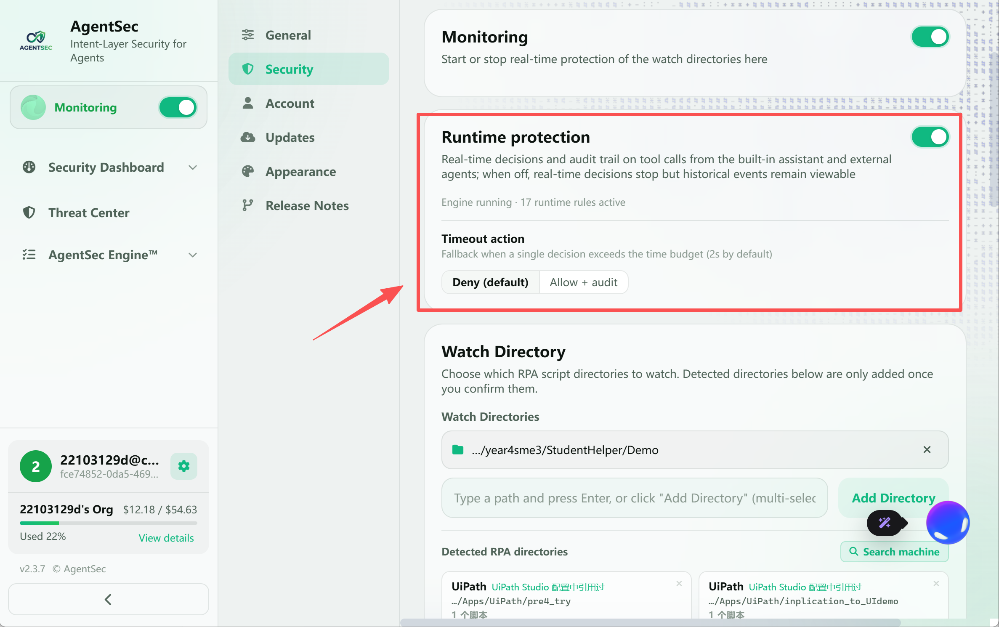
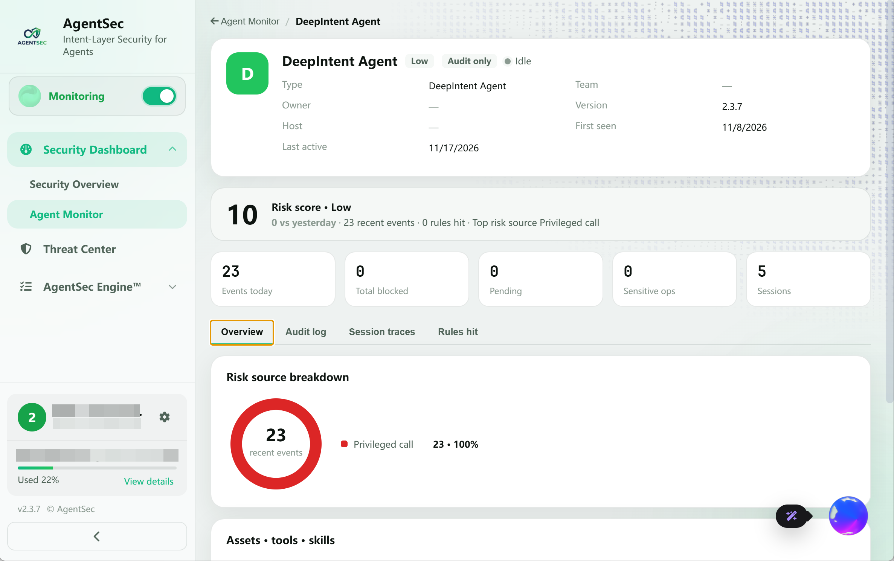
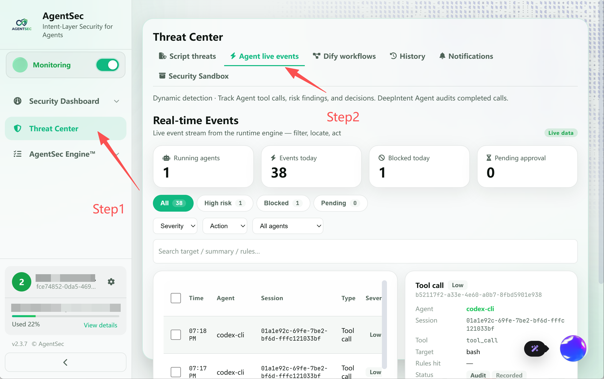
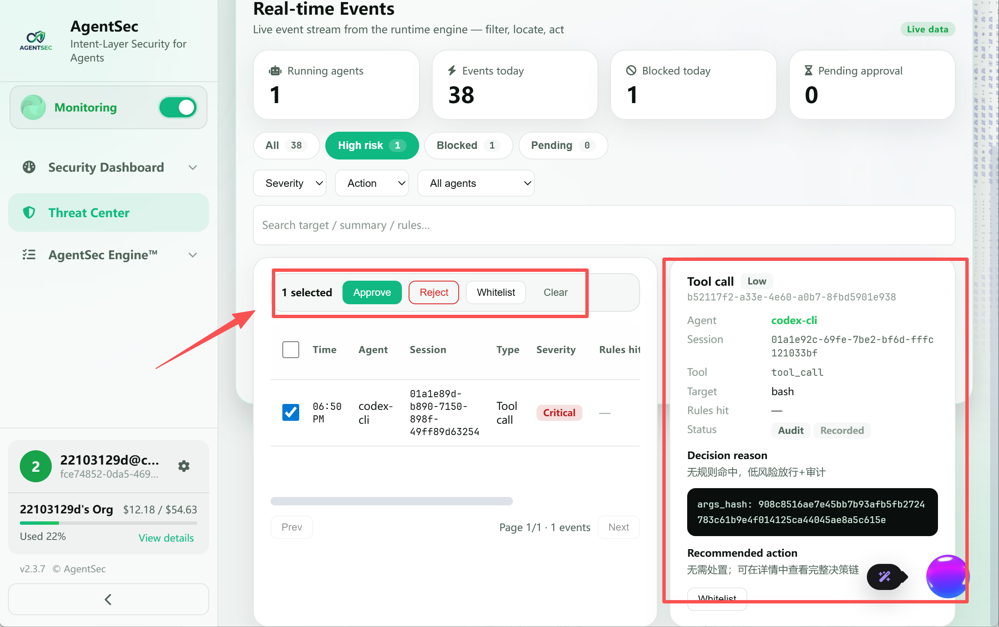

# Agent Runtime Protection and Monitoring

Use this guide to connect local Agents and review tool calls, risk events, and approval records. Supported Agents are the built-in **DeepIntent Agent**, plus **Claude Code, OpenCode, Codex CLI, Gemini CLI, and Qwen Code**.

## 1. Enable Runtime Protection

1. Open **AgentSec Engine™ → Engine → Agent runtime protection** and review the module status and supported Agents.
2. Select **Configure protection** to open **Settings → Security**.
3. Enable **Runtime protection** and wait for the engine-running status.

You can also enable it directly in Settings. It is off by default and has a separate switch from RPA script directory monitoring.

## 2. Connect an Agent

The built-in **DeepIntent Agent** connects automatically when runtime protection is enabled. It records activity and audits completed tool calls; plain text chat does not create tool-call events.

For an external Agent:

1. Select **Manage Agent connections** in the Engine module, or find **Agent directory detection** under **Settings → Security**.
2. Select **Re-detect** to find Agents installed on this computer.
3. Turn on the deployment switch for the target Agent and wait for **Deployed**.
4. Restart the external Agent to load its connector. Restart after connector upgrades as well.

Protection applies to connected, supported tool calls. Turn off the deployment switch to remove an Agent's connector.

## 3. Review Activity and Risk

1. Expand **Security Dashboard → Agent Monitor**. Running Agents appear in yellow; idle Agents appear in gray.
2. Search for an Agent to review its risk, event count, and status, then select it to open the details.
3. Switch between **Overview**, **Audit log**, **Session traces**, and **Rules hit** to inspect activity.

| Tab | What it shows | How to use it |
| --- | --- | --- |
| **Overview** | Risk-source distribution and related assets, external services, tools, and skills. The chart shows the count and share of recent events; related items identify objects involved in Agent activity. | Check which risk source accounts for the events, then review related tools or assets to locate activity that needs attention. A dash (**—**) means no related data is available. |
| **Audit log** | Tool-call records by time, including time, type, target, severity, action, and rules hit. | Find a record by time and review its target, severity, and action. **Audit** means the call was recorded; a dash means no matched rule is shown. |
| **Session traces** | Tool calls and action labels grouped by session and shown in time order. | Follow a session timeline to review call order and context, and cross-check times and targets against the audit log. |
| **Rules hit** | Rules or policies matched by this Agent. | Review which rules correspond to the activity. **No rules matched** means there are no current match records. |

Risk-source charts and related data reflect recorded activity. When data is unavailable, the page may show a dash or an empty state.

## 4. Review Events and Approvals

1. Open **Threat Center → Agent live events**.
2. Filter by severity, action, Agent, or keyword. Select an event to review its tool, target, matched rules, reason, and recommendation.
3. For a **Pending** event, inspect its details, then select **Approve**, **Reject**, or **Allowlist** as appropriate.
4. Review the action and approval record in the event details.

DeepIntent Agent audits completed calls to record risks. Review each event's actual action and handling status alongside its risk findings.

## 5. Set Timeout Handling or Turn Protection Off

Under **Settings → Security → Runtime protection → Timeout action**, choose how to handle a single risk decision that exceeds its time budget (2 seconds by default):

- **Deny (default)** rejects the tool call, preventing an operation from proceeding when its risk decision was not completed in time.
- **Allow + audit** lets the tool call proceed and keeps an audit record for later review under **Threat Center → Agent live events**.

This setting applies to timed-out decisions; it does not change the outcome of decisions completed within the time limit. Choose an option based on your security requirements and need for service continuity.

Turning runtime protection off stops new real-time decisions. Saved events remain available. See the [Dify guide](dify.md) for workflow operations.
