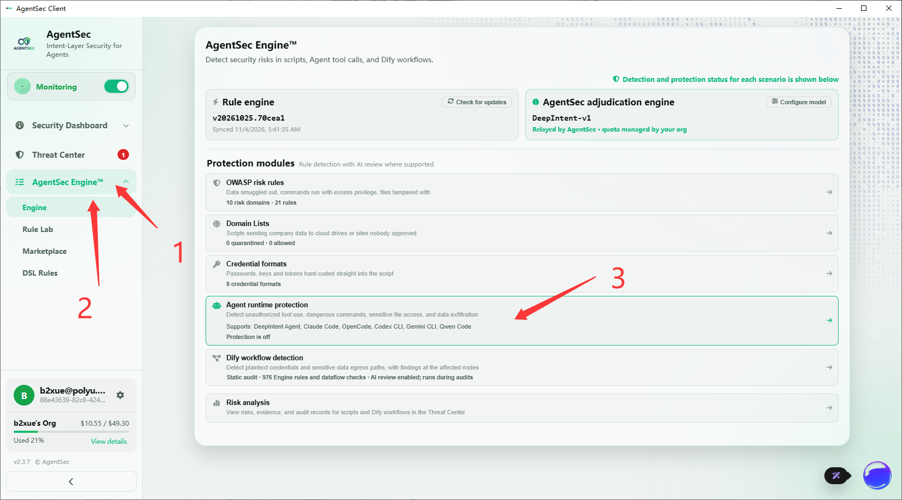

# Agent Runtime Protection and Monitoring

Use this guide to connect local Agents and review tool calls, risk events, and approval records. Supported Agents are the built-in **DeepIntent Agent**, plus **Claude Code, OpenCode, Codex CLI, Gemini CLI, and Qwen Code**.

## 1. Enable Runtime Protection

1. Open **AgentSec Engine™ → Engine → Agent runtime protection** and review the module status and supported Agents.
2. Select **Configure protection** to open **Settings → Security**.
3. Enable **Runtime protection** and wait for the engine-running status.

You can also enable it directly in Settings. It is off by default and has a separate switch from RPA script directory monitoring.

## 2. Connect an Agent

The built-in **DeepIntent Agent** connects automatically when runtime protection is enabled. It records activity and audits completed tool calls; plain text chat does not create tool-call events.

For an external Agent:

1. Select **Manage Agent connections** in the Engine module, or find **Agent directory detection** under **Settings → Security**.
2. Select **Re-detect** to find Agents installed on this computer.
3. Turn on the deployment switch for the target Agent and wait for **Deployed**.
4. Restart the external Agent to load its connector. Restart after connector upgrades as well.

Protection applies to connected, supported tool calls. Turn off the deployment switch to remove an Agent's connector.

## 3. Review Activity and Risk

1. Expand **Security Dashboard → Agent Monitor** to view Agents with recorded activity.
2. Search for and select an Agent to review its risk, event counts, and status.
3. Use the **Overview**, **Audit log**, **Session traces**, and **Rules hit** detail tabs to inspect activity.

## 4. Review Events and Approvals

1. Open **Threat Center → Agent live events**.
2. Filter by severity, action, Agent, or keyword. Select an event to review its tool, target, matched rules, reason, and recommendation.
3. For a **Pending** event, inspect the details, then select **Approve** or **Reject**.
4. Review the resulting action and approval record in the event details.

DeepIntent Agent audits completed calls to record risks. Review each event's actual action and handling status alongside its risk findings.

## 5. Set Timeout Handling or Turn Protection Off

Under **Settings → Security → Runtime protection**, choose **Deny (default)** or **Allow + audit** for an engine decision that exceeds its time budget.

Turning runtime protection off stops new real-time decisions. Saved events remain available. See the [Dify guide](dify.md) for workflow operations.
