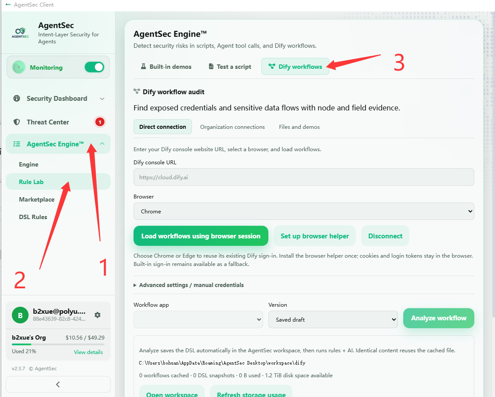
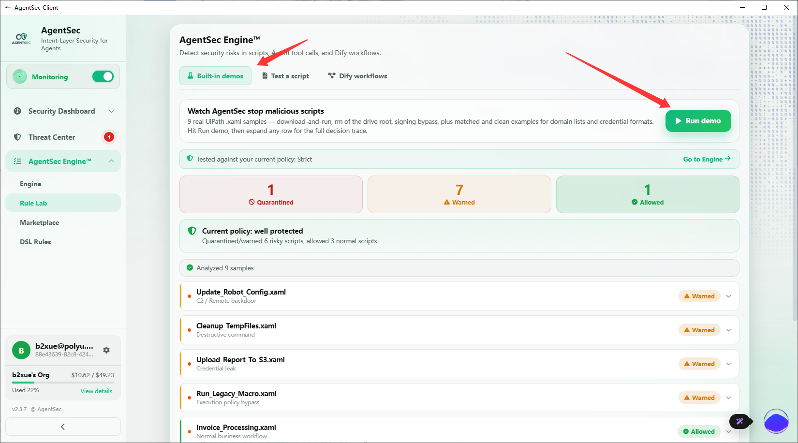
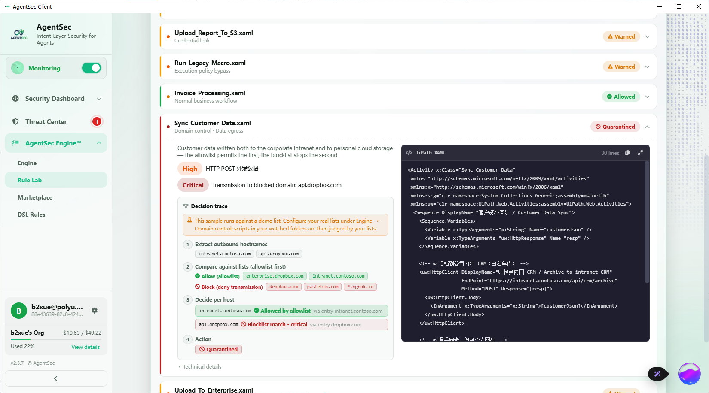
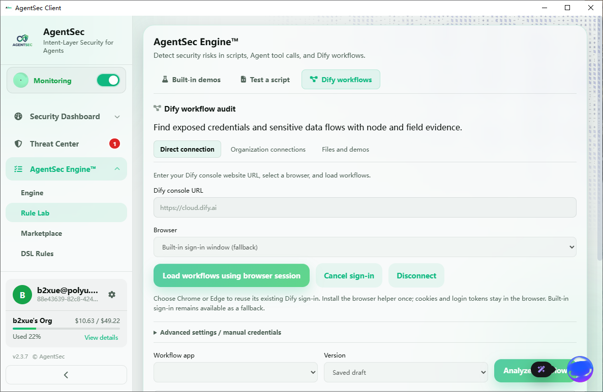
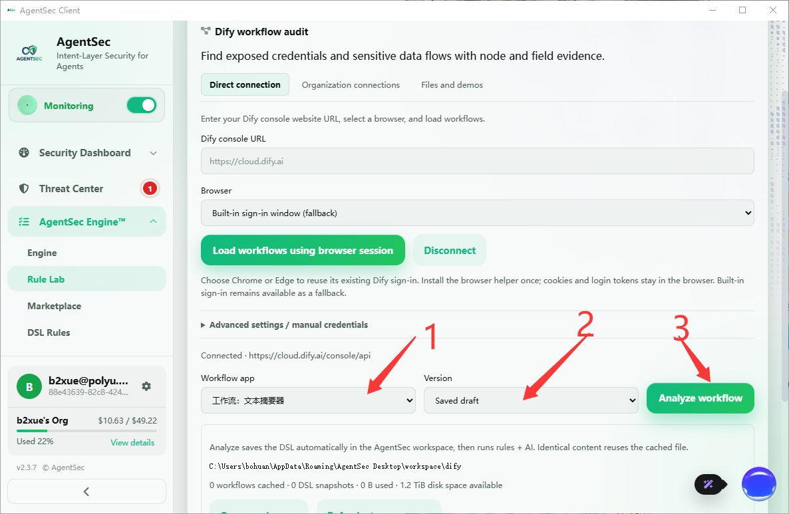
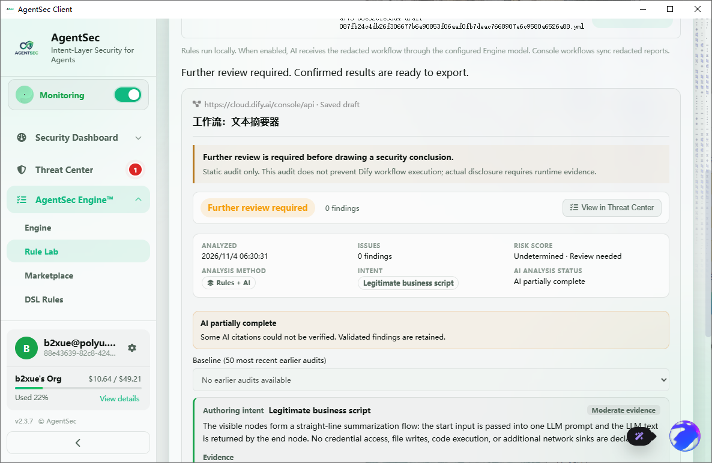
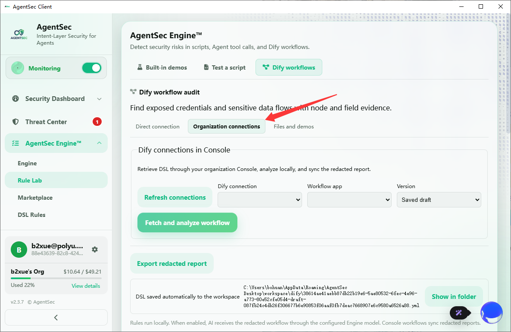
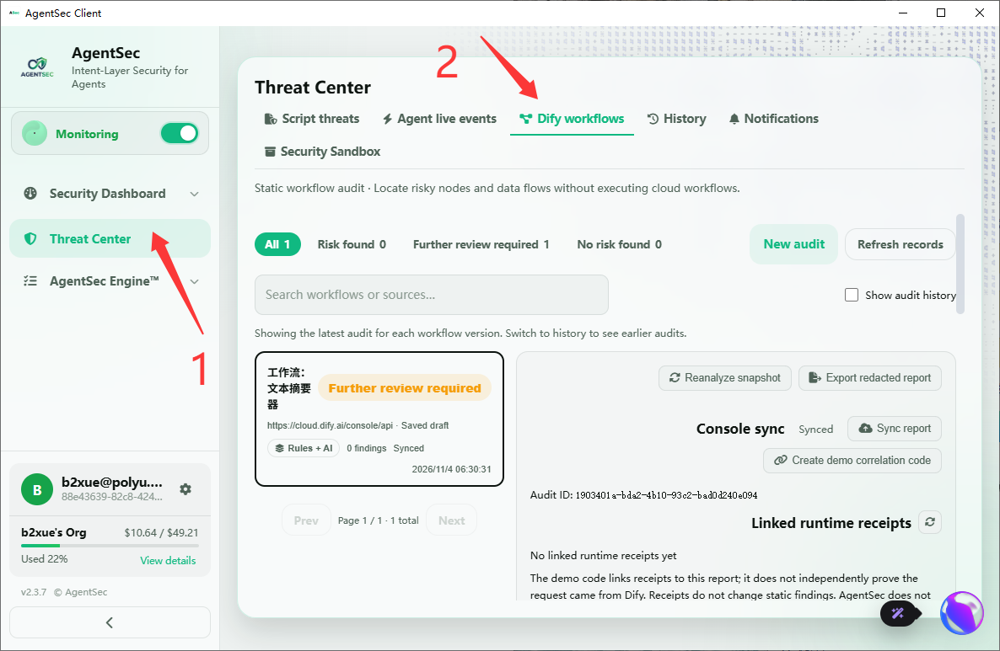

# Dify Workflow Audit

AgentSec Desktop checks Dify workflows for exposed credentials and paths that may send sensitive data outside the workflow. Start with the built-in demo, then audit your own workflow. The audit reads a workflow snapshot; it does not run or publish the workflow or stop execution in Dify Cloud.

## 1. Run the built-in demo

1. Open **AgentSec Engine → Rule Lab → Dify workflows → Files and demos**.
2. Select **Run enterprise demo**. The client analyzes a fictional after-sales support workflow and displays a risk advisory.

3. Expand a finding to inspect the node, field, redacted evidence, and data path. Check the rule and AI analysis status.

The built-in demo uses a separate demo policy and does not change your active security policy. A potential data path in a static audit does not mean that data was actually disclosed.

## 2. Audit your own Dify workflow

### Reuse your Chrome or Edge sign-in

1. Sign in to Dify in Chrome or Microsoft Edge (the **Built-in sign-in window** is recommended) and open the app list or a workflow page.

2. In AgentSec, open **Dify workflows → Direct connection**, enter the Dify console website URL, and choose the same browser.
3. On first use, select **Set up browser helper**. On the browser's extensions page, enable developer mode and select **Load unpacked** to load the helper folder opened by AgentSec.
4. Select **Load workflows using browser session**. In the new helper tab, select **连接并获取工作流** (Connect and load workflows) and allow access to that Dify site when prompted.
5. Return to AgentSec, choose a **Workflow app** and **Saved draft** or **Published version**, then select **Analyze workflow**.

The client saves the retrieved DSL automatically and displays the rule and AI analysis results. Only a saved draft or published version is audited; save any unsaved editor changes first. If the browser helper is unavailable, choose **Built-in sign-in window** in the browser selector. **Advanced settings / manual credentials** is also available.

### Use an organization connection or DSL file

- **Organization connections**: If an administrator has enabled a Dify connection in Console, select **Refresh connections**, choose the connection, workflow app, and version, then select **Fetch and analyze workflow**. This route syncs the redacted report.
- **Files and demos**: If you have an exported Workflow / Chatflow `.yml` or `.yaml` file, select **Import Dify DSL** and choose the file. The limit is 1 MiB.

## 3. Review findings and retest changes

1. In the report, inspect the risk advisory, findings, and any **Further review required** notice. Expand findings for nodes, fields, evidence, and recommendations; coverage gaps are shown separately.
2. In **Threat Center → Dify workflows**, select a report, search or filter the list, enable **Show audit history**, or select **Export redacted report**.
3. After changing and saving the Dify workflow, fetch and analyze it again from its source. For files, import the revised DSL again. In **Remediation comparison**, review **Resolved**, **Remaining**, **New risks**, and **Unconfirmed**. Choose a **Baseline** when comparing against a different record.

**Reanalyze snapshot** checks the previously saved snapshot. To check changes, fetch or import the revised version from its source.

## 4. Link a demo runtime receipt (optional)

After an enrolled client's report has synced to Console, select it in **Threat Center → Dify workflows** and choose **Create demo correlation code**. If your Dify demo app provides a `demo_run_token` input, enter the code and run the synthetic case. Return to the report to inspect **Linked runtime receipts**. The receipts and static audit findings are displayed separately.
