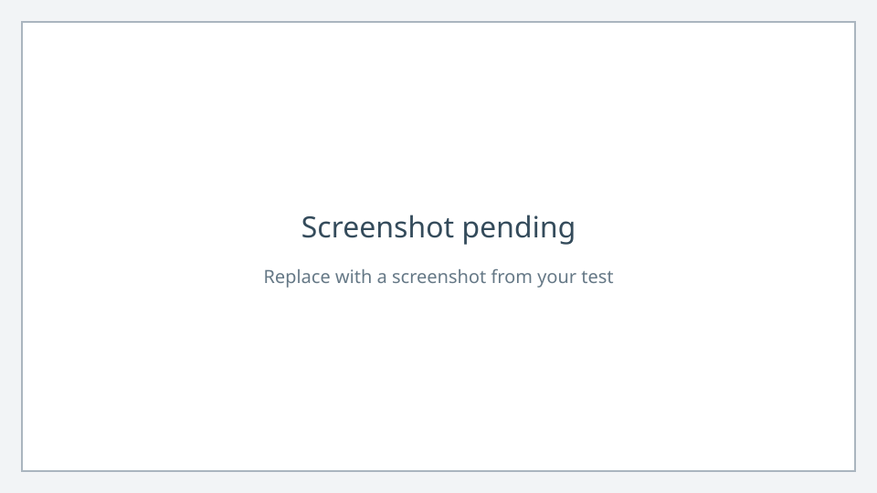

# Dify Workflow Demo and Audit

This chapter walks through the Dify trade finance demo first, then shows how to check your organization's own Dify workflows.

## 1. Complete the Dify demo

1. On the Console **Dify workflows** page, select **Open interactive demo**.
2. In the Dify trade finance demo, view **Risk version (风险版)** and select **View audit evidence (查看审计证据)**.
3. Switch to **Remediated version (整改版)** and compare the workflow and findings.
4. Select **Open Dify run (打开 Dify 运行)** and run the example as shown. Return to Console and select **View received requests (查看接收记录)** to check the run receipt.

_Screenshot pending: risk version, remediated version, and audit evidence._

_Screenshot pending: Dify run page and received requests in Console._

## 2. Check your Dify workflow

1. Ask an organization administrator to select **New connection** on the Console **Dify workflows** page, fill in the Dify address and sign-in details, save, and select **Test connection**.
2. In AgentSec Desktop, open Dify workflow audit under **AgentSec Engine → Rule Lab**, refresh connections, and choose a **Workflow / Chatflow** app and version.
3. Fetch and analyze the workflow. View the result in Desktop, then find the same report under **Client audit results** in Console.

_Screenshot pending: connection form, app selection, Desktop findings, and Console report. Redact sign-in details._

The report lists findings and the relevant nodes. After changing the workflow, run the check again to compare results. The check does not modify your Dify workflow.
