# 快速入門（跟我做）

> 預計用時：10 分鐘 | 您將完成：安裝 → 登錄 → 配置 → 第一次監控 → 看懂第一個分析結果

本教程會**帶着您一步一步操作**。請打開 AgentSec，跟着做。

如果您想直接使用配套示例完成後續安全分析，可以先下載 [UiPath 示例包](https://github.com/PolyUxAISecurity/AgentSec-UserDoc/raw/main/Demo/agentsec-uipath-demo.zip)，解壓後在後續步驟中把 `Demo` 文件夾設爲監控目錄。

---

## 1. 安裝並打開

### Windows 用戶

1. 從 [發佈頁](https://github.com/PolyUxAISecurity/AgentSec-Release/releases)下載當前版本的 Windows x64 ZIP 包（文件名包含版本號）
2. 解壓到一個新建目錄（如 `D:\AgentSec Client`）
3. 雙擊 `agentsec.exe`

> 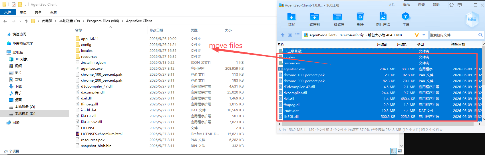

> 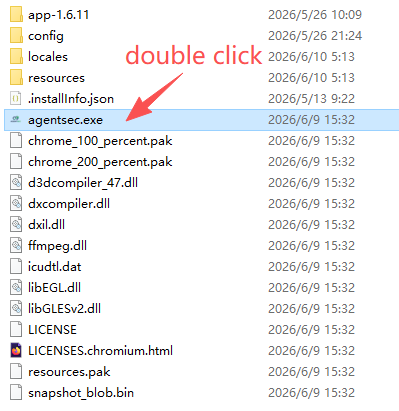

### macOS 用戶

1. 從 [發佈頁](https://github.com/PolyUxAISecurity/AgentSec-Release/releases)下載 `.dmg` 文件，雙擊掛載
2. 拖入 `Applications` 文件夾
3. 在「應用程序」中打開 **AgentSec Desktop**

---

## 2. 首次配置（引導向導）

打開應用後，會自動彈出引導向導。

如果需要重新配置：

點擊左側 ⚙「設置」→ 左側選「常規」→ 點擊頂部的 **「運行引導向導」** 按鈕。

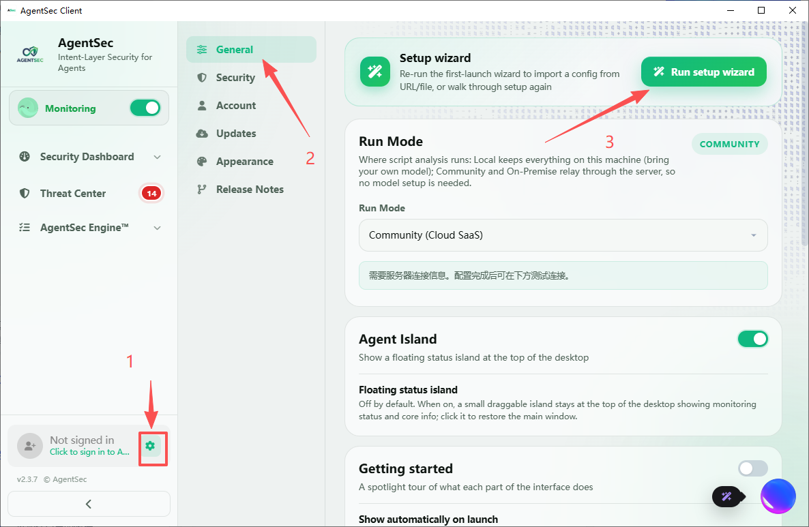

### 2.1 選擇使用方式

您會看到兩個選項：

> 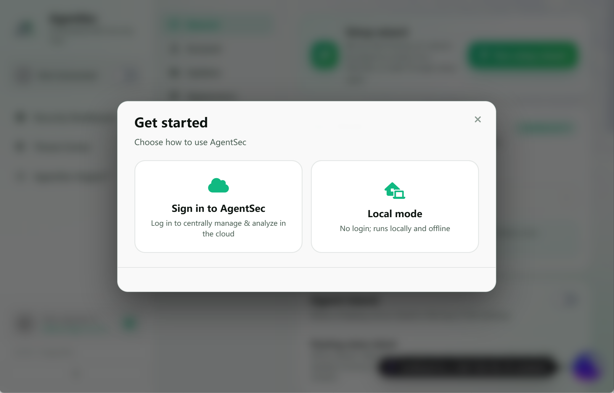

| 選項 | 適合誰 | 需要準備 |
|------|--------|---------|
| **從 AgentSec 登錄**（推薦👍） | 有賬號、能上網 | 一個郵箱（註冊賬號用） |
| **本地模式** | 不登錄 AgentSec，使用本機規則掃描 | 無需模型；使用 AI 功能時再配置自己的模型 |

> 💡 **不確定？選「從 AgentSec 登錄」**，這是最簡單的方式，不需要額外配置 AI。

### 2.2 登錄（選擇「登錄」的用戶）

1. 點擊「下一步」
2. 瀏覽器自動打開 AgentSec 登錄頁
3. 輸入郵箱和密碼（沒有賬號？點擊註冊）
4. 登錄成功後，瀏覽器會**自動回到應用**

> 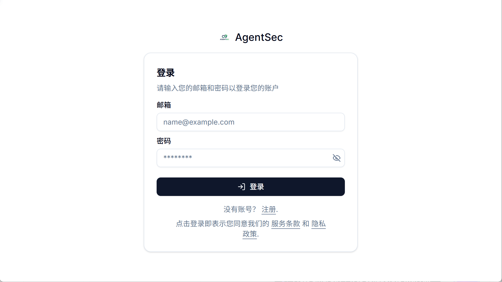
>
> 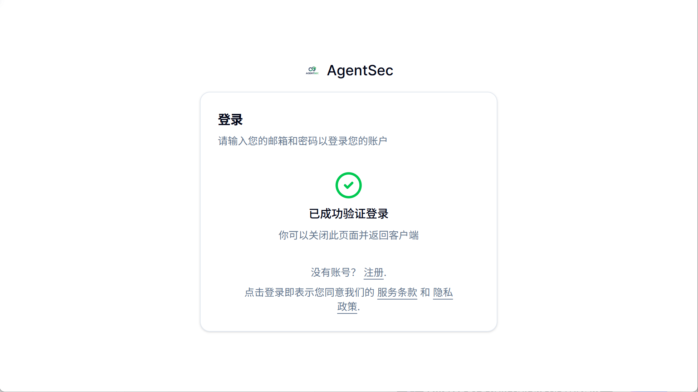

**成功標誌**：側邊欄底部出現您的郵箱和頭像。

> 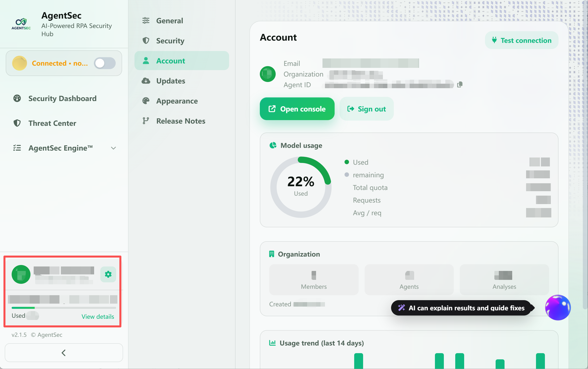
### 2.3 選擇監控目錄

點擊「添加目錄」，找到您存放 RPA 腳本的文件夾；在彈出的窗口中點擊「選擇文件夾」確認。

> 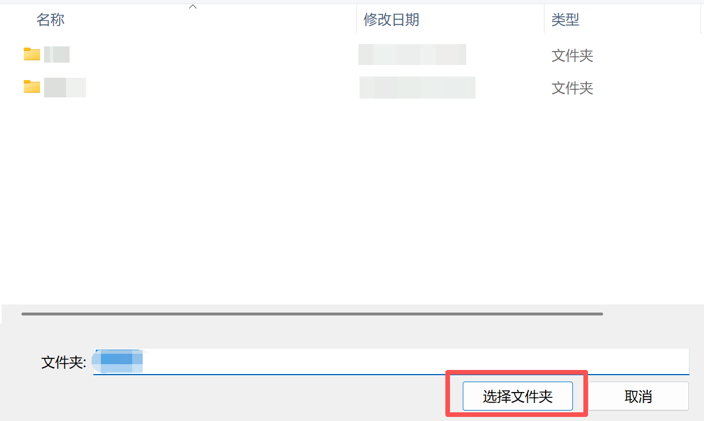
>
> 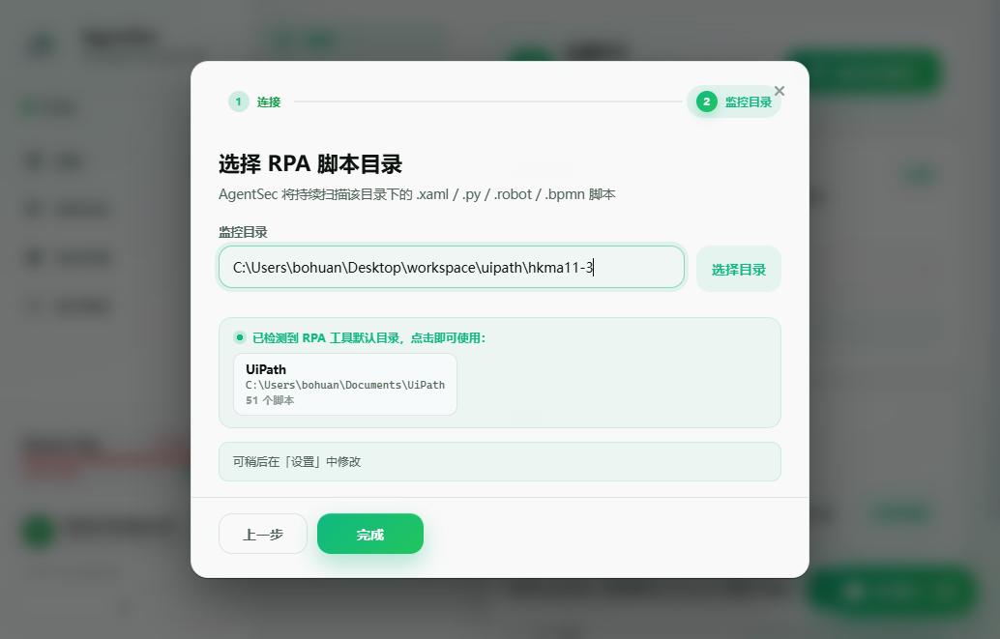

> 💡 如果電腦安裝了 UiPath，AgentSec 會自動檢測並顯示建議目錄，直接點擊即可。

### 2.4 配置 AI 模型（本地模式，可選）

本地模式最後會顯示 **「配置 AI 模型（可選）」**。不配置模型也能完成引導並使用規則掃描；配置後可使用 AI 研判和 AI 助手。

選擇供應商並填寫模型名稱，按供應商要求填寫 API Key；Ollama 等本機模型可留空。使用 Ollama 或 OpenAI 兼容服務時，覈對 **自定義 Base URL**。也可以以後在 **設置 → 常規 → 運行模式** 中填寫，並點擊 **測試 LLM**。

> 使用遠程模型服務時，AI 請求會發送到您配置的服務；只有使用本機模型時，AI 推理纔在本機完成。

---

## 3. 啓動第一次監控

引導完成後，您會看到**儀表盤**。

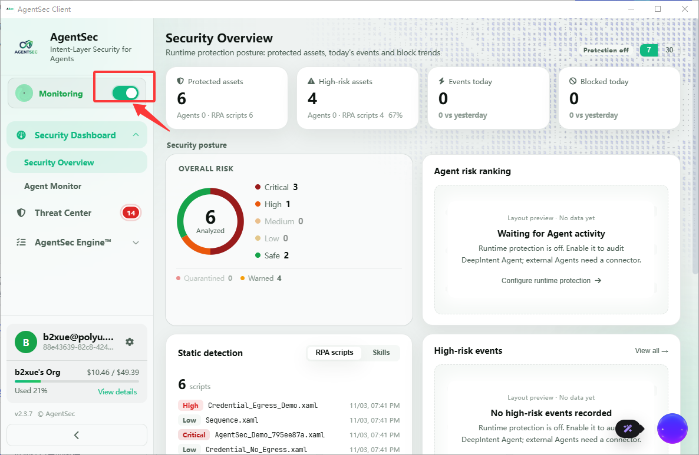

現在，點擊開關按鈕，啓動監控。

**您會立刻看到的變化：**

| 變化   | 說明                    |
| ---- | --------------------- |
| 監控開關 | 由關閉變爲開啓，狀態文字顯示爲 `監控中` |
| 分析結果 | 分析腳本數量與風險文件列表會隨掃描結果更新 |

**AgentSec 正在做什麼？**

AgentSec 會掃描監控目錄中的腳本，執行規則檢查，並按配置進行 AI 研判。風險結論和實際處置分別顯示；需要人工確認的高危建議，請到威脅中心複覈後處理。

---

## 4. 看懂分析結果

規則結果會先出現；AI 研判的等待時間取決於腳本、模型和服務響應，可在詳情中查看進度。

### 4.1 儀表盤概覽

| 看這裏        | 說明                   |
| ---------- | -------------------- |
| **總體風險** | 腳本風險等級及處置分佈 |
| **靜態檢測結果 → RPA 腳本** | 已檢測腳本和最近結果 |
| **風險趨勢 → 腳本分析** | 近 7 或 30 天的分析次數、高危量與攔截建議 |
| **Agent 風險排行、實時高危事件** | 已接入 Agent 的工具調用記錄；僅掃描腳本時可以暫無數據 |

### 4.2 進入威脅中心

點擊左側 **「威脅中心」**，查看每個腳本的詳情。

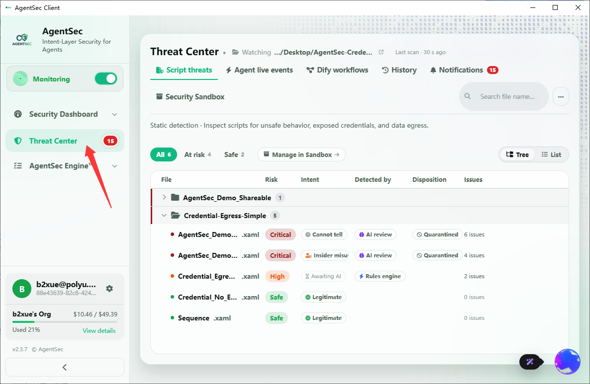

**點擊任意一個腳本**，展開右側詳情面板：

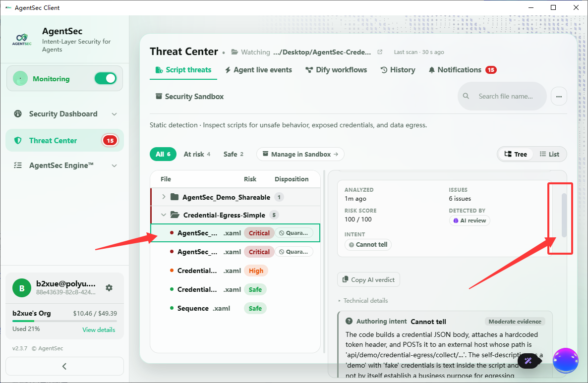

**三個關鍵信息**：
1. **💡 建議**：告訴您怎麼修復
2. **📝 代碼片段**：指出具體哪行有問題
3. **風險等級顏色**：紅 > 橙 > 黃 > 灰（越紅越緊急）

---

## 5. 如果腳本被攔截了

如果看到「已隔離」標籤，說明該文件已移入隔離區。若顯示待確認的高危建議，先查看證據，再決定是否隔離；高風險結論不一定代表已經執行隔離。

### 您確認它是惡意腳本？

保持隔離，不要點擊「信任」或還原。展開問題查看證據，並按組織流程處理該文件；原文件保存在 `.agentsec_quarantine` 目錄中，原路徑由安全樁替代。

### 您確認它是誤攔（腳本是安全的）？

1. 點擊該腳本 → 打開詳情面板
2. 點擊 **「信任」** 按鈕
3. 確認操作 → 文件移至「安全區」

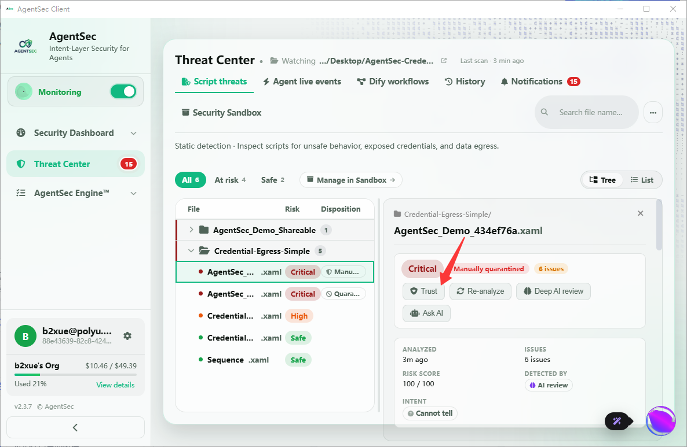

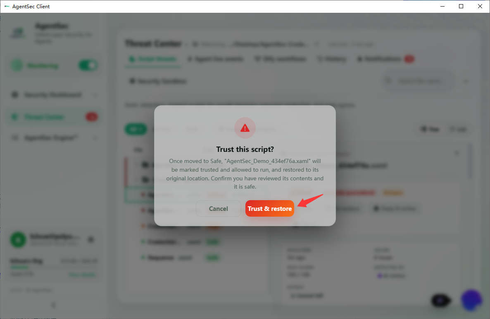

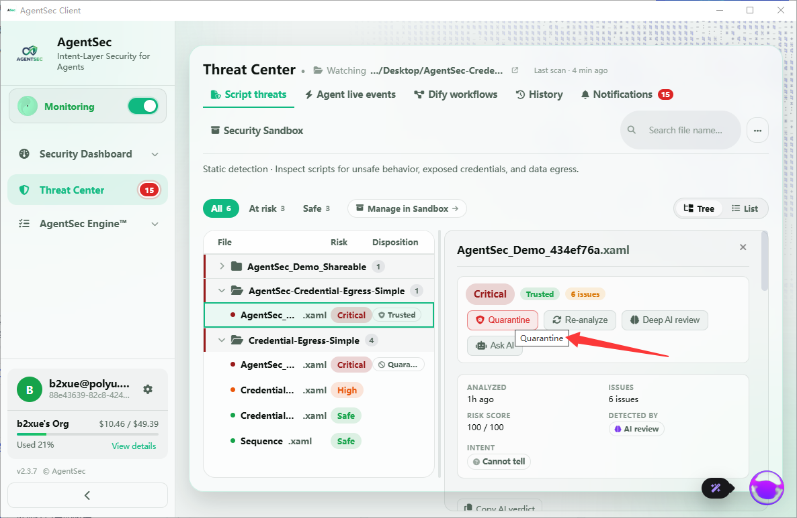

> 💡 還原後該文件內容不變，以後掃描會自動跳過。如果之後修改了文件，AgentSec 會重新分析。

---

## 6. 試用 AI 助手

按 **`Ctrl+K`**（Windows）或 **`Cmd+K`**（macOS），右側彈出 AI 助手面板。

試試問它：

> 「總結一下當前的腳本安全狀況」

> 「哪個腳本風險最高？爲什麼？」

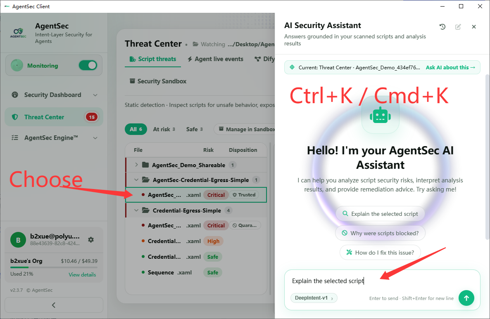

AI 會基於實際的監控數據和分析結果回答，不是套話。

---

## 7. 快速檢查：您上手了嗎？

- [ ] 監控成功啓動，並出現已分析腳本或風險文件
- [ ] 威脅中心中有已完成的分析記錄
- [ ] 點擊某個腳本，看到了詳細的問題列表（或「未發現安全問題」）

如果三項都完成，恭喜！🎉 您已經掌握 AgentSec 的基本使用。

---

## 接下來

| 我想... | 看這個 |
|---------|--------|
| 瞭解儀表盤每個數字的含義 | [02 — 儀表盤詳解](02-dashboard.md) |
| 看一個完整的「發現→分析→處理」案例 | [03 — 第一次安全分析](03-first-analysis.md) |
| 瞭解監控的細節和優化 | [04 — 監控配置詳解](04-monitoring.md) |
| 學習如何解讀分析結果 | [05 — 威脅中心（防護日誌）](05-security-log.md) |
| 管理被攔截和已信任的文件 | [06 — 安全沙箱](06-sandbox.md) |
| 調整安全檢測的嚴格程度 | [07 — 安全策略](07-security-policy.md) |
| 學習 AI 助手的全部能力 | [08 — AI 安全助手](08-ai-assistant.md) |
| 通過示例學習 AI 助手的用法 | [09 — AI 助手使用場景](09-ai-assistant-use-cases.md) |
| 配置賬戶、模型、更新等 | [10 — 設置詳解](10-settings.md) |
| 理解本文檔中的術語 | [11 — 關鍵概念](11-concepts.md) |
| 遇到問題怎麼辦 | [12 — 常見問題](12-faq.md) |
