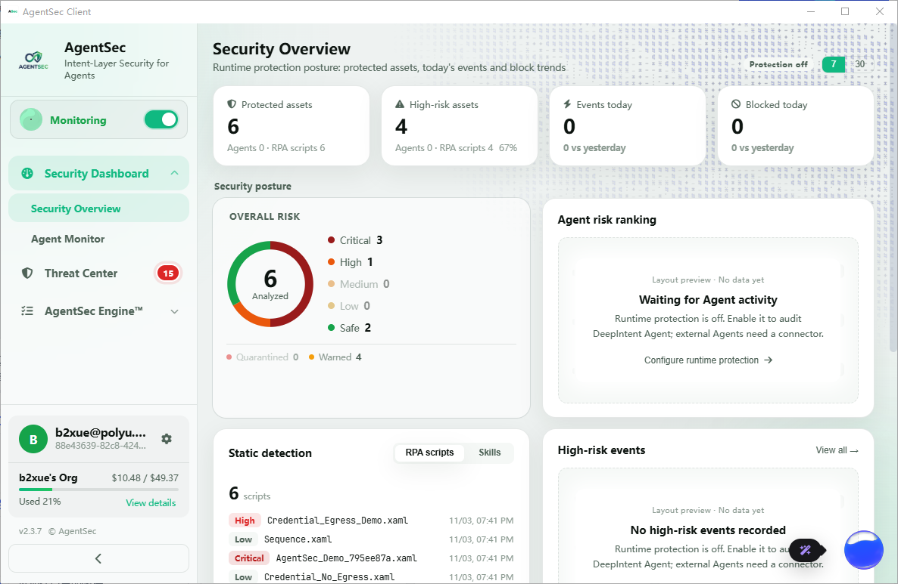
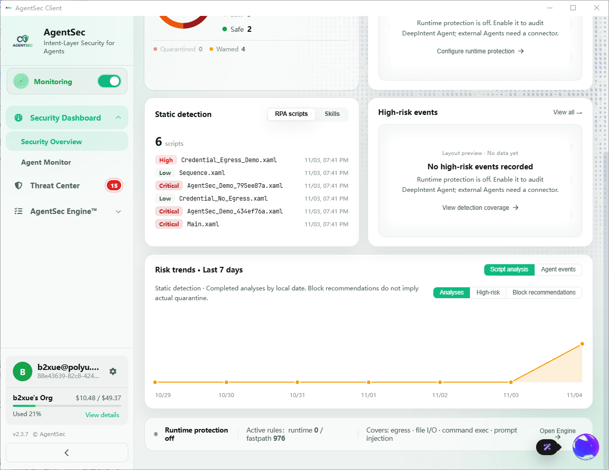
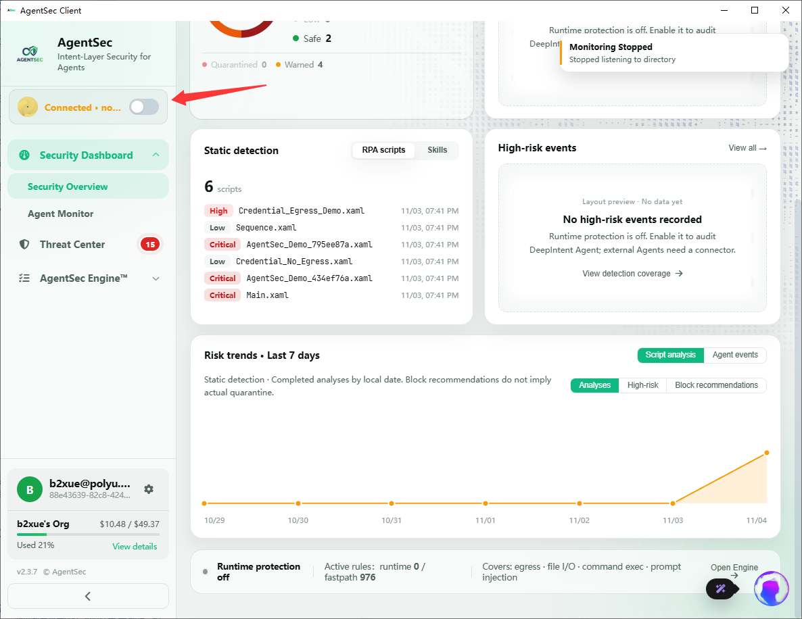

# 安全儀表盤使用指南

左側 **安全儀表盤** 下有 **安全總覽** 和 **Agent 監控** 兩個入口。安全總覽彙集腳本檢測與 Agent 運行時事件；Agent 監控用於查看某個 Agent 的活動和風險。

## 1. 查看安全總覽

| 區域 | 如何閱讀 |
| --- | --- |
| **受保護資產** | 查看 Agent 和 RPA 腳本數量 |
| **高危資產** | 查看存在高危風險的 Agent 和 RPA 腳本 |
| **今日事件 / 今日阻斷** | 查看當天記錄的運行時事件與實際拒絕的調用 |
| **總體風險** | 查看腳本風險等級和處置分佈 |
| **Agent 風險排行** | 按風險定位 Agent；點擊一行進入詳情 |
| **靜態檢測結果** | 在 **RPA 腳本** 中查看腳本數量和最近結果 |
| **實時高危事件** | 查看所屬 Agent、時間、風險和處置；點擊事件打開詳情，或點擊 **查看全部** |

**Skill** 標籤當前顯示「Skill 靜態檢測暫未開放」，不需要爲它準備掃描素材。

沒有記錄時，頁面會顯示「展示模板 · 尚無數據」及配置入口。模板圖形不是檢測結果；配置監控目錄或接入 Agent 併產生實際活動後，頁面會自動更新。

## 2. 切換趨勢統計

1. 在頁面右上選擇 **7** 或 **30** 天。
2. 在風險趨勢中選擇 **腳本分析** 或 **Agent 事件**。
3. 選擇要看的指標。

| 來源 | 指標含義 |
| --- | --- |
| **腳本分析** | 已完成的分析次數、高危量、攔截建議 |
| **Agent 事件** | 工具事件量、高危量、實際阻斷量 |

腳本的「攔截建議」表示分析建議，不等於文件已經隔離。Agent 事件的阻斷量統計實際拒絕的調用。

## 3. 啓動或停止腳本監控

側邊欄頂部的狀態卡片顯示連接和監控狀態，右側開關用於啓停已配置目錄的腳本監控。

先在 **設置 → 安全配置 → 監控目錄** 添加文件夾，再開啓監控。點擊狀態球也可進入目錄配置。目錄操作見 [監控與目錄配置](04-monitoring.md)。

腳本監控開關與 **運行時防護** 是兩個功能。需要 Agent 工具調用記錄時，請在 **設置 → 安全配置** 開啓運行時防護並接入所需的外部 Agent，詳見 [Agent 運行時防護與監控](agent-runtime.md)。

## 4. 查看 Agent 監控

1. 展開側邊欄 **安全儀表盤**，點擊 **Agent 監控**。
2. 在列表中按名稱或 ID 搜索，點擊需要查看的 Agent。
3. 查看風險評分、近期活動、今日事件、累計阻斷、待審批和活躍會話等信息。
4. 在詳情下方切換標籤頁。

| 標籤頁      | 內容                   |
| -------- | -------------------- |
| **概覽**   | 風險來源分佈與關聯資產、工具、Skill |
| **審計日誌** | 該 Agent 的工具調用審計記錄    |
| **會話鏈路** | 按會話查看相關活動            |
| **關聯策略** | 查看該 Agent 命中的規則      |

DeepIntent Agent 已內置接入，界面標明 **僅審計**；純文本對話不計爲工具調用事件。外部 Agent 完成接入併產生受支持的工具調用後，纔會出現相應審計和處置記錄。

## 5. 常用導航

| 入口 | 用途 |
| --- | --- |
| **威脅中心** | 查看腳本威脅、Agent 實時事件、Dify 工作流、歷史記錄、通知和安全沙箱 |
| **AgentSec Engine™** | 查看引擎模塊、規則實驗室和策略市場 |
| **側邊欄底部賬戶 / 用量** | 查看當前身份和組織額度 |
| **側邊欄底部齒輪** | 打開設置 |
| **右下角 AI 助手** | 打開 DeepIntent Agent；也可按 `Ctrl+K` / `Cmd+K` |

接下來可查看 [威脅中心](05-security-log.md)、[Dify 工作流審計](dify.md)或 [AI 助手](08-ai-assistant.md)。
