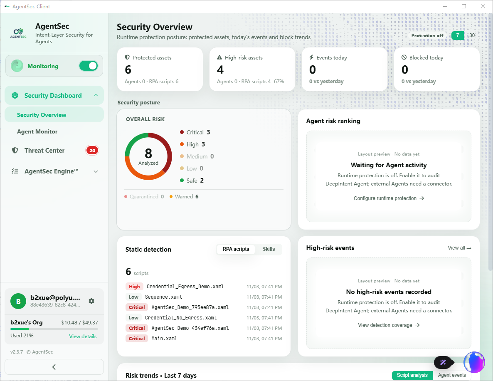
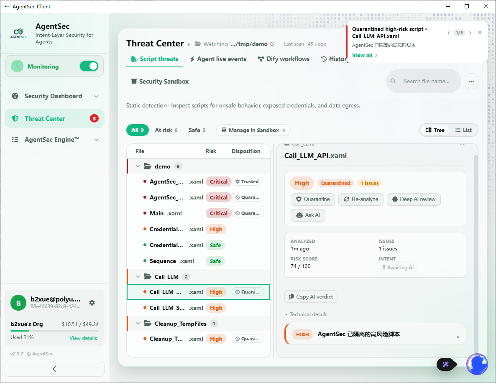

# 第一次安全分析：三個 UiPath 工作流案例

> 本頁以三個 UiPath XAML 工作流爲例，演示從啓動監控、查看分析結果到處理風險文件的完整流程。

---

## 場景準備

假設您的監控目錄 `C:\Users\Documents\UiPath` 中有三個腳本：

| 文件                       | 用途                          | 主要安全特徵                                  |
| ------------------------ | --------------------------- | --------------------------------------- |
| `Call_LLM_API.xaml`      | 調用大模型生成工單摘要，再將結果回帖到 Slack   | 在工作流中直接寫入 API Key 和 Slack Token         |
| `Call_LLM_Secure.xaml`   | `Call_LLM_API.xaml` 的安全改寫版本 | 從 Orchestrator Assets 讀取憑據，幷包含異常處理和安全日誌 |
| `Cleanup_TempFiles.xaml` | 調用 PowerShell 清理文件          | 執行鍼對系統盤根目錄的強制遞歸刪除命令                     |

> 示例中的密鑰、Token、接口地址和頻道編號均爲演示值，不是真實憑據。

如果您想跟着本章復現，可以先下載配套的 [UiPath 示例包](https://github.com/PolyUxAISecurity/AgentSec-UserDoc/raw/main/Demo/agentsec-uipath-demo.zip)。解壓後，將 `Demo` 文件夾放到一個測試目錄，並在 AgentSec 中把該目錄設爲監控目錄。

示例包中包含三個工作流：`Call_LLM_API.xaml`、`Call_LLM_Secure.xaml` 和 `Cleanup_TempFiles.xaml`，後續各階段會逐個說明它們的分析結果和處理方式。

配置好目錄後，使用側欄頂部 **「監控開關」** 開啓監控；也可進入 **設置 → 安全配置 → 監控開關**。

---

## 階段一：掃描與發現

啓動監控後，AgentSec 會掃描 `C:\Users\Documents\UiPath`，發現三個 `.xaml` 文件並依次創建分析任務。掃描完成後，儀表盤會更新腳本數量和初步分析結果。

**您看到的畫面：**



## 階段二：安全檢查

每個腳本先經過規則掃描。命中規則後，結果會註明規則來源和建議動作；沒有命中時，按當前配置繼續進行 AI 研判，或顯示僅規則掃描結果。規則掃描與 AI 研判分別顯示進度。

### 第1關：正則快速掃描

本章用三份腳本觀察以下風險。實際命中的規則、問題數量和風險等級，以當前生效策略及客戶端結果爲準：

| 腳本                       | 正則結果                                             | 處理         |
| ------------------------ | ------------------------------------------------ | ---------- |
| `Call_LLM_API.xaml`      | 檢查硬編碼憑據和外部請求 | 查看問題詳情與建議動作 |
| `Call_LLM_Secure.xaml`   | 檢查憑據讀取和請求處理 | 覈對是否仍有需要處理的問題 |
| `Cleanup_TempFiles.xaml` | 檢查系統目錄遞歸刪除命令 | 命中攔截規則時按處置策略隔離 |

默認處置方式下，規則給出的攔截決定會自動隔離；AI 給出的攔截建議需要您在威脅中心確認後點擊 **「隔離」**。風險等級與文件是否已隔離是兩項信息，請分別查看。

`Cleanup_TempFiles.xaml` 被隔離後：
- 原始文件 → `.agentsec_quarantine\Cleanup_TempFiles_20260609T093000Z.xaml`
- 原路徑 → 安全樁文件，代替原腳本邏輯

### 第2關：AI 深度分析

未命中規則且已啓用 AI 研判的腳本會調用配置的模型。若某個腳本已由規則給出結果，但您仍想查看模型分析，可在其詳情中點擊 **「AI 深度研判」**。

**Call_LLM_API.xaml 的分析過程**（登錄模式）：

```
AgentSec 規則掃描 → 按配置調用 AI 模型
  ↓
檢查項目（基於您啓用的安全策略規則）:
  · 是否向外部發送數據？（網絡請求檢查）
  · 是否包含硬編碼密碼？（憑證檢查）
  · 是否使用明文 HTTP？（傳輸安全檢查）
  · 是否有異常處理？（代碼質量檢查）
  · 是否有 SQL 注入風險？（注入檢查）
  ...（檢查範圍取決於當前策略和啓用的分析引擎）
  ↓
返回分析結果
```

---

## 階段三：查看結果

分析完成後，在左側導航欄點擊 **「威脅中心」**，再從腳本列表中選擇文件查看詳情。



| 文件                       | 重點核對                       |
| ------------------------ | -------------------------- |
| `Call_LLM_API.xaml`      | 憑據與外部請求問題、檢出方式、建議動作及當前處置狀態 |
| `Call_LLM_Secure.xaml`   | 是否檢出問題，以及本次是否完成 AI 研判      |
| `Cleanup_TempFiles.xaml` | 刪除命令的規則證據，以及是否已隔離          |

這裏可以看到三個典型結果：

- **Safe**：未發現安全問題，文件可繼續使用；
- **High**：存在高危問題，需要修復或人工確認；
- **Critical**：存在可能造成嚴重破壞的操作，應優先處理。

截圖中的問題數和等級是示例。請以您當前版本的結果爲準，並同時覈對 **「檢出方式」** 與 **「已隔離／整改中」** 等處置標籤。

> 分析詳情頁還提供 **「信任」**、**「重新分析」** 和 **「詢問 AI」** 等操作。只有在確認文件安全後，才應使用「信任」。

---

## 階段四：逐個解讀

### 腳本一：`Call_LLM_API.xaml`——檢查憑據風險

#### 工作流做了什麼

該工作流先構造工單摘要請求，通過 HTTP 接口調用大模型；隨後構造 Slack 消息，並通過另一個 HTTP 請求發送回帖。

#### AgentSec 的判定
重點查看 XAML 中的明文 API Key、Slack Token 和疑似密碼字段，以及它們如何進入外部請求。硬編碼憑據告警不等於文件已經隔離；請根據詳情中的建議和處置狀態處理。

**處理建議：** 刪除明文憑據，輪換已經暴露的密鑰，並改用 UiPath Orchestrator Asset 或其他密鑰管理服務。

---

### 腳本二：`Call_LLM_Secure.xaml`——覈對整改方式

#### 與高風險版本有什麼不同

安全版本仍然完成“調用 LLM 生成摘要並回帖到 Slack”的業務流程，但採用了更安全的實現：

| 改進 | XAML 中的實現 |
| --- | --- |
| 不保存明文憑據 | 使用 `GetRobotAsset` 讀取 `LLM_Gateway_ApiKey` 和 `Slack_Bot_Token` |
| 運行時傳入令牌 | HTTP 請求使用 `OAuthToken` 變量，不在請求頭中寫死 Token |
| 限制請求行爲 | 啓用 TLS、設置超時，並配置有限次數的重試 |
| 檢查響應狀態 | 對非 2xx HTTP 狀態主動拋出異常 |
| 處理運行異常 | 使用 `TryCatch` 包裹 LLM 與 Slack 調用 |
| 減少日誌泄露 | 只記錄成功狀態、HTTP 狀態、耗時和響應長度等元數據 |

#### AgentSec 的判定
該工作流實現了相同的 LLM 與 Slack 調用，但憑據從 Orchestrator Assets 讀取，並加入了異常處理、HTTP 狀態檢查和安全日誌。查看當前報告，覈對這些改動是否解決了已發現的問題；若僅完成規則掃描，不要將其理解爲已完成 AI 審查。

---

### 腳本三：`Cleanup_TempFiles.xaml`——檢查危險刪除命令

該工作流名義上用於清理臨時文件，但其 PowerShell 活動實際執行：

```powershell
Remove-Item -Recurse -Force -Path C:\
```

該命令會嘗試從系統盤根目錄開始強制遞歸刪除。查看命中的規則及處置狀態；默認處置方式下，命中攔截規則會自動隔離。

**處理建議：** 不要直接信任或還原；應將刪除目標改爲明確、受控的臨時目錄，並在執行前校驗路徑和使用 `-WhatIf` 預演。

---

## 階段五：處理與修復

| 文件 | 主要處理 |
| --- | --- |
| `Call_LLM_API.xaml` | 輪換已暴露的憑據，刪除明文密鑰，並參考安全版本改用 Orchestrator Assets |
| `Call_LLM_Secure.xaml` | 覈對報告後，按正常流程測試接口權限和業務邏輯 |
| `Cleanup_TempFiles.xaml` | 刪除系統盤遞歸刪除命令，改用經過校驗的明確目標目錄 |

已隔離文件可在 **威脅中心 → 安全沙箱** 點擊 **「轉入整改」**，再點擊 **「編輯」** 修改隔離副本。保存後點擊 **「再次檢測」**；複檢不再建議隔離時，可人工確認 **「信任並放入安全區」**，還原到原始位置。未隔離文件修改保存後，可點擊 **「重新分析」**。

> 請從安全沙箱的「編輯」入口修改隔離副本，不要修改原路徑上的安全樁或隔離元數據。

---
## 總結：第一次分析的收穫

| 學到的                 | 說明                            |
| ------------------- | ----------------------------- |
| AgentSec 掃描是**自動的** | 啓動監控後全程自動，不需要手動觸發             |
| 檢查分階段進行 | 先運行規則，按配置啓用 AI；結果中可查看實際參與引擎 |
| 隔離副本可整改與還原 | 保留的隔離副本可複檢，確認安全後由用戶信任並還原 |
| 詳情要看三個地方            | 風險等級、代碼片段、修復建議                |
| 風險與處置分別查看 | 規則或 AI 的發現、建議動作和文件是否已隔離需要一起覈對 |

---

## 下一步

- [配置和管理監控目錄](04-monitoring.md)
- [查看威脅中心的完整分析詳情](05-security-log.md)
- [管理隔離區與安全區](06-sandbox.md)
- [配置安全策略](07-security-policy.md)
- [使用 AI 助手解釋和修復問題](08-ai-assistant.md)
