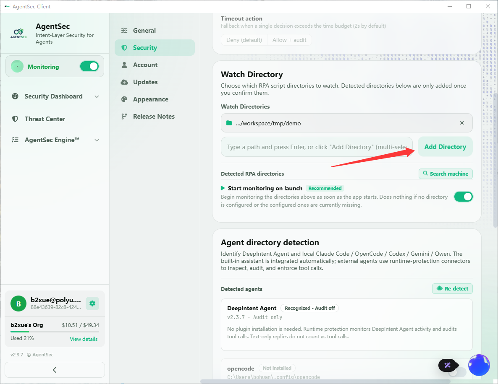
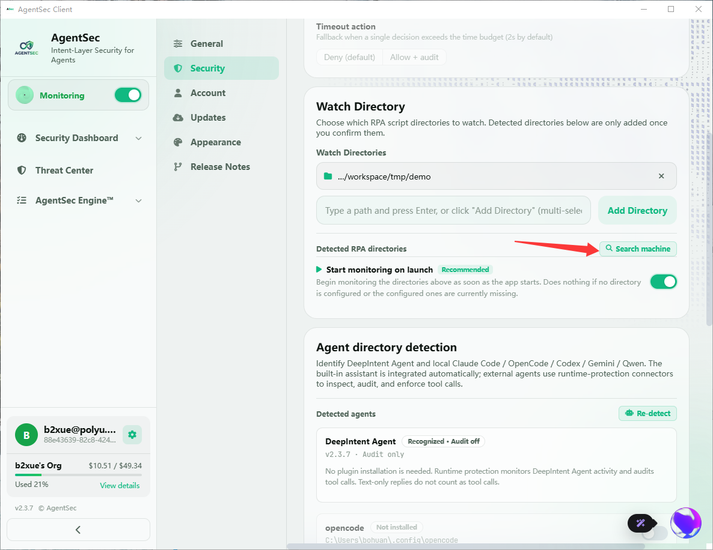
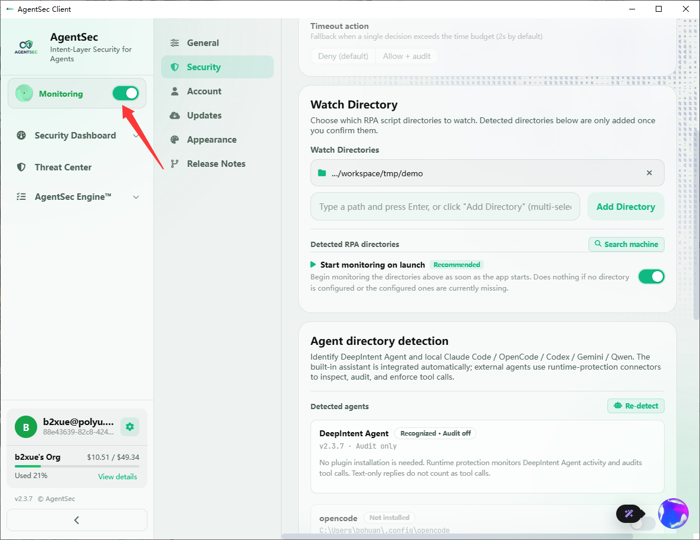

# 監控配置與使用指南

> 監控是 AgentSec 的核心功能。啓動後，AgentSec 會持續監視您指定的目錄，自動檢測新增或修改的腳本並觸發安全分析。

---

## 什麼是「監控」？

AgentSec 的監控功能包含以下自動操作：

1. **發現腳本**：掃描指定目錄中的所有 RPA 腳本
2. **實時監聽**：目錄中有新文件或文件被修改時，自動觸發分析
3. **安全檢查**：先運行規則掃描，再按配置進行 AI 研判
4. **風險處理**：按規則和處置策略隔離，或顯示告警供您確認

---

## 如何選擇監控目錄？

### 在設置中添加目錄

1. 點擊側欄底部的 **「設置」**
2. 選擇 **「安全配置」**
3. 點擊「選擇目錄」按鈕
4. 支持**多目錄同時監控**：可添加多個文件夾路徑

### 使用自動檢測

AgentSec 會自動檢測您電腦上已安裝的 RPA 工具，將其默認項目目錄列在建議區：

| 可能檢測到的工具 | 默認目錄 |
|----------------|---------|
| UiPath | `Documents\UiPath` |
| Power Automate Desktop | `Documents\Power Automate Desktop` |
| Automation Anywhere | `Documents\Automation Anywhere Files` |

> 💡 直接點擊建議目錄即可自動填入，無需手動翻找。

### 選擇目錄的原則

| ✅ 推薦 | ❌ 不推薦 |
|--------|----------|
| RPA 項目專用目錄 | C 盤根目錄 |
| 腳本集中存放的文件夾 | 系統目錄（Windows / Program Files） |
| 某個項目的子目錄 | 包含大量非腳本文件的目錄 |

---

## 啓動 / 停止監控

### 啓動

1. 確認「監控目錄」已正確設置
2. 點擊開啓**「監控」** 開關

啓動監控後，AgentSec 會掃描已有文件，開始監聽新增或修改的腳本，並將分析結果實時推送到界面。默認處置方式下，攔截級規則命中會自動隔離；AI 的攔截建議需要您在威脅中心確認後點擊「隔離」。

### 停止

- 關閉**「監控」** 開關
- 停止後：
  - 不再監聽新文件
  - 正在進行的分析會繼續完成
  - 已分析的結果保留在界面上

---

## 監控過程中會發生什麼？

監控過程中，AgentSec 先完成基礎過濾和規則掃描。規則命中後會顯示對應發現和建議動作；規則未命中時，按配置繼續進行 AI 研判。規則給出結果後如需模型補充，可在腳本詳情點擊「AI 深度研判」。

### 第1關：基礎過濾

進入分析前，AgentSec 會先排除以下文件：
- 臨時文件（名稱以 `~$` 或 `.` 開頭、後綴 `.tmp` / `.swp`）
- 不支持的腳本類型
- 已被加入白名單（信任列表）且內容未變的文件

### 第2關：正則預掃（毫秒級）

使用當前生效規則集快速掃描；規則數量會隨策略和規則更新變化。典型檢查包括：

| 類別 | 示例 |
|------|------|
| 系統破壞 | `rm -rf /`、格式化 C 盤 |
| 勒索軟件 | 刪除卷影副本、禁用系統恢復 |
| 惡意代碼執行 | 從網絡下載並直接執行、PowerShell 加密繞過 |
| 憑據竊取 | Mimikatz、轉儲 lsass 進程 |
| 硬編碼密鑰 | AWS 密鑰、GitHub Token、SSH 私鑰 |

> 規則命中可能建議攔截或僅告警。例如，硬編碼憑據本身可以產生告警；是否隔離應看規則動作及文件的實際處置狀態。

### 第3關：AI 深度分析

規則未命中的腳本在啓用 AI 研判後調用有效模型配置進行分析。登錄模式使用組織提供的模型服務，本地模式使用您配置的模型接口；耗時取決於模型、腳本內容和網絡。

AI 關閉時顯示僅規則掃描結果。AI 未能完成時，頁面會說明未完成或降級狀態；請查看本次實際參與的引擎，不要將規則掃描通過理解爲已完成 AI 審查。

---

## 監控範圍

AgentSec 會遞歸監控您選擇的目錄（最多 10 層子目錄），但會自動跳過以下目錄：

- `node_modules`、`__pycache__`、`.venv` — 依賴緩存目錄
- `.git`、`.svn` — 版本控制目錄
- `.idea`、`.vscode` — IDE 配置目錄
- `$RECYCLE.BIN`、`System Volume Information` — 系統目錄
- `.agentsec_quarantine` — AgentSec 自己的隔離目錄

---

## 大目錄的處理方式

啓動掃描時，AgentSec 採用兩段式處理：

| 階段 | 處理方式 |
| --- | --- |
| 規則掃描 | 先快速檢查目錄內腳本，並按規則動作和處置策略處理命中項 |
| AI 研判 | 啓用後對需要進一步分析的腳本進行模型研判，結果陸續更新 |

規則掃描與 AI 研判分別顯示進度。規則進度完成後，AI 仍可能繼續運行；請同時查看文件條目和 AI 進度。

---

## 文件狀態說明

分析完成後，腳本文件會根據分析結果處於不同狀態：

| 狀態 | 標記 | 含義 | 文件權限 |
|------|------|------|---------|
| 已隔離 | `已隔離`（紅色標籤） | 被判定爲需要攔截，已移入隔離區 | 原路徑被安全樁替換 |
| 整改中 | `整改中` | 已隔離文件正在編輯與複檢 | 原路徑仍爲安全樁 |
| 待人工處理 | 風險等級及「隔離」操作 | AI 建議隔離，等待用戶確認 | 文件保持原樣 |
| 未隔離 | 無隔離標籤 | 未執行隔離，仍需結合風險和引擎狀態審查 | 不因告警改爲只讀 |

> 未隔離不代表沒有風險。風險等級、檢出方式和實際處置狀態應分別查看。

---

## 監控目錄變更

如果您需要更換監控目錄：

1. 如果監控正在運行，**先停止監控**
2. 在 **設置 → 安全配置 → 監控目錄** 中修改目錄；也可點擊側欄頂部狀態球跳轉到目錄配置
3. 重新點擊開啓「監控」開關
4. AgentSec 會對新目錄重新全量掃描

---

## 常見問題

**Q: 爲什麼有些腳本分析很快，有些很慢？**
A: 規則掃描通常較快；需要 AI 研判的腳本還需等待模型返回。耗時會隨腳本大小、模型和網絡變化。

**Q: 監控對系統性能有影響嗎？**
A: 文件監聽使用操作系統事件通知。批量掃描和 AI 研判會佔用一定資源；分析速度和資源使用與目錄大小、模型和硬件有關。

**Q: 關閉應用後監控還繼續嗎？**
A: 不會。AgentSec 必須保持運行才能監控。建議將 AgentSec 設爲開機自啓。
