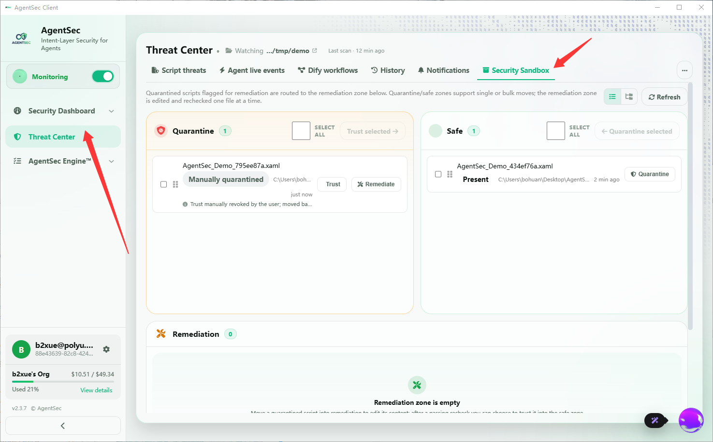
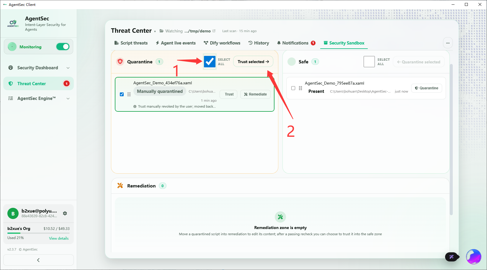
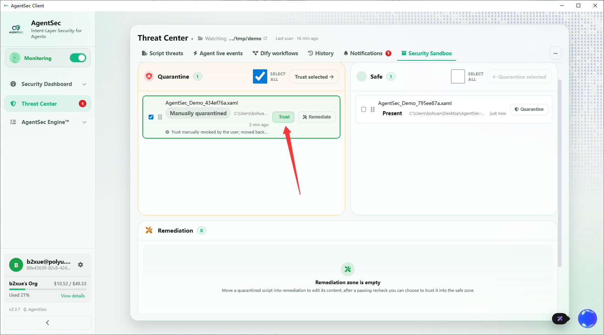
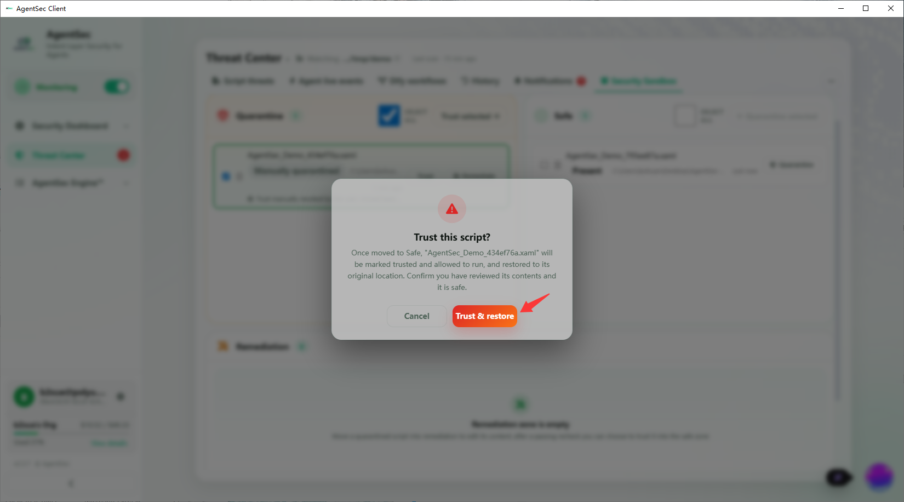
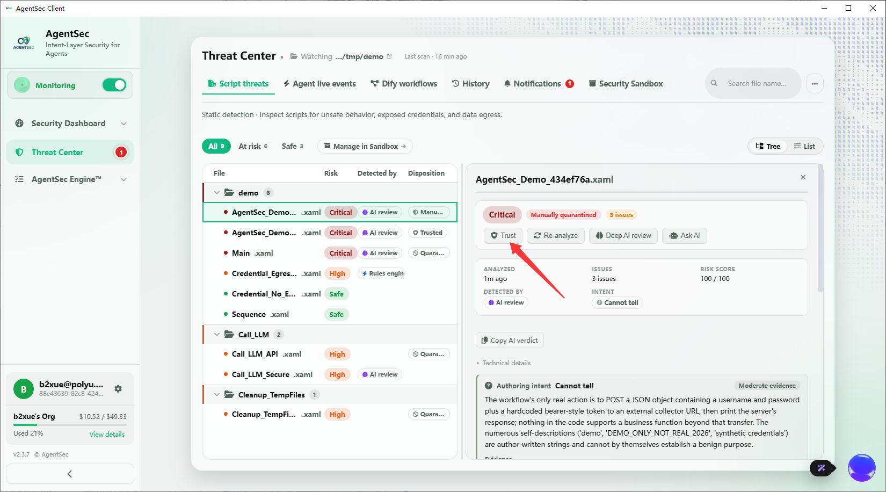
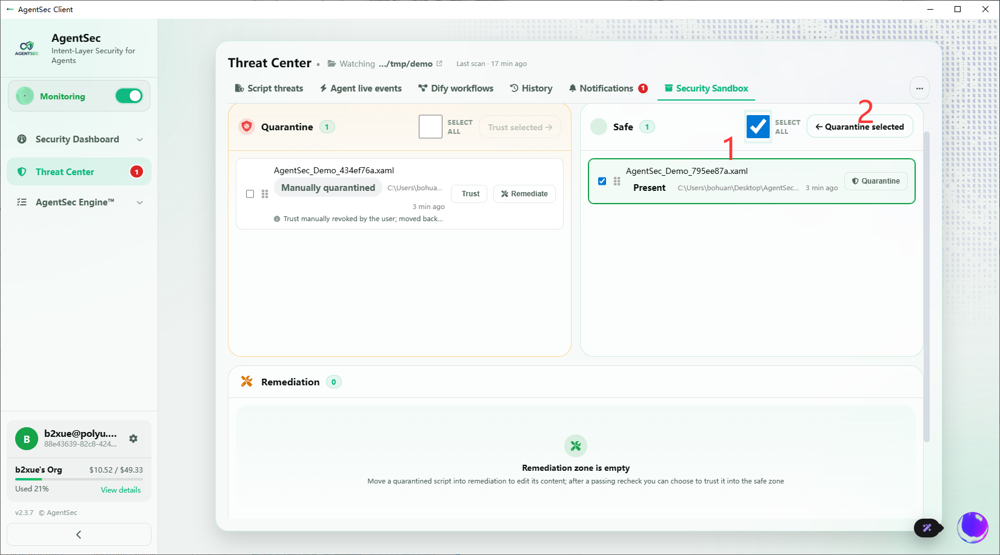

# 安全沙箱 — 隔離、整改與還原

> 安全沙箱用於管理被 AgentSec 攔截的腳本，支持將誤攔的文件還原，或將信任的文件重新隔離。

---

## 什麼是安全沙箱？

安全沙箱用於管理隔離和信任的文件，並提供整改入口：

| 區域  | 用途                      |
| --- | ----------------------- |
| 隔離區 | 存放被 AgentSec 攔截、等待審查的腳本 |
| 安全區 | 存放已確認可信、已從隔離區還原的腳本      |
| 整改區 | 編輯和複檢隔離副本；文件仍處於隔離狀態     |

---

## 打開安全沙箱

安全沙箱已整合進**威脅中心**。在左側導航欄點擊 **「威脅中心」**，再點擊頂部的 **「安全沙箱」** Tab。



---

## 隔離區 — 被攔截的文件

### 什麼情況下腳本會進入隔離區？

- 默認處置方式下，命中攔截級規則
- AI 建議攔截後，用戶查看證據並點擊「隔離」
- 用戶手動將安全區的文件移回隔離區

### 隔離時發生了什麼？

當腳本被判定需要隔離時，AgentSec 會嘗試終止正在運行的相關進程，將原文件移入隔離區，在原路徑生成安全樁文件，並記錄隔離元數據。

### 隔離區條目信息

每個隔離區條目顯示：

| 信息 | 說明 |
|------|------|
| 文件名 | 被隔離的腳本文件名稱 |
| 風險等級 | `CRITICAL` / `HIGH` 標籤 |
| 原始路徑 | 文件被隔離前的完整路徑 |
| 隔離時間 | 何時被隔離 |

---

## 安全區 — 已信任的文件

### 什麼情況下文件進入安全區？

- 從隔離區還原後，**自動加入**安全區
- 加入時會計算文件的 SHA-256 哈希值

### 安全區的「文件存在」標記

| 標記 | 含義 |
|------|------|
| ✅ `文件存在`（綠色） | 記錄的原路徑上仍有文件 |
| ❌ `文件不存在`（紅色） | 文件已被刪除或移動 |

### 內容變更檢測

安全區不只記錄路徑，還記錄了文件的 **SHA-256 哈希值**。如果文件內容後來被修改：
- AgentSec 會**自動將其移出安全區**
- 觸發重新分析
- 確保「已信任」的文件不會因爲被篡改而成爲安全漏洞

---

## 操作指南

### 從隔離區還原文件（隔離 → 安全）

如果某個腳本被誤攔，您可以將它還原：

**方式一：選擇文件還原**

1. 在隔離區勾選要還原的文件
2. 點擊 **「批量信任」** 按鈕
3. 確認操作







**方式二：拖拽還原**

1. 在隔離區勾選文件
2. 將文件拖拽到右側「安全區」

**方式三：從防護日誌還原**

1. 在威脅中心的「腳本威脅列表」中找到被隔離的腳本
2. 點擊展開詳情面板
3. 點擊 **「信任」** 按鈕



還原時，AgentSec 會刪除安全樁文件，將隔離文件移回原路徑，計算文件哈希並加入信任列表。只要文件內容不變，後續掃描不會重複分析。

### 將文件重新隔離（安全 → 隔離）

如果之前還原的文件經過審查發現確實有風險，或想撤銷信任：

1. 在安全區勾選要重新隔離的文件
2. 點擊上方 **「批量隔離」** 按鈕

文件會被從安全區移除，重新執行隔離流程。



### 在整改區修改並複檢

1. 在隔離區找到需要修復的腳本，點擊 **「轉入整改」**。
2. 在下方整改區點擊 **「編輯」**，用系統默認程序打開隔離副本，修改並保存。需要選擇其他編輯器時，可從威脅中心右上角「⋯」打開隔離區文件夾。
3. 點擊 **「再次檢測」**，檢查剛保存的內容，並查看更新後的結果。
4. 複檢仍建議隔離時，繼續修改；複檢通過後，人工複覈並選擇 **「信任並放入安全區」**，文件還原到原位置。
5. 暫不繼續修改時，點擊 **「退回隔離」**。

轉入整改或退回隔離只改變管理分區，原路徑仍爲安全樁。整改區按文件逐個編輯、複檢，不參與批量信任和拖拽。

### 多選操作

- 勾選單個文件的複選框
- 點擊「全選」可一次選中當前區域全部文件
- 選中後可通過批量按鈕或拖拽進行統一操作

### 複製詳情與永久刪除

在已隔離腳本的詳情中，可點擊 **「複製詳情」** 保存隔離信息。確認無需保留原文件時，可點擊 **「永久刪除」** 並確認；它會刪除隔離的原文件及其元數據，原路徑上的安全樁保留。此操作完成後，不能再從隔離區還原該副本。

---

## 物理文件位置

隔離的文件存儲在**原腳本所在目錄的 `.agentsec_quarantine` 子目錄**中：

```
原腳本目錄/
├── Main.xaml              ← 安全樁，代替原腳本邏輯
├── Process.py              ← 安全樁，代替原腳本邏輯
├── .agentsec_quarantine/   ← 隔離目錄（AgentSec不會重複掃描）
│   ├── Main_20260101T120000Z.xaml      ← 被隔離的原文件
│   ├── Main_20260101T120000Z.xaml.meta.json ← 隔離元數據
│   ├── Process_20260102T093000Z.py
│   └── Process_20260102T093000Z.py.meta.json
└── ...
```

> 修改隔離副本請使用整改區的「編輯」入口。不要修改安全樁或 `.meta.json` 元數據；還原和信任請通過 AgentSec 完成。

---

## 安全樁文件

被隔離後，原路徑會留一個**安全樁（Stub）**文件，用來說明情況：

- **Python 腳本**的樁：打印警告信息並以錯誤碼退出
- **UiPath 腳本**的樁：一個空的 Sequence，包含 `Terminate` 活動
- **其他類型**的樁：純文本警告

原腳本邏輯不會由這些樁文件執行。

---

## 常見問題

**Q: 還原後文件會被重新分析嗎？**
A: 不會。還原時文件自動加入白名單並記錄 SHA-256 哈希值。只要內容不變，後續掃描會跳過。

**Q: 如果還原後修改了文件內容呢？**
A: AgentSec 會在下次掃描時檢測到哈希變化，自動將文件移出白名單並重新分析。這是有意爲之——您改了代碼就應該重新檢查。

**Q: 可以手動把文件加入安全區嗎？**
A: 當前版本不支持手動添加。安全區文件來自隔離區還原。

**Q: 安全區文件被刪除了怎麼辦？**
A: 安全區會標記爲「文件不存在」。先覈對原路徑，確認文件是否已被移動或刪除。
