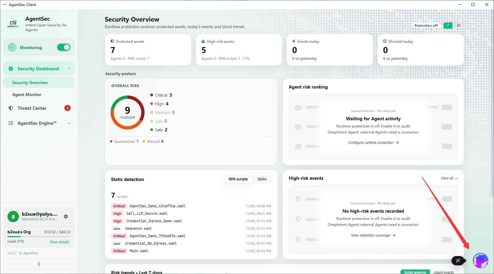
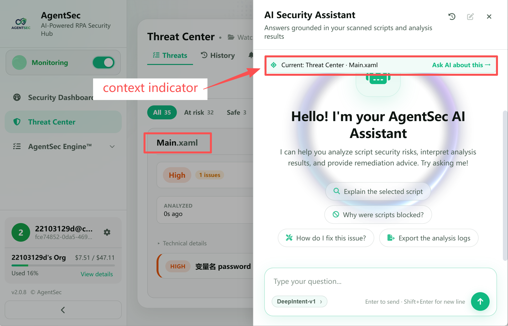
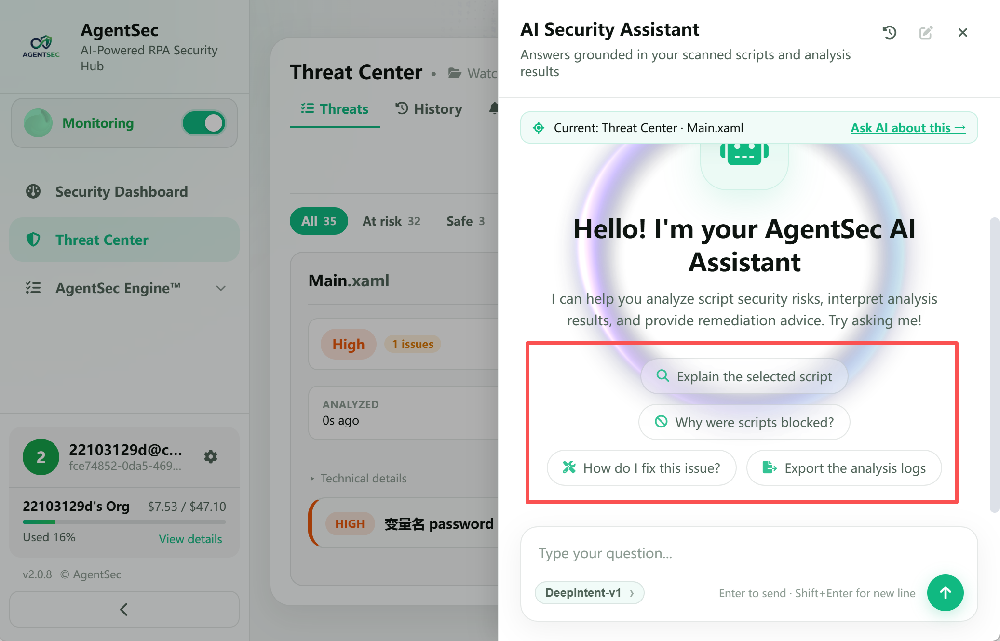
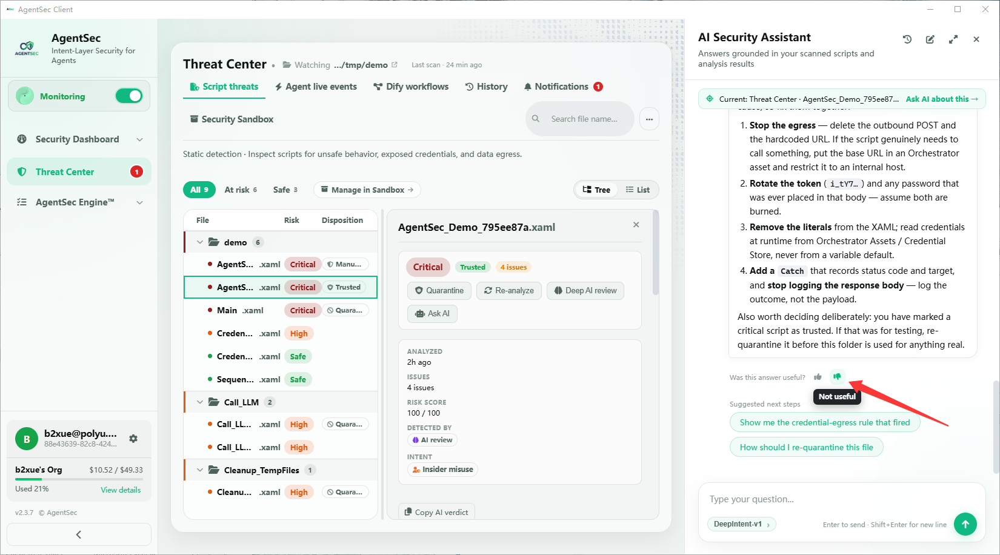
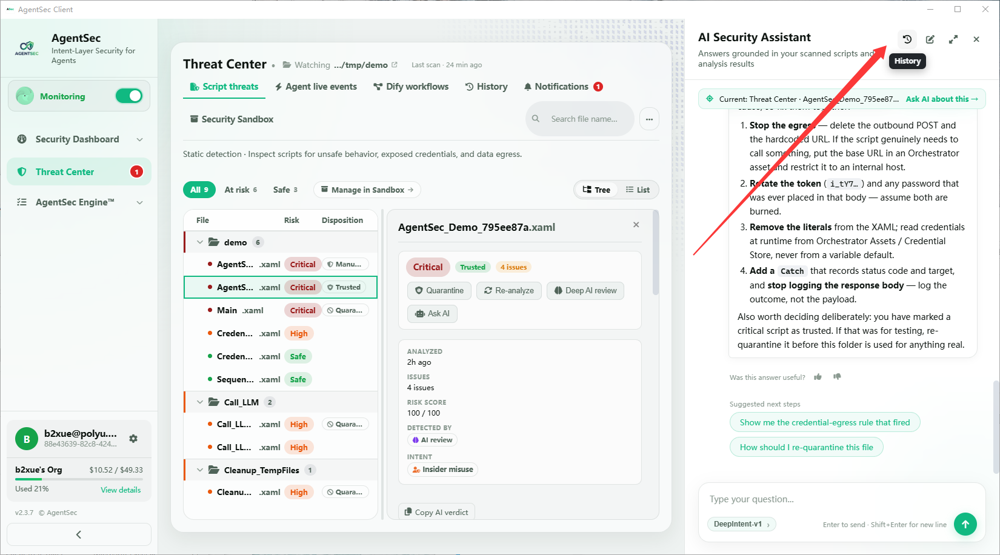

# AI 安全助手使用指南

> AgentSec 內置了一個 AI 安全助手。您可以用自然語言向它提問，它會根據當前的監控狀態、分析結果和配置信息給出回答，還可以直接幫您執行操作。

---

## 打開 AI 助手

**三種方式：**

| 方式 | 操作 |
|------|------|
| 點擊 FAB | 點擊主界面右下角的藍色「AI 助手」浮動按鈕 |
| 快捷鍵 | 按 `Ctrl+K`（Windows）或 `Cmd+K`（macOS） |
| 再次按快捷鍵 | 關閉面板 |



---

## 助手面板佈局

AI 助手面板包含標題欄、歷史對話、新對話、當前上下文提示、建議問題、對話區域、工具執行進度和輸入框。用戶可以在面板中直接提問，也可以點擊建議問題快速開始。

### 三種顯示模式

| 模式 | 效果 |
|------|------|
| 關閉 | FAB 按鈕在右下角，面板隱藏 |
| 停靠 | 面板在右側，佔 1/3 寬度，主內容區自動壓縮 |
| 全屏 | 面板擴展到最大，適合查看複雜內容 |

在停靠模式下點擊標題欄的展開按鈕可切換全屏。

---

## AI 助手能做什麼？

### 1. 回答安全問題

您可以用自然語言詢問：

| 可以問  | 示例                           |
| ---- | ---------------------------- |
| 安全概況 | 「總結一下當前所有腳本的安全狀況」            |
| 風險分析 | 「哪些腳本風險最高？爲什麼？」              |
| 修復建議 | 「如何降低 Main.xaml 的安全風險？」      |
| 規則解釋 | 「AgentSec 當前的安全策略是什麼？有哪些規則？」 |
| 配置檢查 | 「幫我檢查當前配置是否合理」               |
| 狀態查詢 | 「現在有哪些腳本正在分析？」               |

**上下文感知**：AI 助手知道您當前在哪個頁面、選中了什麼內容。例如在威脅中心中選中 `Cleanup_TempFiles.xaml` 時，上下文提示會自動變爲「解讀一下 Cleanup_TempFiles.xaml 的分析結果」。

> 

### 2. 自動執行操作

AI 助手可以查詢當前應用狀態，並協助執行以下操作：

| 能力 | 觸發方式 |
|------|---------|
| 檢查配置 | 「檢查配置」→ AI 自動驗證目錄、LLM、服務端連通性 |
| 設置監控目錄 | 「換個監控目錄」→ 彈出文件夾選擇器；助手操作範圍限於 AgentSec 工作區 |
| 啓動/停止監控 | 「啓動監控」→ 先檢查配置；工作區外的目錄請使用界面監控開關 |
| 查看監控狀態 | 「監控狀態怎麼樣？」→ AI 返回當前監控情況 |
| 查看策略 | 「當前有哪些安全規則？」→ AI 列出所有啓用的規則 |
| 查詢分析進度 | 「分析進度怎麼樣了？」→ AI 返回正在分析的腳本 |
| 查看引擎與規則 | 「當前規則版本是什麼？哪些規則開啓了？」 |
| 查看實驗室與策略市場 | 「有哪些演示樣本？有哪些可用策略？」 |
| 讀取和修復工作區副本 | 先導入待修復腳本，再讓助手讀取、解釋或修改副本 |

**AI 在操作前會先檢查配置**。例如您說「啓動監控」，它會先確認監控目錄、AI 模型和服務端連接是否可用。如果有問題，AI 會先指出需要修復的配置；確認無誤後纔會繼續執行操作。

日誌導出請使用客戶端的 **「導出日誌」** 按鈕；策略應用和規則修改也需要在對應頁面完成。

### 3. 讀取與修復腳本副本

1. 打開 **設置 → 安全配置 → DeepIntent Agent 工作區**。
2. 點擊 **「導入待修復腳本」**，選擇腳本；客戶端將副本放入自己的工作區。
3. 打開 AI 助手，說明文件名和修復目標，例如「讀取工作區裏的 Main.xaml，解釋問題並修復硬編碼憑據」。
4. 覈對助手的修改後，點擊 **「打開工作區」** 查看文件，再由您安排後續驗證和使用。

助手只能讀寫工作區中的副本，不會直接修改外部原文件，也不會執行腳本。

### 4. 快捷操作按鈕

AI 回覆末尾可能會附上 **快捷操作按鈕**，例如：

```
[總結當前安全狀況]  [查看高風險腳本詳情]  [如何修復這些風險]
```

點擊任一按鈕即可自動發送對應問題，無需手動輸入。

> 

### 5. 評價回答

已登錄並加入組織時，助手回答下方會顯示 **「有用」** 和 **「沒用」** 按鈕。點擊「沒用」後，可補充一句問題說明並點擊 **「提交」**；文字說明可以跳過。本地模式不顯示這些反饋按鈕。



---

## 對話技巧

### ✅ 好的提問方式

- 「Main.xaml 有哪些安全問題？幫我逐一解釋」
- 「對比一下 Process.py 和 Main.xaml 的風險等級」
- 「如何修復硬編碼密碼的問題？給出具體步驟」

### ❌ 不太有效的提問

- 「安全」（太模糊）
- 「隨便修一下」（沒有說明文件和目標）
- 「今天天氣怎麼樣」（與 RPA 安全無關）

### 💡 提示

- AI 助手會根據您當前的界面語言自動選擇回覆語言
- 點擊標題欄 **「歷史對話」** 可搜索、打開並繼續已有會話，關閉應用後仍可查看已保存的對話。
- 點擊 **「新對話」** 開始另一段會話，舊會話保留在歷史中。需要刪除時，在歷史列表點擊該會話的刪除按鈕並確認。



---

## 模型信息顯示

輸入框左下角有一個 **模型標籤**，顯示當前使用的 AI 模型：

- **登錄模式**：顯示組織當前提供的模型，由 AgentSec 中轉。
- **本地模式**：顯示您配置的模型。

點擊標籤可快速跳轉到 **AgentSec Engine™ → 引擎 → AI 模型**。本地模型的編輯入口爲該頁的 **「去設置」**。

---

## 常見問題

**Q: AI 助手需要聯網嗎？**
A: 取決於您的使用模式。登錄模式下需要聯網（通過 AgentSec 服務端中轉調用 AI）。本地模式下如果使用 Ollama 本地模型則不需要聯網。

**Q: AI 助手會消耗多少配額？**
A: 登錄模式下，每次對話消耗組織的 AI 配額。您可以在側邊欄底部查看剩餘配額。本地模式下無配額限制（取決於您自己的 API 賬戶）。

**Q: 對話內容會被記錄嗎？**
A: 對話會保存在本機。已登錄並加入組織的客戶端還會將會話同步到組織服務端；本地模式不進行這項同步。

**Q: 組織的 AI 配額用完了怎麼辦？**
A: 聯繫您的組織管理員在 AgentSec 控制檯中充值。用完配額後 AI 助手和 AI 分析都會暫停。

**Q: AI 助手爲什麼不能回答某些問題？**
A: AgentSec AI 助手的定位是 RPA 安全專家，它會盡量把回答限定在安全分析、腳本風險、修復建議等範圍內。與 RPA 安全無關的問題可能會被婉拒。
