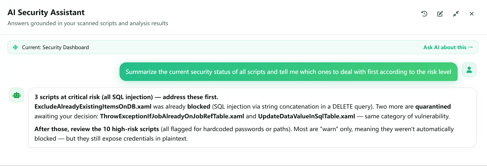
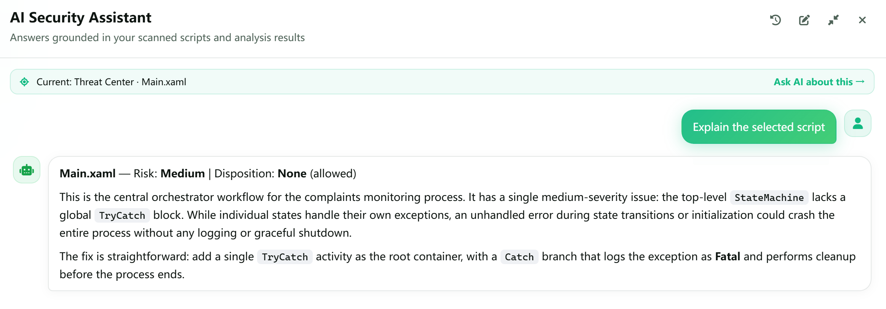
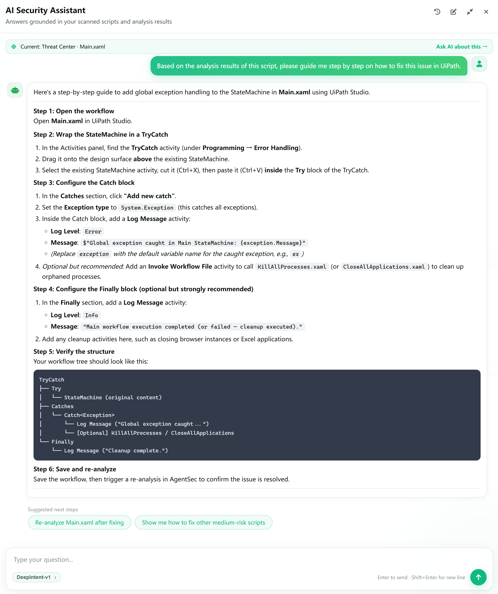
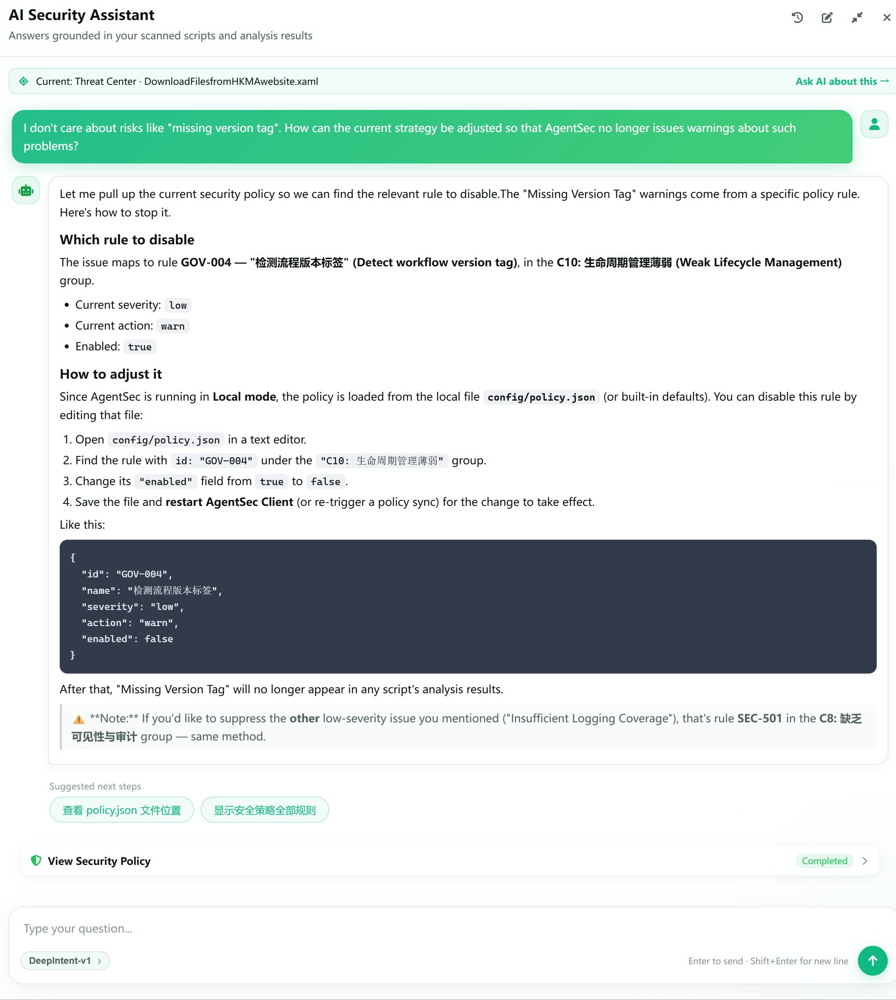
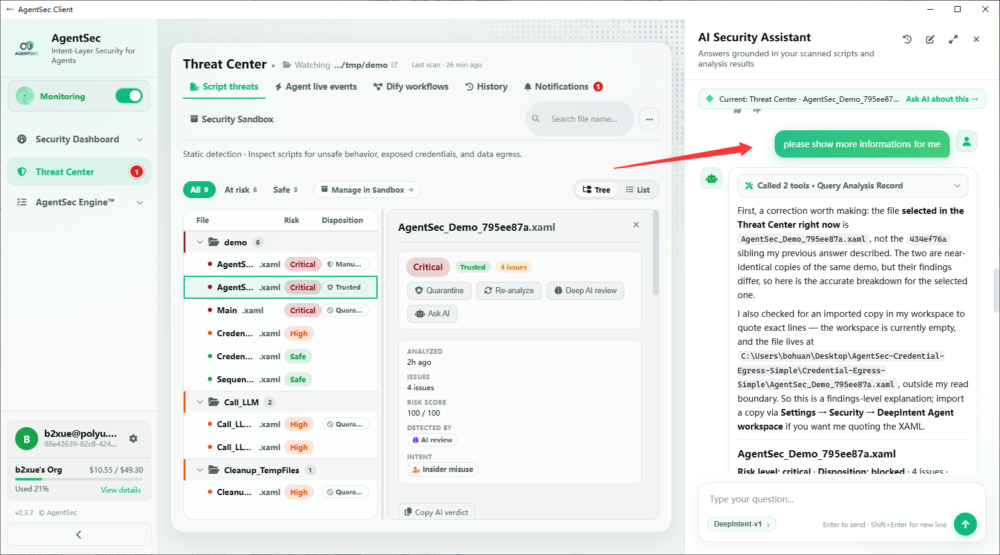

# AI 安全助手：使用場景

> 本章通過幾個常見任務，展示如何把 AI 助手用於日常的 RPA 腳本安全工作。

---

## 使用前準備

爲了讓回答更貼合您的實際情況，請先：

1. 選擇並啓動監控目錄；
2. 等待至少一個腳本完成分析；
3. 在需要時，從儀表盤或威脅中心選中對應的腳本後，再打開 AI 助手。

AI 助手會結合當前頁面、已選腳本和分析結果回答問題；它的建議應作爲安全排查的輔助信息，執行會影響文件或監控狀態的操作前，請確認結果符合預期。

---

## 場景一：快速瞭解當前風險

**適用情況**：剛打開 AgentSec，想先判斷今天是否有需要優先處理的問題。

**可以這樣問：**

> 總結一下當前所有腳本的安全狀況，並按風險等級告訴我應該先處理哪些。

AI 助手會概括已分析腳本、風險等級和主要問題類型，並指出值得優先查看的高風險腳本。

>

**追問示例：**
- 哪個腳本的風險最高？原因是什麼？
- 哪些問題需要在今天內優先修復？

---

## 場景二：解釋單個腳本的分析結果

**適用情況**：在威脅中心發現一個風險腳本，但不清楚某條檢測結果的含義。

1. 在威脅中心打開目標腳本的詳情；
2. 選中該腳本或點擊「就這個問 AI」；
3. 點擊對話框上方的建議問題，或者手動輸入問題，例如：

> 請解讀一下 `Main.xaml` 的分析結果。

AI 助手會基於該腳本的分析結果，用更容易理解的語言說明風險原因。

>

**繼續追問：**

> 請按優先級列出修復這個腳本的步驟，並說明每一步需要驗證什麼。

---

## 場景三：獲取可執行的修復建議

**適用情況**：已經知道問題類型，希望得到具體的修復方法。

**示例提問：**

> 根據這個腳本的分析結果，請一步一步指導我如何在UiPath中修復這個問題。

AI助手會根據分析的結果，給出具體的修復方法。

>

修復完成後，重新分析修改後的腳本，覈對結果。若腳本已隔離，請按威脅中心的整改與還原流程處理。

如需助手直接修改副本，先在 **設置 → 安全配置 → DeepIntent Agent 工作區** 導入腳本，再明確要求它讀取和修復該副本。完成後由您檢查工作區文件並安排使用，原文件不會自動替換。

---

## 場景四：諮詢、理解和調整當前策略

**適用情況**：想了解當前啓用了哪些安全策略、某類風險爲何會觸發警告，或希望根據可接受的風險範圍調整策略。

**示例提問：**

> 當前策略中有哪些規則會針對這類風險發出警告？請用通俗的方式解釋它們的作用，以及調整後可能帶來的影響。

例如，若您不在意某一種風險，希望停止收到該類警告，可以繼續問：

> 我不在意「缺少版本標籤」這一類風險。如何調整當前策略，使 AgentSec 不再針對這類問題發出警告？

AI 助手會先說明相關規則和調整的影響，再解釋操作方法。請在引擎頁面自行保存調整；內網只讀部署需要聯繫管理員。調整後重新分析相關腳本，覈對結果。

>

---

## 場景五：自動執行操作

**適用情況**：希望 AI 助手協助檢查配置、查看監控狀態、查詢分析進度，或操作 AgentSec 工作區內的監控。

以啓動監控爲例，您可以輸入：

> 幫我啓動監控。

AI 助手會先檢查配置。助手選擇目錄和啓動監控限於 AgentSec 工作區及其子目錄；監控外部目錄時，請使用應用內的監控開關。日誌導出也請點擊客戶端的「導出日誌」按鈕。

更多可自動執行的操作及其說明，請參閱 [08 — AI 安全助手](08-ai-assistant.md#2-自動執行操作)。

## 場景六：繼續之前的排查

點擊助手標題欄的 **「歷史對話」**，搜索並打開之前的會話，再繼續追問。需要開始其他任務時點擊 **「新對話」**，此前會話仍保留。

> 上次我們討論 Main.xaml 的憑據問題，請繼續說明還需要驗證哪些地方。

---

## 提問小技巧

- **說清對象**：使用腳本名、風險等級或問題類型，例如“解釋 `Process.py` 的攔截風險”。
- **說明目標**：說明您是想了解原因、尋找修復方法，還是檢查運行狀態。
- **逐步追問**：先讓 AI 總結，再針對其中一個腳本或一個問題深入提問。

想了解 AI 助手的入口、面板和全部能力，請參閱[08 — AI 安全助手](08-ai-assistant.md)。
