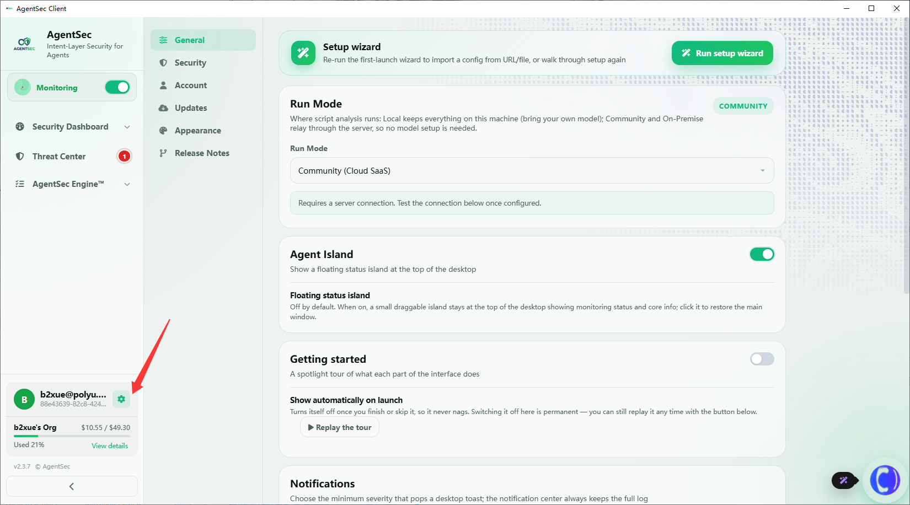
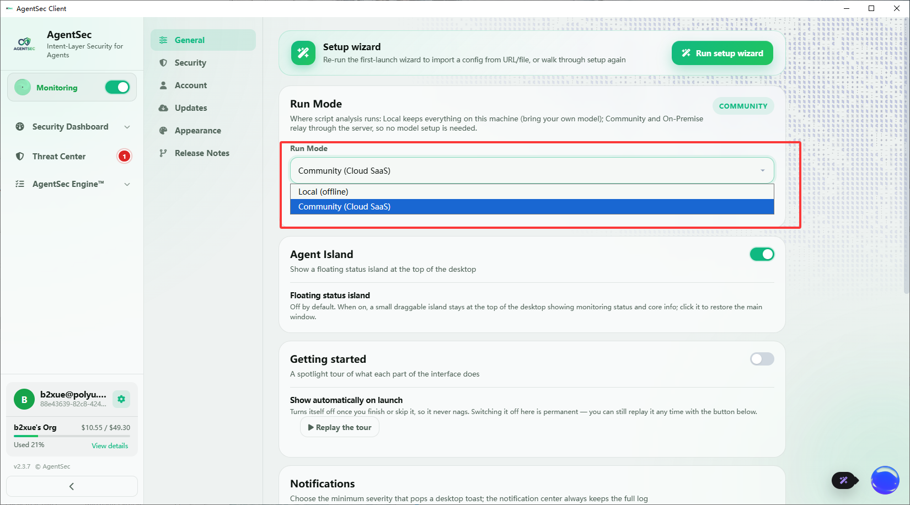
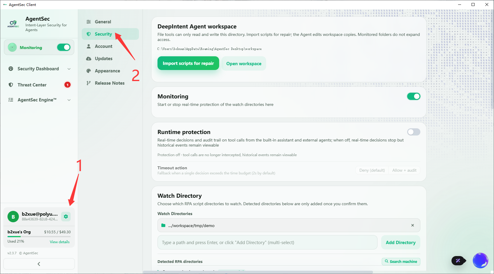
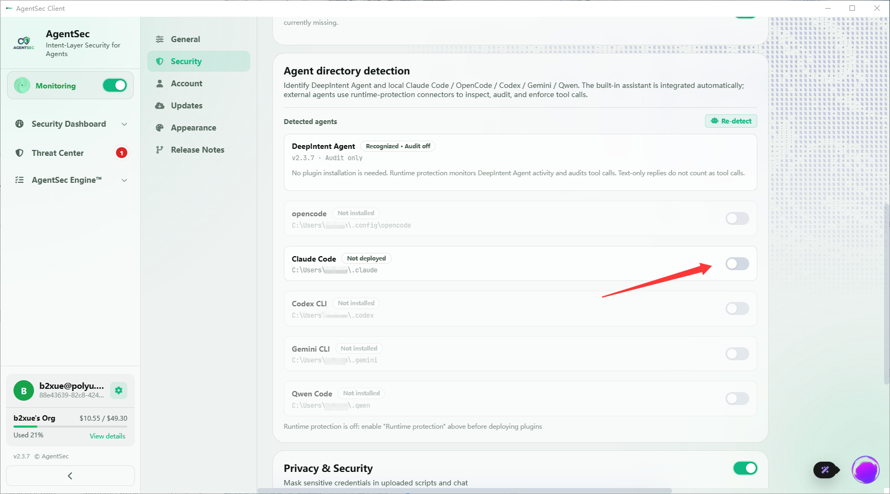
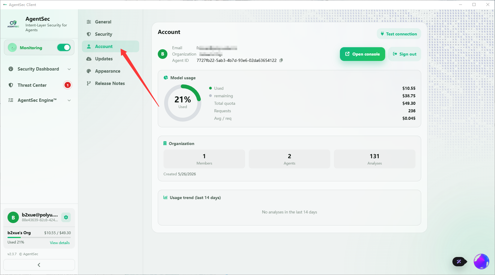
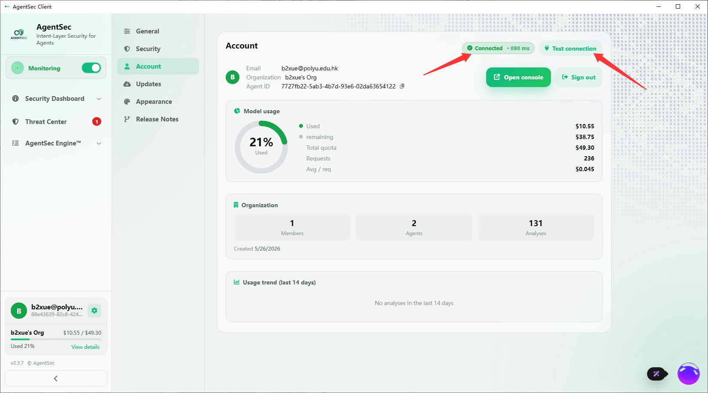
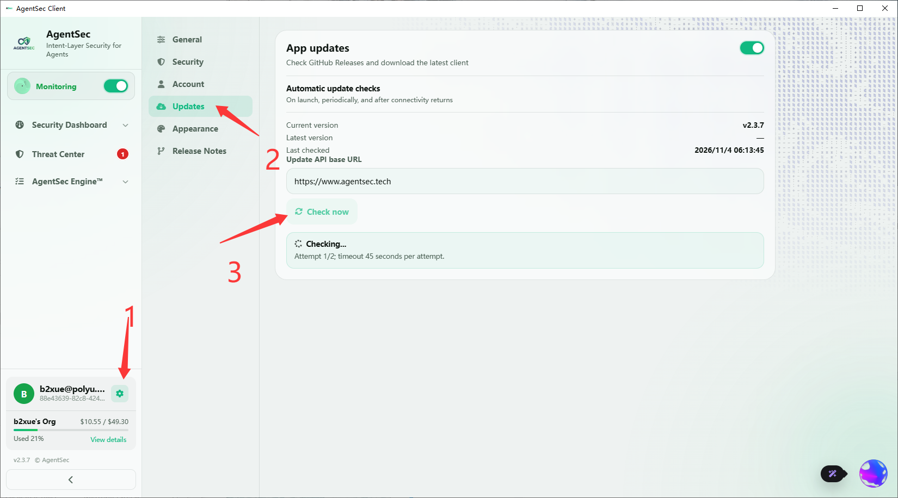
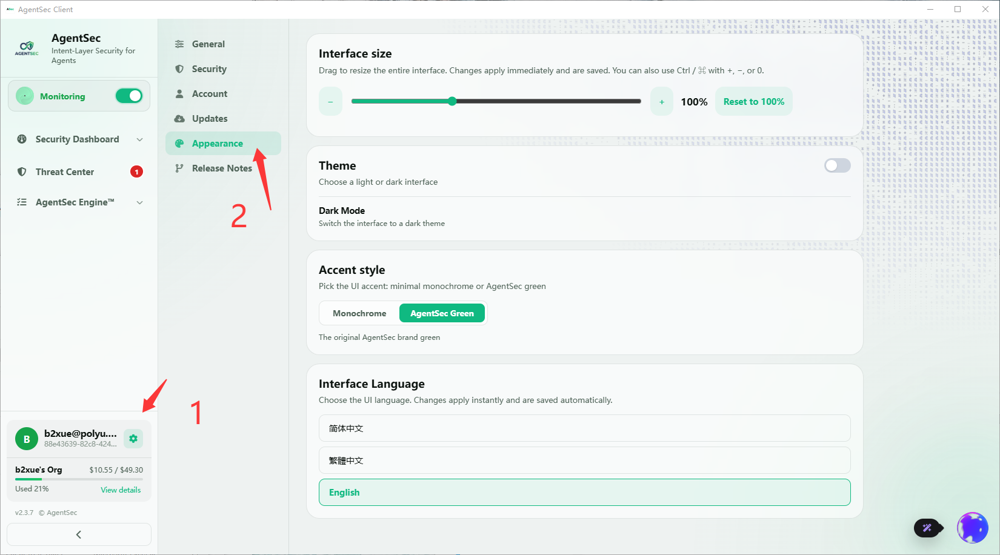
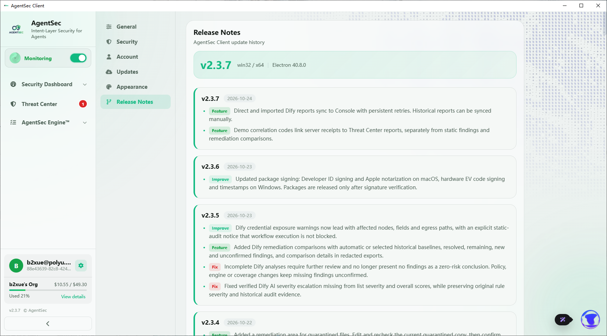

# 設置與賬戶指南

> 設置頁面用於管理 AgentSec 的所有配置：常規、安全配置、賬戶、AI 模型、自動更新等。

---

## 打開設置

點擊側邊欄底部的 **⚙ 設置** 按鈕。

---

## 設置頁面佈局

設置頁採用**左右分類導航**佈局：左側用於切換常規、安全配置、賬戶、更新、外觀和版本等分類，右側顯示當前分類的具體設置項。

### ⚡ 自動保存

設置改動會自動保存；監控和運行時防護開關立即生效。頁面沒有單獨的底部保存按鈕。

---

## 一、常規

### 配置嚮導

點擊 **「運行引導向導」** 可以重新運行首次配置嚮導。適合想要重新設置使用方式或監控目錄的情況。

### 運行模式

| 模式                 | 說明                                    |
| ------------------ | ------------------------------------- |
| Local（離線本地）        | 不登錄 AgentSec；規則在本機運行。AI 可選，使用您配置的模型服務 |
| Community（雲端 SaaS） | 登錄 AgentSec 雲服務，使用組織提供的模型服務           |

切換模式後，下方會顯示對應的提示和配置項。

本地模式的 **AI 研判模型（可選）** 位於此處。選擇供應商、模型和所需的 API Key；使用 Ollama 或 OpenAI 兼容服務時，可填寫自定義 Base URL。點擊 **測試 LLM** 覈對連接。不配置模型仍可使用規則掃描。企業內網部署按管理員提供的服務器與賬號連接。

### 新手引導、通知與高級模式

- **Agent Island**：開啓桌面頂部可拖動的懸浮狀態島，查看監控和分析進度，點擊可恢復主窗口；默認關閉。
- **新手引導**：重新觀看界面介紹。
- **通知提醒級別**：選擇全部、警告及以上、僅錯誤或關閉彈出提醒；通知仍可在威脅中心查看。
- **高級模式 → 顯示 DSL 自定義規則**：開啓後，Engine 側欄顯示「DSL 規則」入口。關閉僅隱藏入口，已保存的規則仍按當前狀態運行。

### 開發者選項

- **啓用 Debug 視圖**：開啓後側邊欄出現「Debug」入口，可查看實時分析日誌流
- 僅在排查問題時需要開啓

Debug 的 **Git 保管庫** 可查看內容快照的提交日誌、追蹤文件和內容差異；**實時日誌** 可查看、清空或導出日誌。這些入口只在啓用 Debug 後顯示，日常監控和審計無需開啓。

### 危險區域

**「重置所有數據」** 按鈕會：
- 清空配置、Agent ID、分析歷史、聊天記錄、白名單
- 刪除完成後應用自動退出
- 重新打開時如同首次安裝

> ⚠️ 此操作不可撤銷！

---

## 二、安全配置

### DeepIntent Agent 工作區

點擊 **導入待修復腳本**，把需要助手讀取或修改的腳本副本放入工作區；點擊 **打開工作區** 查看文件。助手的文件工具只訪問該工作區，監控目錄不會擴大其讀寫範圍，原始腳本不會因導入而修改。

### 運行時防護與 Agent 接入

開啓 **運行時防護** 後，可記錄內置 DeepIntent Agent 的活動及工具調用審計。外部 Agent 需要在下方 **Agent 目錄檢測** 中接入：

1. 點擊 **重新檢測**，查看已安裝的 Claude Code、OpenCode、Codex、Gemini 或 Qwen。
2. 爲需要接入的 Agent 打開部署開關。
3. 部署或重新部署後，重啓正在運行的外部 Agent。
4. 到 **安全儀表盤 → Agent 監控** 和 **威脅中心 → Agent 實時事件** 查看記錄。

內置 DeepIntent Agent 自動接入，界面標爲「僅審計」。外部 Agent 僅對已接入且受支持的工具調用實施防護。**超時處置** 可選「拒絕（默認）」或「放行並留痕」。

### 監控開關

使用 **監控開關** 卡片可以啓動或停止腳本監控。關閉後，AgentSec 不再實時分析目錄中新建或修改的 RPA 腳本；重新開啓即可恢復監控。

### 監控目錄

支持**多目錄同時監控**。可以通過以下方式添加需要保護的 RPA 腳本目錄：

- 在輸入框中填寫路徑並按回車
- 點擊 **「添加目錄」** 打開目錄選擇器，可一次選擇多個目錄
- 點擊 **「搜索本機」** 檢測常見 RPA 工具的腳本目錄

搜索到的目錄會顯示在 **「檢測到的 RPA 目錄」** 中，並標註工具名稱、路徑和腳本數量。檢測結果不會自動加入監控，需要確認後纔會生效。

刪除監控目錄前會顯示確認。確認後會清理該目錄的本地分析、信任和內容快照記錄；磁盤上的腳本和隔離副本會保留，需要時先在安全沙箱處理隔離文件。

#### 啓動即開啓監控

啓用後，AgentSec 啓動時會自動監控已配置且當前存在的目錄，無需每次手動啓動。未配置監控目錄或目錄已不存在時，不會自動開啓監控。

### 隱私與安全

#### 敏感憑據密文顯示

默認開啓。上傳腳本或使用 AI 問答時，憑據會在離開本機及顯示到界面前替換爲不可逆佔位符，避免 API Key、密碼等敏感信息被直接展示或發送；本地腳本原文不會被修改。

### 分析引擎

#### 規則引擎（DSL 規則集）

規則引擎**始終啓用**，負責進行確定性規則匹配。分析在本地以毫秒級完成，不依賴網絡或大型模型；命中規則後，AgentSec 會按照規則給出風險結論和處置建議。

規則可以通過兩種方式更新：

- **從 Console 更新規則**：連接 Console 獲取最新規則
- **導入規則更新包（離線）**：適用於內網或無法連接 Console 的環境，由管理員導出簽名規則包後在此導入

#### AI 研判（可選）

AI 研判用於理解腳本意圖，補充識別規則暫未覆蓋的風險。關閉後，腳本正文不會因 AI 研判離開本機，分析結論僅由規則引擎給出。

---

## 三、賬戶

#### 已登錄

顯示以下信息：

| 字段 | 說明 |
|------|------|
| 頭像 | 根據郵箱自動生成的標識 |
| 郵箱 | 登錄時使用的郵箱 |
| 組織 | 您所屬的 AgentSec 組織（租戶） |
| Agent ID | 當前機器的唯一標識 |
| 模型用量 | 組織的 AI 配額使用情況 |

點擊 **「退出登錄」** 可斷開與服務端的連接。

#### 未登錄

- 顯示「連接控制檯（登錄）」按鈕

### 連接測試

點擊 **「測試連接」** 可以驗證服務端是否可達、登錄憑證是否有效。

## 四、更新

### 自動檢查更新

- **開關**：啓用/禁用啓動時和週期性的自動更新檢查
- **默認**：啓用，每 6 小時檢查一次

### 當前版本信息

| 信息 | 說明 |
|------|------|
| 當前版本 | 您正在使用的 AgentSec 版本 |
| 最新版本 | GitHub Release 上的最新版本 |
| 上次檢查 | 上次檢查更新的時間 |

**更新 API 地址** 由默認服務或部署管理員提供；按當前部署使用相應地址。

### 手動檢查更新

點擊 **「立即檢查更新」** 按鈕，實時查詢最新版本。

檢測到新版本後：
- 設置頁面顯示新版本詳情 + 發佈說明
- 儀表盤頂部彈出更新橫幅
- 點擊「下載並安裝」自動下載和安裝（Windows）/ 打開 DMG（macOS）

---

## 五、外觀

### 界面大小

拖動滑塊或點擊加減按鈕調整整個界面，範圍爲 50%–200%；點擊 **恢復 100%** 還原。也可使用 `Ctrl` / `⌘` 配合 `+`、`−`、`0`。修改立即生效並自動保存。

### 主題

- **深色模式**：開關切換
- 默認跟隨系統偏好（`prefers-color-scheme`）

### 配色風格

可選 **極簡單色** 或 **AgentSec 綠**。

### 界面語言

支持三種語言：
- 簡體中文（默認）
- 繁體中文
- English

切換後整個界面立即生效，AI 助手也會自動切換回復語言。

---

## 六、版本說明

顯示 v2.0.1 起的版本更新歷史（Changelog），按版本倒序排列。

更新記錄按新增、修復、改進或界面調整等類型顯示。
