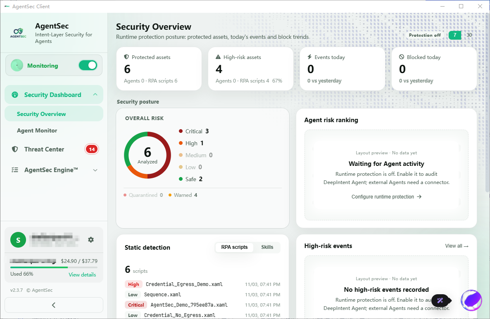

# AgentSec Desktop — 用戶手冊

歡迎使用 AgentSec Desktop！本手冊介紹腳本監控、Agent 運行時防護和 Dify 工作流審計。使用 Dify 的讀者可先看 [Dify 工作流審計](dify.md)。

如果您想跟着「快速入門」和「第一次安全分析」一起操作，可以先下載配套的 [UiPath 示例包](https://github.com/PolyUxAISecurity/AgentSec-UserDoc/raw/main/Demo/agentsec-uipath-demo.zip)。

---

## 什麼是 AgentSec？

AgentSec 將本機規則檢查與可選 AI 研判用於以下場景：

- 🔍 **自動掃描**：實時監測您電腦上的 RPA 腳本（UiPath、Python、PowerShell 等）
- 🛡️ **Agent 防護**：查看已接入 Agent 的活動，並對支持的外部工具調用進行檢測和處置
- 🔎 **Dify 審計**：獲取或導入工作流，定位憑據與敏感數據外發風險，複覈整改結果
- 🚫 **腳本處置**：按檢查結論和處置方式進行隔離、告警或人工複覈
- 💬 **DeepIntent Agent**：解讀風險、調用工具，並處理工作區中的腳本副本

先選擇需要使用的場景，再按對應章節配置和查看結果。

---

## 📖 閱讀順序（推薦）

| # | 章節 | 內容 | 用時 |
|---|------|------|------|
| 01 | [快速入門（跟我做）](01-quickstart.md) | 安裝 → 配置 → 第一次監控 → 看懂結果 | 10 分鐘 |
| 02 | [安全儀表盤](02-dashboard.md) | 安全總覽、風險趨勢、Agent 監控 | 5 分鐘 |
| 03 | [第一次安全分析](03-first-analysis.md) | 完整案例：三個腳本從發現到處理的全過程 | 10 分鐘 |
| 04 | [監控與目錄配置](04-monitoring.md) | 監控目錄、三關檢查、大目錄優化 | 5 分鐘 |
| 05 | [威脅中心](05-security-log.md) | 腳本、Agent、Dify 結果與安全沙箱 | 10 分鐘 |
| 06 | [AgentSec Engine™](07-security-policy.md) | 引擎模塊、規則實驗室、策略市場 | 10 分鐘 |
| 07 | [AI 安全助手](08-ai-assistant.md) | 與 AI 對話、讓它幫您操作 | 5 分鐘 |
| 08 | [AI 助手使用場景](09-ai-assistant-use-cases.md) | 通過示例完成風險排查、修復和配置檢查 | 5 分鐘 |
| 09 | [設置詳解](10-settings.md) | 常規、賬戶、更新、外觀等 | 按需查閱 |
| 10 | [關鍵概念](11-concepts.md) | 術語解釋：什麼是隔離？什麼是風險等級？ | 按需查閱 |
| 11 | [常見問題](12-faq.md) | 遇到問題怎麼辦 | 按需查閱 |

另有獨立的 [Dify 工作流審計](dify.md)和 [Agent 運行時防護與監控](agent-runtime.md)指南。Dify 指南包含可直接操作的客戶端內置演示。

> 💡 **新手路徑**：01 → 02 → 03 三篇看完，就完全上手了。其餘按需查閱。

---

## 應用界面導航

AgentSec 桌面端採用單頁應用設計：

| 導航位置 | 入口 |
|---------|------|
| **安全儀表盤** | 安全總覽、Agent 監控 |
| **威脅中心** | 腳本威脅列表、Agent 實時事件、Dify 工作流、歷史記錄、通知、安全沙箱 |
| **AgentSec Engine™** | 引擎、規則實驗室、策略市場；高級模式可顯示 DSL 規則 |
| **AI 助手** | 右下角懸浮按鈕（或 `Ctrl+K` / `Cmd+K`） |
| **設置** | 側邊欄底部齒輪按鈕 — 常規、安全配置、賬戶、更新、外觀、版本說明 |

## 三種使用模式

AgentSec 支持三種運行模式，您可以根據實際情況選擇：

| 模式 | 適用場景 | 需要什麼 |
|------|---------|---------|
| **登錄 AgentSec**（推薦） | 大多數用戶 | 一個 AgentSec 賬號（瀏覽器登錄即可） |
| **內網部署** | 企業自建了 AgentSec 服務器 | 公司提供的服務器地址 + 賬號 |
| **本地模式** | 不登錄 AgentSec，使用本機規則掃描 | 無需模型；AI 功能可選配本機或遠程模型 |

> 💡 **不確定選哪個？** 選「登錄 AgentSec」即可，這是最簡單的方式。

---

## 快速瞭解界面

---

## 典型工作流程

1. 選擇需要監控的 RPA 腳本目錄。
2. 啓動監控後，AgentSec 自動發現新增或修改的腳本。
3. 腳本先經過正則快速掃描，再按需進入 AI 深度分析。
4. 查看風險結論與實際處置；待確認的建議由用戶複覈後處理。
5. 用戶在威脅中心查看詳情，並按需信任、修復或重新分析。

---

## 支持檢測的腳本類型

| 擴展名 | 腳本類型 | 常見來源 |
|--------|---------|---------|
| `.xaml` `.xmal` | UiPath 工作流 | UiPath Studio |
| `.py` | Python 腳本 | Python 自動化 |
| `.robot` | Robot Framework | 測試自動化 |
| `.bpmn` | BPMN 流程 | 流程建模工具 |
| `.ps1` | PowerShell 腳本 | Windows 系統管理 |
| `.vb` | VBScript 腳本 | 傳統 Windows 自動化 |

---

## 需要幫助？

- 📖 按左側目錄瀏覽詳細手冊
- 💬 使用應用內的 AI 安全助手（按 `Ctrl+K` 或 `Cmd+K` 喚起）
- ❓ 查看 [常見問題](12-faq.md)

---

> 📄 適用客戶端：v2.3.7 | 更新日期：2026年11月
