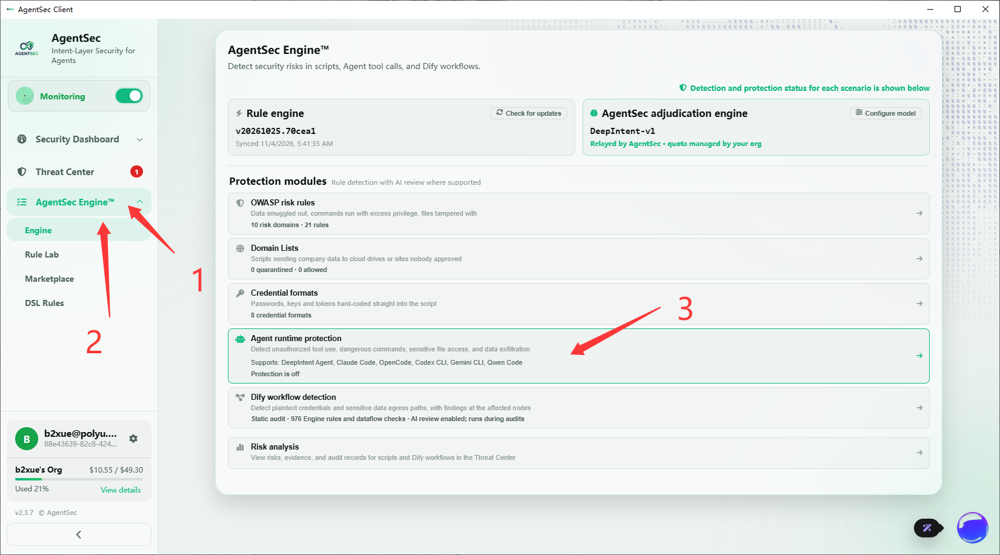

# Agent 運行時防護與監控

本章用於接入本機 Agent，查看工具調用、風險事件和審批記錄。支持內置 **DeepIntent Agent**，以及 **Claude Code、OpenCode、Codex CLI、Gemini CLI、Qwen Code**。

## 1. 開啓運行時防護

1. 打開 **AgentSec Engine™ → 引擎 → Agent 運行時防護**，查看模塊狀態和支持名單。
2. 點擊 **「配置防護」**，進入 **設置 → 安全配置**。
3. 開啓 **「運行時防護」**，等待狀態顯示引擎運行中。

也可以直接從設置頁開啓。此開關默認關閉，與 RPA 腳本目錄的監控開關分別控制。

## 2. 接入 Agent

**內置 DeepIntent Agent** 在開啓運行時防護後自動接入，無需安裝插件。它記錄活動並在工具調用完成後審計；純文本聊天不會產生工具調用事件。

接入外部 Agent：

1. 在引擎模塊點擊 **「管理 Agent 接入」**，或在 **設置 → 安全配置** 找到 **「Agent 目錄檢測」**。
2. 點擊 **「重新檢測」**，查看本機已安裝的 Agent。
3. 開啓目標 Agent 行右側的部署開關，等待顯示 **「已部署」**。
4. 重啓對應的外部 Agent，加載接入插件；升級插件後也需要重啓。

外部 Agent 的防護範圍是已接入且受支持的工具調用。需要移除接入時，關閉該 Agent 的部署開關。

## 3. 查看活動和風險

1. 展開 **安全儀表盤 → Agent 監控**，查看已產生活動的 Agent。
2. 搜索並選擇一個 Agent，查看風險、事件數量和狀態。
3. 在詳情中切換 **「概覽」**、**「審計日誌」**、**「會話鏈路」** 和 **「關聯策略」**，查看相關活動。

## 4. 查看事件與處理審批

1. 打開 **威脅中心 → Agent 實時事件**。
2. 按風險等級、處理動作、Agent 或關鍵詞篩選；點擊事件查看工具、目標、命中規則、原因與建議。
3. 如有 **「待審批」** 事件，先查看詳情，確認後點擊 **「批准」** 或 **「拒絕」**。
4. 覈對事件詳情中的處置與審批記錄。

內置 DeepIntent Agent 的調用後審計用於記錄風險；查看風險時，請同時覈對事件的實際動作和處理狀態。

## 5. 調整超時處置與關閉防護

在 **設置 → 安全配置 → 運行時防護** 中，可選擇引擎判定超時後的 **「拒絕（默認）」** 或 **「放行並留痕」**。

關閉運行時防護後停止新的實時判定，已保存的事件仍可查看。Dify 工作流的操作見 [Dify 指南](dify.md)。
