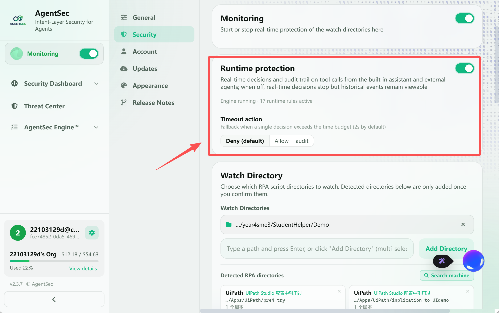
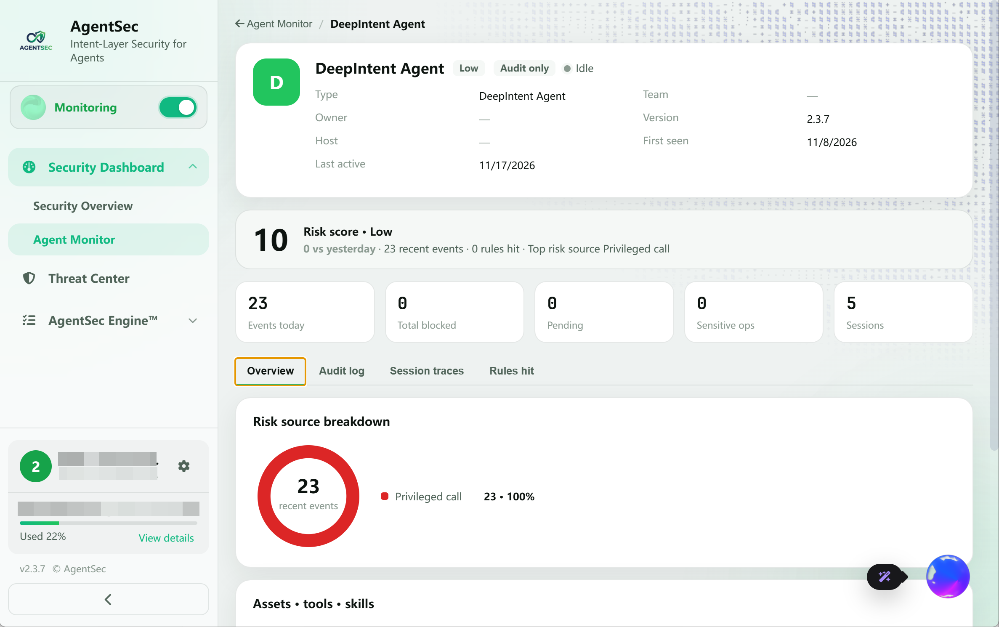
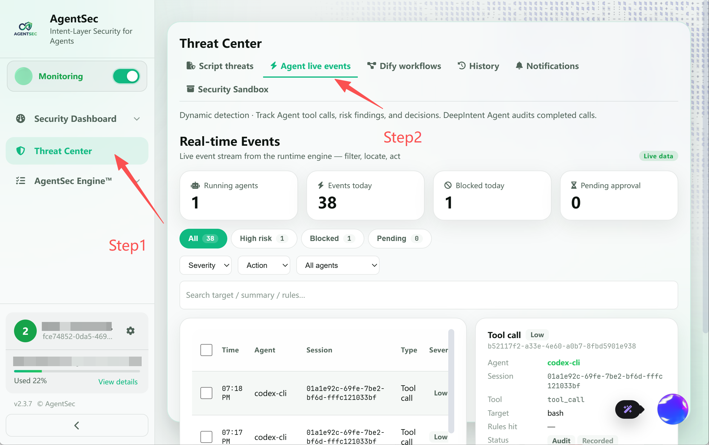
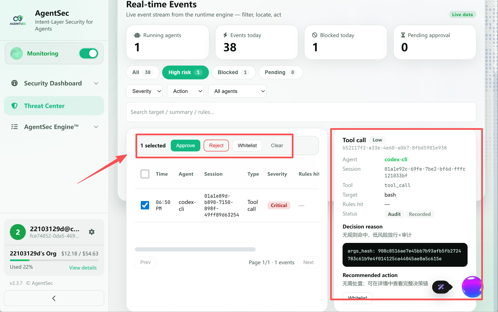

# Agent 運行時防護與監控

本章用於接入本機 Agent，查看工具調用、風險事件和審批記錄。支持內置 **DeepIntent Agent**，以及 **Claude Code、OpenCode、Codex CLI、Gemini CLI、Qwen Code**。

## 1. 開啓運行時防護

1. 打開 **AgentSec Engine™ → 引擎 → Agent 運行時防護**，查看模塊狀態和支持名單。
2. 點擊 **「配置防護」**，進入 **設置 → 安全配置**。
3. 開啓 **「運行時防護」**，等待狀態顯示引擎運行中。

也可以直接從設置頁開啓。此開關默認關閉，與 RPA 腳本目錄的監控開關分別控制。

## 2. 接入 Agent

**內置 DeepIntent Agent** 在開啓運行時防護後自動接入，無需安裝插件。它記錄活動並在工具調用完成後審計；純文本聊天不會產生工具調用事件。

接入外部 Agent：

1. 在引擎模塊點擊 **「管理 Agent 接入」**，或在 **設置 → 安全配置** 找到 **「Agent 目錄檢測」**。
2. 點擊 **「重新檢測」**，查看本機已安裝的 Agent。
3. 開啓目標 Agent 行右側的部署開關，等待顯示 **「已部署」**。
4. 重啓對應的外部 Agent，加載接入插件；升級插件後也需要重啓。

外部 Agent 的防護範圍是已接入且受支持的工具調用。需要移除接入時，關閉該 Agent 的部署開關。

## 3. 查看活動和風險

1. 展開 **安全儀表盤 → Agent 監控**。正在運行的 Agent 顯示黃色，閒置的 Agent 顯示灰色。
2. 搜索 Agent，查看風險、事件數量和狀態；點擊目標 Agent 打開詳情。
3. 在詳情中切換 **「概覽」**、**「審計日誌」**、**「會話鏈路」** 和 **「關聯策略」**，查看相關活動。

| 欄目 | 展示內容 | 使用方法 |
| --- | --- | --- |
| **概覽** | 風險來源分佈，以及關聯資產、外部服務、工具和技能。風險來源圖顯示近期事件的數量及佔比；關聯項展示該 Agent 活動涉及的對象。 | 先查看事件主要來自哪類風險，再檢查關聯工具或資產，以定位需要關注的活動。顯示「—」表示目前沒有可展示的關聯資料。 |
| **審計日誌** | 按時間列出工具調用記錄，包括時間、類型、目標、風險等級、處置和命中策略。 | 按時間找到記錄，並結合目標、風險等級和處置查看該次調用的審計結果。「審計」表示記錄該調用；「—」表示沒有顯示命中策略。 |
| **會話鏈路** | 按會話分組，依時間順序展示會話中的工具調用及處置標記。 | 沿時間線查看相關會話中的調用順序和上下文，並與審計日誌的時間和目標相互核對。 |
| **關聯策略** | 展示該 Agent 命中的策略或規則。 | 查看活動對應的策略依據。若頁面顯示「未命中任何規則」，表示目前沒有命中記錄。 |

風險來源分佈和關聯資料會隨已記錄的活動變化；沒有資料時，頁面可能顯示「—」或空狀態。

## 4. 查看事件與處理審批

1. 打開 **威脅中心 → Agent 實時事件**。
2. 按風險等級、處理動作、Agent 或關鍵詞篩選；點擊事件查看工具、目標、命中規則、原因與建議。
3. 如有 **「待審批」** 事件，先查看詳情，再按情況點擊 **「批准」**、**「拒絕」** 或 **「加白」**。
4. 在事件詳情中核對處置結果和審批記錄。

內置 DeepIntent Agent 的調用後審計用於記錄風險；查看風險時，請同時核對事件的實際動作和處理狀態。

## 5. 調整超時處置與關閉防護

在 **設置 → 安全配置 → 運行時防護 → 超時處置** 中，可選擇單次風險判定超過時間預算（默認 **2 秒**）時的處理方式：

- **拒絕（默認）**：拒絕本次工具調用，避免未能及時完成風險判定的操作繼續執行。
- **放行並留痕**：允許本次工具調用繼續執行，同時保留審計記錄，便於之後在 **威脅中心 → Agent 實時事件** 中復核。

此選項僅決定判定超時時的處置方式，不改變正常完成判定後的規則結果。請根據安全要求和業務連續性選擇合適的方式。

關閉運行時防護後停止新的實時判定，已保存的事件仍可查看。Dify 工作流的操作見 [Dify 指南](dify.md)。
