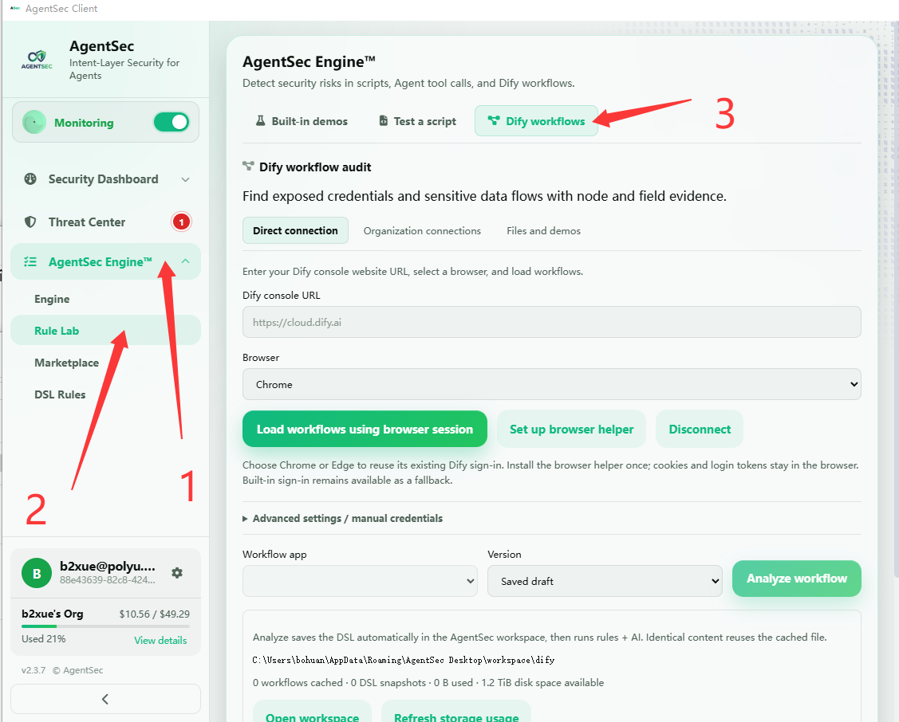
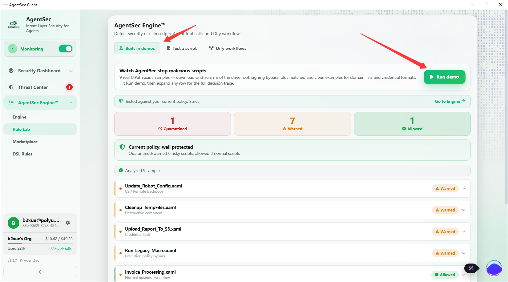
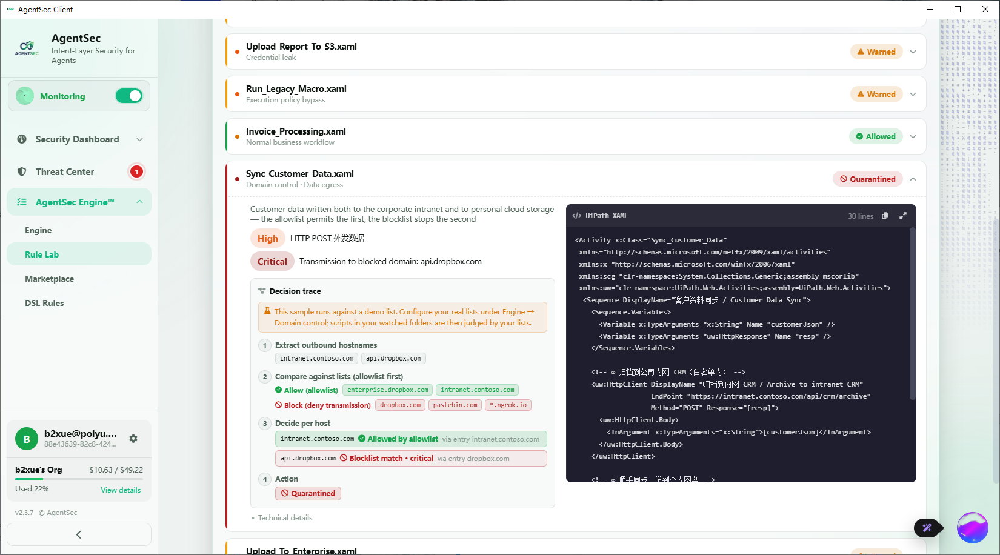
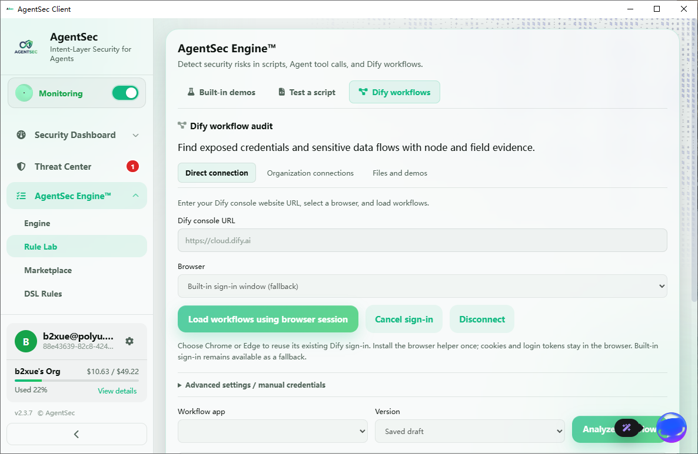
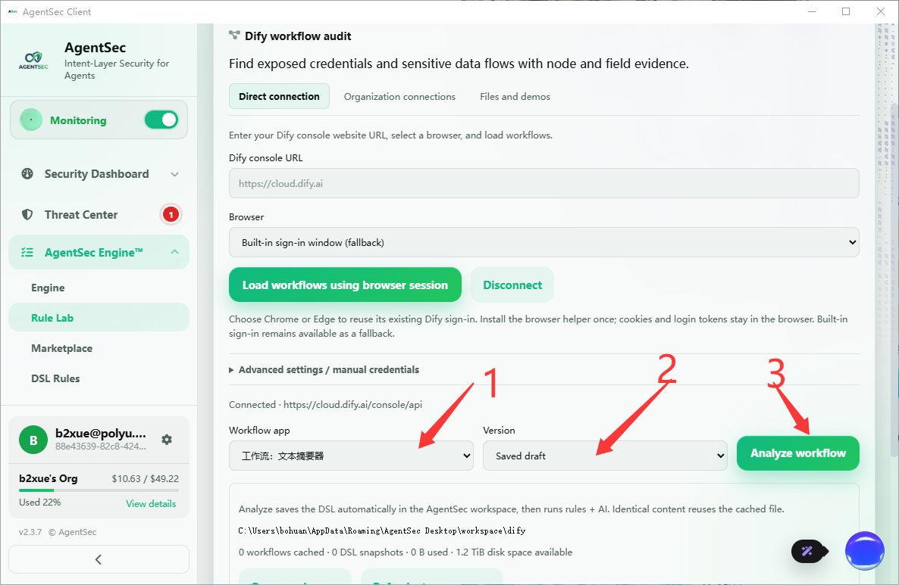
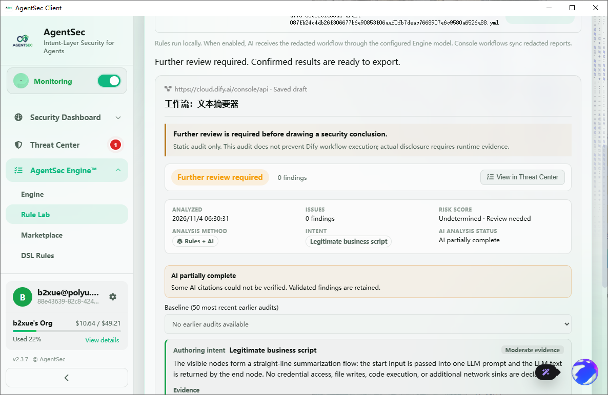
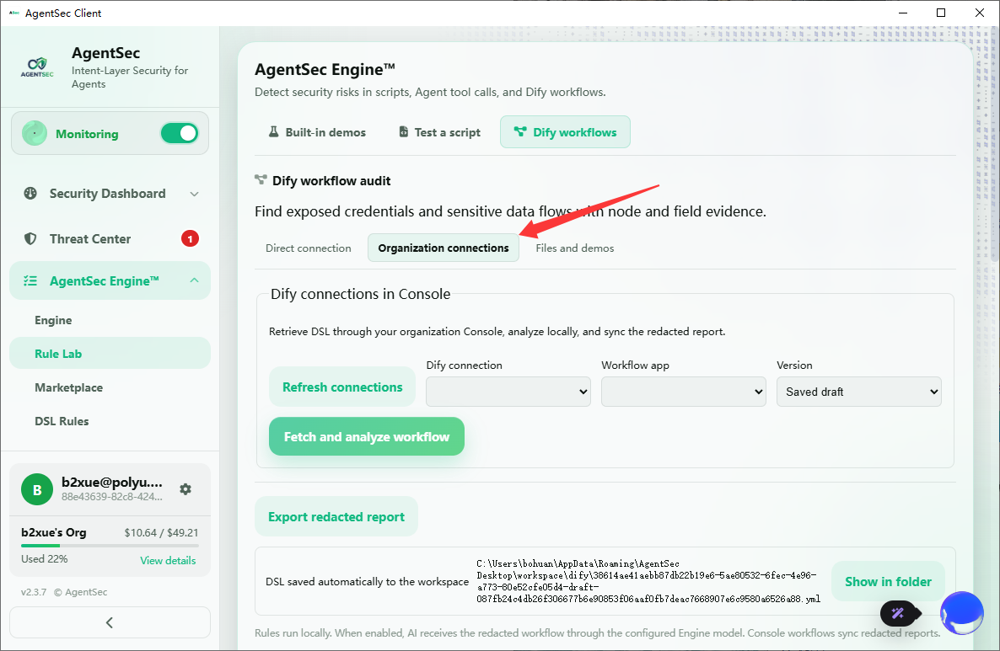
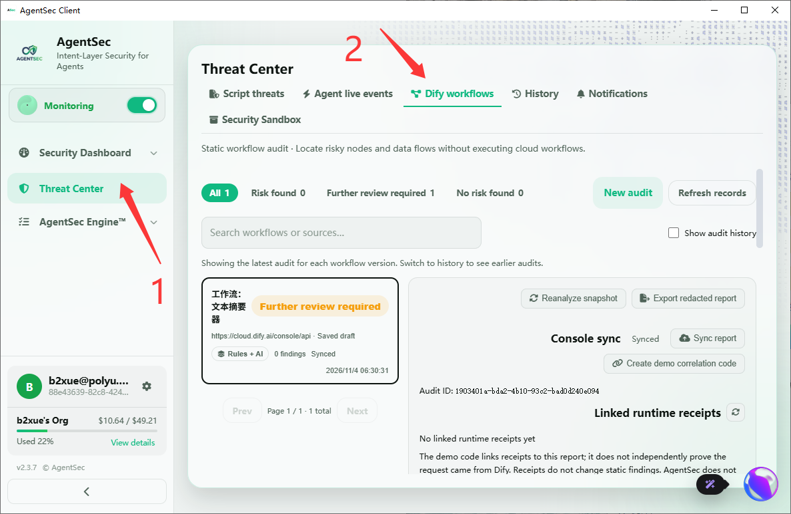
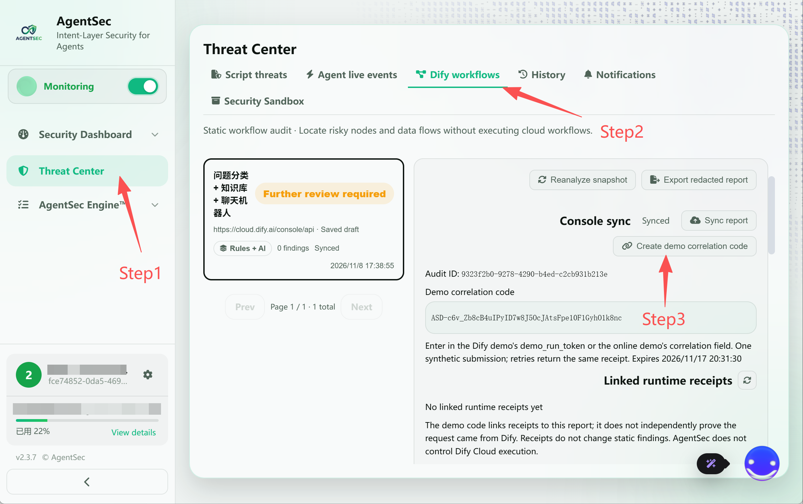

# Dify 工作流審計

AgentSec Desktop 可以檢查 Dify 工作流中的明文憑據和敏感數據流向。建議先運行客戶端內置演示，再檢查自己的工作流。審計讀取工作流快照，不會運行或發佈 Dify 工作流，也不會阻止 Dify Cloud 執行。

## 1. 運行內置演示

1. 打開 **AgentSec Engine → 規則實驗室 → Dify 工作流 → 文件與演示**。
2. 點擊 **運行企業場景演示**。客戶端會分析一份虛構的售後工單工作流，並顯示風險提示。

3. 展開問題，查看命中的節點、字段、脫敏證據和數據路徑；同時查看規則匹配和 AI 研判的完成狀態。

內置演示使用獨立演示策略，不會改變當前安全策略。頁面顯示的是工作流靜態風險，不能把潛在外發路徑理解爲已經發生的外泄。

## 2. 檢查自己的 Dify 工作流

### 使用 Chrome 或 Edge 登錄態

1. 在 Chrome 或 Microsoft Edge(推薦用第三個選項Built-in-sign-in windows) 中登錄 Dify，並打開應用列表或工作流頁面。

2. 在 AgentSec 的 **Dify 工作流 → 本地直連**中填寫 Dify 控制檯網頁地址，選擇同一個瀏覽器。
3. 首次使用時點擊 **安裝瀏覽器助手**。在瀏覽器的擴展管理頁開啓開發者模式，選擇**加載已解壓的擴展程序**，加載 AgentSec 打開的助手文件夾。
4. 點擊 **使用瀏覽器登錄態獲取工作流**，在新打開的助手頁點擊 **連接並獲取工作流**，按提示允許訪問該 Dify 站點。
5. 回到 AgentSec，選擇**工作流應用**及**已保存草稿**或**發佈版本**，點擊 **分析工作流**。

客戶端會自動保存獲取的 DSL，並顯示規則與 AI 分析結果。只有已保存的草稿或已發佈版本會進入本次檢查；編輯器中尚未保存的修改需要先保存。若不便使用瀏覽器助手，可在瀏覽器選擇框中改用**內置登錄窗口**；頁面也保留**高級設置 / 手動憑據**入口。

### 使用組織連接或 DSL 文件

- **組織連接**：如果管理員已經在 Console 配置並啓用 Dify 連接，在 **組織連接**中點擊 **刷新連接**，依次選擇連接、工作流應用和版本，然後點擊 **獲取並分析工作流**。此入口會回傳脫敏報告。
- **文件與演示**：如果已有 Dify 導出的 Workflow / Chatflow `.yml` 或 `.yaml` 文件，在 **文件與演示**中點擊 **導入 Dify DSL**並選取文件。文件最大 1 MiB。

## 3. 查看結果與整改複測

1. 在報告中查看風險提示、問題詳情和**部分待複覈**提示。展開問題可查看節點、字段、證據及建議；分析未覆蓋的內容會單獨提示。
2. 在 **威脅中心 → Dify 工作流**中選擇報告，使用搜索、風險篩選或**顯示歷史審計**查看記錄，也可點擊 **導出脫敏報告**。
3. 修改並保存 Dify 工作流後，回到分析入口重新獲取並分析；文件導入方式需重新導入修改後的 DSL。在新報告的**整改複測對比**中查看**已解決、仍存在、新增風險、待確認**。如需對比另一份記錄，可選擇**對比基線**。

**重新分析快照**只檢查已經保存的舊快照；覈對整改後的工作流時，要從來源入口重新獲取或導入新版本。

## 4. 關聯演示運行回執（可選）

已入組客戶端的報告同步到 Console 後，可在 **威脅中心 → Dify 工作流**選中報告，點擊 **創建演示關聯碼**。如果你的 Dify 演示應用提供 `demo_run_token` 輸入，將關聯碼填入後運行合成案例，再回到報告查看**關聯運行回執**。回執與靜態審計結論分別顯示。

